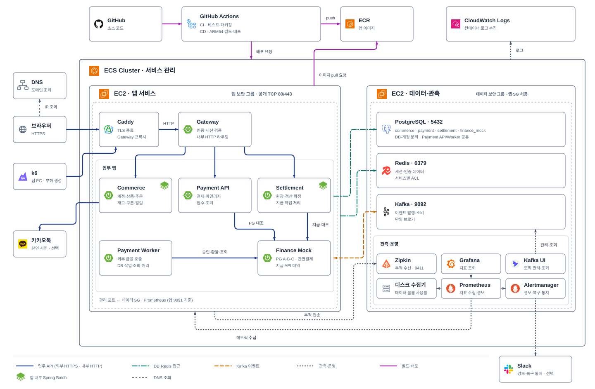
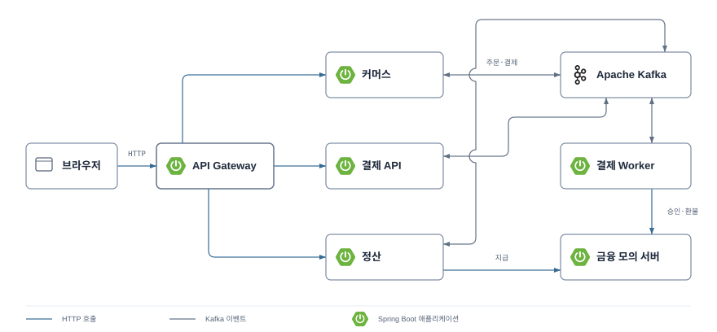

# commerce-settle

**구매자의 주문·결제·환불과 판매자 정산을 연결하는 커머스 MSA 플랫폼**

구매자는 상품과 수량을 고르고, 배송지·쿠폰·결제수단을 선택해 주문합니다. 구매자의 결제와 환불을 처리하고 판매자별 매출에서 환불·수수료를 반영해 정산·지급합니다. 주문이 몰리거나 외부 PG의 응답이 유실돼도 거래 상태와 금액을 일치시키는 데 집중합니다.

프로젝트의 지원 범위와 기술 기준을 소개합니다. 처음 실행할 때는 [개발 환경](docs/development.md#처음-실행), 기능을 개발할 때는 [협업 규칙](CONTRIBUTING.md)에서 시작합니다. 문서별 기준 위치는 [기술·개발 안내](#기술개발-안내)를 따릅니다. 성능 목표와 실제 측정 결과를 구분합니다.

## 해결하려는 문제와 자동지급

매출대금으로 다음 재고를 매입하는 판매자는 정산이 늦거나 지급액이 부정확하면, 다음 판매에 필요한 재고를 제때 확보하기 어렵다.

commerce-settle은 결제·환불을 정확히 반영한 판매대금을 최대한 빠르고 안정적으로 지급해, 판매자가 다음 판매를 준비할 수 있도록 한다.

**모의 배송완료 → 환불 요청 기간 7일 → 자동 구매확정 → 첫 일배치 자동지급**을 기준으로, 지급 준비가 끝난 거래를 판매자별로 합산합니다. 지급 시점까지 PG 입금이 끝나지 않은 거래도 먼저 지급할 수 있도록 모의 재원은 충분하다고 가정합니다. 기한·보류·재개는 [정산 정책](docs/policies.md#정산재처리)을 따릅니다.

단축 대상은 구매확정과 선행 결제 원장 반영이 끝난 뒤의 대기입니다. 발송·배송과 배송완료 후 7일의 환불 요청 기간은 줄이지 않으므로, 배송이 늦으면 지급도 늦어집니다.

지급 속도의 검증 기준은 결제 확정부터 지급 성공까지의 전체 시간과 지급 준비 후의 추가 소요시간입니다. 미지급·보류 거래를 함께 보는 [지급 시간 기준](docs/design.md#판매대금-지급-시간)을 따르며, 실제 재고 구매나 판매자 자금 사정의 개선 여부는 이 기술 시험으로 확인하지 않습니다.

## 수수료

거래 수수료는 PG·부가세 포함 15%입니다. 거래 당시 요율·금액을 주문에 고정하며 [금액 정책](docs/policies.md#금액과-주문)을 따릅니다. 판매자 구독·청구는 지원하지 않습니다.

## 지원 범위

| 영역 | 범위 |
| --- | --- |
| 사용자·인증 | 구매자·판매자 계정별 가입·로그인과 권한, 구매자 기본 배송지 관리 |
| 판매자·상품 | 판매자 계정·판매 상태·정산 정보, 상품·가격·판매 가능 수량 관리 |
| 주문·쿠폰 | 단일 판매자·단일 상품 주문, 배송지 사본·가격 확정, 쿠폰·재고 예약 |
| 선착순 이벤트 | 판매자의 특정 상품·한정 수량·시작/종료 시각 설정, 구매 예약, 판매 진행률·매진 종료 |
| 결제 | 신용카드·체크카드·간편결제 대역, 우리 마일리지 사용, 접수·조회·멱등 처리 |
| 환불 | 배송완료 후 7일 이내 요청·배송 전 취소·지급 예약 전 전액 환불, 원결제수단 취소·사용 마일리지 복원, 정산금 예약·해제 |
| 정산 | 매출·환불·수수료 계산, 배치 생성, 모의 지급 |
| 거래 알림 | 구매자·판매자 거래 결과, 마일리지 사용·복원 잔액, 판매 묶음·정산·지급 안내의 카카오 모의 발송 |
| 운영 | 미확정 거래·작업 적체·자원 부족 알람, 원키 재처리, 지표·추적 관측 |

기본 범위는 구매자·판매자 계정을 분리한 단일 판매자·단일 상품 주문과 지급 예약 전 전액 환불입니다. 배송은 모의 처리하며 방송·영상·채팅·택배사·실금융 연동은 제외합니다. 포함·제외 범위와 가정은 [업무 설계](docs/design.md#2-해결-범위), 쿠폰·마일리지·기한·알림 조건은 [업무 정책](docs/policies.md)을 따릅니다.

## 통합 인프라 구조도

Compose 개발·CI 구성입니다. 상세 연결은 [인프라 설계](docs/architecture.md#인프라-구조도)를 따릅니다.

## 서비스 설계

커머스는 주문·재고·쿠폰을, Payment는 결제·마일리지·환불을, Settlement는 원장·정산·지급을 소유합니다. 외부 금융기관은 `finance-mock`으로 대체하고 공개 요청은 Gateway로 받습니다.

서비스·DB·실행 역할과 책임은 [아키텍처](docs/architecture.md#실행-단위)를 따릅니다.

### 정합성 설계

업무 상태와 Outbox를 함께 저장하고, 수신 측은 Inbox·작업을 저장한 뒤 offset을 커밋합니다. 중복은 업무 키로 처리하며 타임아웃만으로 외부 금융 실패를 확정하지 않습니다. 주문 예약·환불 SAGA·금액 보존은 [핵심 업무 흐름](docs/design.md#6-핵심-업무-흐름)과 [금액·데이터 불변식](docs/design.md#7-금액데이터-불변식), 전달 보장은 [Kafka 전달·용량 기준](docs/architecture.md#kafka)을 따릅니다.

## 성능 목표와 검증

로컬 목표는 **결제 확정 1,000 TPS를 15분 유지**하는 시험입니다. 결제 확정은 서로 다른 신규 결제의 외부 승인·마일리지 차감이 Payment DB에 반영된 결과이며 접수·조회 요청 수와 구분합니다. 배포 환경 API의 p99 3초 목표는 로컬 시험이나 비동기 확정 지연에 적용하지 않습니다.

시험 입력·지표·최종 금액 대조는 [업무 검증 기준](docs/design.md#검증-지표와-완료-기준), 실행·관측 결과는 [부하·복구 시험](tests/load/README.md)을 따릅니다. [선착순 집중 부하](docs/design.md#선착순-이벤트-집중-부하)는 한정 수량 때문에 지속 처리량과 별도로 검증합니다. 목표·모의 금융 입력을 달성 실적이나 실제 금융기관 성능으로 안내하지 않습니다.

## 실행

Java 21, Docker·Compose v2, Python 3, Git이 필요합니다. 환경 생성 → 빌드 → Redis 실행 식별자 준비 → Compose 기동 → smoke 순서와 명령은 [처음 실행](docs/development.md#처음-실행)을 따릅니다. 재기동·데이터 초기화는 [종료·재실행·초기화](docs/development.md#종료재실행초기화), 선택 관측 도구·k6는 [접속과 검증](docs/development.md#접속)에서 확인합니다.

[Swagger UI](http://localhost:8080/swagger-ui.html) · [Zipkin](http://localhost:9411)

## 기술·개발 안내

Java 21 · Spring Boot · Spring Cloud Gateway · PostgreSQL · Kafka · Redis · Micrometer·OpenTelemetry·Zipkin · Prometheus·Grafana · Docker Compose · k6

기술 버전은 [build.gradle](build.gradle)·[Compose](compose.yml)·[앱 Dockerfile](Dockerfile)·[DB Dockerfile](infra/postgres/Dockerfile)을 기준으로 합니다. `.env`는 Git에서 제외하며 비밀번호는 환경 초기화 스크립트로 생성합니다.

- [실행·접속·종료·검증](docs/development.md)
- [API 사용 흐름과 이벤트](docs/api.md) · [OpenAPI 계약](docs/openapi.json)
- [금액·기한·복구 정책](docs/policies.md) · [데이터 모델](docs/data-model.md)
- [인프라 구조도·컨테이너·관측 구성](docs/architecture.md#인프라-구조도)
- [서비스·DB·코드 경계](docs/architecture.md)
- [DB 변경 절차](docs/migrations.md)
- [협업 규칙](CONTRIBUTING.md)
- [문서 구조·기준 위치·추가 방법](CONTRIBUTING.md#문서와-기록)
- [업무 흐름·범위·가정·검증 조건](docs/design.md)
- [구매자·판매자 와이어프레임](docs/wireframes.html)

## 참고

[Kafka 전달 보장](https://kafka.apache.org/42/design/design/) · [Outbox 이벤트 ID·집계 키](https://debezium.io/documentation/reference/stable/transformations/outbox-event-router.html) · [결제 멱등성](https://docs.tosspayments.com/blog/what-is-idempotency)
