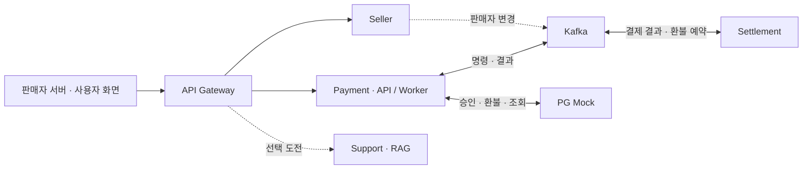

# live-settle

**라이브커머스 판매자를 위한 결제·환불·정산 MSA 플랫폼**

라이브 방송과 프로모션으로 몰리는 결제를 처리하고, 판매자별 매출에서 환불과 수수료를 반영해 정산합니다. 외부 PG의 지연·장애, 이벤트 중복·유실 상황에서도 거래 상태와 금액을 일치시키는 데 집중합니다.

> **상태: 설계 단계**
>
> 이 README는 개발 범위와 검증 계획을 정리한 문서입니다. 기능 체크리스트와 성능 수치는 구현·검증할 목표이며, 완료한 기능이나 측정 결과를 뜻하지 않습니다.

## 프로젝트 범위

- **판매자(Seller)**: 정산금을 받는 사업자·판매 업체입니다. 여러 방송 계정이 같은 정산 주체에 속하면 하나의 `sellerId`로 관리합니다.
- **구매자**: 판매자에게 결제하고 결제·환불 상태를 확인합니다.
- **운영자**: 판매자 등록, 정산 배치, 실패·미확정 거래를 관리합니다.

의류·식품·굿즈 등 여러 업종을 공통 구조로 처리합니다. 각 결제와 정산 항목에 `sellerId`를 기록하며, 판매자 수가 늘어나도 같은 서비스를 함께 사용합니다.

상품·재고·방송·배송은 외부 커머스의 책임입니다. live-settle은 판매자 서버에서 주문 참조와 금액을 받아 결제·환불·정산을 처리합니다. PG 승인·환불과 정산금 지급은 각각 Mock과 지급 시뮬레이터로 검증합니다.

## 기본 기능

아래는 프로젝트가 선택한 MVP 기능입니다. 과제에서 지정한 기술 요건은 별도 항목으로 구분합니다.

| 기능 | 범위 |
| --- | --- |
| 판매자 관리 | 등록, 로그인·연동 자격, 데이터 접근 권한 |
| 결제 | 요청 접수, Mock PG 승인, 상태·내역 조회, 중복 요청 방지 |
| 환불 | 전액 환불, 정산금 예약, 결과 확인, 확정 실패 시 예약 해제 |
| 정산 | 매출·환불·수수료 계산, 정산 예정액 조회, 배치 생성·모의 지급 |
| 운영 | 실패·미확정 거래 추적, 안전한 재처리, 모니터링 |

### MVP 정책

- 통화는 KRW, 금액은 원 단위 정수로 저장합니다.
- 프로젝트 가정으로 수수료를 5%로 고정하고 원 미만을 버립니다. 계산에 사용한 정책 버전을 기록합니다.
- 환불은 지급 예약 전 거래의 전액 환불부터 지원하며, 최초 수수료와 순정산액을 정확히 상쇄합니다.
- 정산 배치는 원장에 반영된 지급 가능 항목을 선점합니다. 늦게 반영된 거래는 다음 배치에서 처리합니다.
- 부분 환불, 지급 후 환불, 다중 판매자 묶음 결제와 다중 통화는 후속 확장 범위입니다.

## 아키텍처

기본 업무 서비스는 **Seller·Payment·Settlement 3개**입니다. Gateway, Kafka와 Mock은 공통 인프라·테스트 구성입니다.



| 서비스 | 책임 | 소유 데이터 |
| --- | --- | --- |
| **Seller** | 판매자·사용자·연동 자격 관리 | 판매자, 사용자, 자격·권한 |
| **Payment** | 결제 접수, PG 승인·환불, 상태 확인, 환불 SAGA 조정 | 결제, 시도 이력, 환불, SAGA, 실행 작업 |
| **Settlement** | 원장 반영, 환불금 예약, 정산 계산·지급 | 거래별 원장, 예약, 정산 항목·배치, 지급 |
| **Support** — 선택 | 정책 문서 기반 고객 응대 | FAQ·정책 문서의 검색 인덱스, 평가 자료 |

각 서비스는 전용 DB와 계정을 소유하고 API·이벤트로 연동합니다. 다른 서비스의 테이블에 직접 접근하지 않습니다.

Payment의 API와 Worker는 같은 업무 서비스의 별도 실행 역할이며 같은 DB를 사용합니다. 요청 접수와 PG 호출 작업을 각각 확장하고, 판매자 정보는 로컬 조회 모델로 확인합니다. 자격 폐기·판매자 정지의 반영 지연 정책은 별도로 정의합니다.

RAG 도전 적용 시 Support를 네 번째 업무 서비스로 추가해 LLM의 지연·자원 사용을 결제 경로에서 격리합니다. Gateway와 백엔드는 인증·권한을 확인하고, 내부 서비스·DB·관리 API의 외부 직접 접근을 제한합니다.

### 서비스 내부 구조

| 계층 | 책임 |
| --- | --- |
| 표현(Presentation) | Controller, DTO, 요청·응답 변환 |
| 응용(Application) | 유즈케이스, 트랜잭션 경계, SAGA 진행 |
| 도메인(Domain) | 상태 전이, 금액·환불·정산 규칙 |
| 인프라(Infrastructure) | DB 구현, Kafka 어댑터, PG 클라이언트, 캐시 |

도메인은 인프라의 구체 구현에 의존하지 않습니다. 계층별 책임과 의존 방향을 AI로 검증하고 의사결정 근거를 기록합니다.

## 핵심 처리 흐름

### 결제

1. 구매자의 결제 의사를 확인한 판매자 서버가 서버 전용 자격과 `Idempotency-Key`로 결제를 요청합니다. 같은 판매자·키는 같은 거래로 처리하고, 본문이 다르면 거절합니다.
2. Payment가 결제 요청과 **Outbox(발행 대기 기록)를 같은 DB 트랜잭션에 저장**합니다. Publisher가 Kafka 적재 ACK를 확인한 뒤 `202 Accepted`와 `paymentId`를 반환합니다.
3. Kafka 수신기는 **Inbox(중복 확인 기록)와 영속 실행 작업을 함께 저장**한 다음 offset을 커밋합니다.
4. PG Worker가 작업을 임대하고 DB 트랜잭션·행 잠금을 해제한 상태에서 제한된 동시성으로 PG를 호출합니다.
5. 승인 결과와 결과 Outbox를 함께 커밋합니다. Settlement는 결과 이벤트를 받아 원장과 정산 항목에 반영합니다.

클라이언트는 `paymentId`로 결과를 조회합니다. 접수 확인이나 PG 응답이 유실되면 동일 키 재시도와 상태 조회로 확인하며, 타임아웃만으로 실패·취소를 확정하지 않습니다.

### 환불 SAGA

Payment가 진행 상태와 다음 명령을 영속 저장해 두 서비스에 걸친 환불을 조정합니다.

| 상황 | 처리 |
| --- | --- |
| 환불 요청 | Payment가 환불 상태와 정산금 예약 명령 저장·발행 |
| 예약 성공 | Settlement가 해당 거래의 정산금을 예약한 뒤 Payment가 PG 환불 실행 |
| PG 환불 성공 | 예약을 소비하고 최초 원장을 상쇄하는 항목 기록 |
| PG 환불 확정 실패 | **보상 명령으로 예약 해제**, 확인될 때까지 추적·재시도 |
| PG 결과 미확정 | 예약을 유지하고 PG 상태 조회로 결과 확인 |

환불과 지급은 같은 정산 항목을 동시에 선점할 수 없도록 처리합니다. 승인 이벤트보다 환불 예약 명령이 먼저 도착하면 선행 원장 반영을 기다립니다. 성공한 외부 환불의 후속 반영이 늦어지면 반영 작업을 재시도합니다.

### 정합성 원칙

- API 멱등키, Inbox와 원장 업무 키에 DB 유니크 제약을 둡니다.
- 거래 스트림의 Kafka key는 `paymentId`로 두고, Outbox는 동일 거래의 발행 순서를 지킵니다. 토픽 간 전역 순서는 가정하지 않습니다.
- PG 작업은 임대·상태 버전·PG 멱등키로 재시작과 중복 실행에 대응합니다.
- 제한된 재시도 후 실패 메시지는 DLT에서 추적하며 원인 수정·재처리 경로를 제공합니다.
- 원장은 거래별로 쌓고 판매자 합계는 별도로 집계해 쓰기 집중을 줄입니다.

## 과제 필수 요건

- [ ] **MSA**: 서비스별 책임·데이터 소유권·통신 경계 분리
- [ ] **Docker Compose**: 실제 사용 파일, `.env.example`, 재현 가능한 실행 안내 제출
- [ ] **분산 트랜잭션**: Kafka 기반 SAGA 1개 이상, 실패·보상·복구 시연
- [ ] **비동기 처리**: Kafka 적재 확인 후 접수 응답, Consumer의 후속 처리
- [ ] **장애·중복·유실 대응**: 강제 실패, 중복 전달, 발행·수신·응답 유실 검증
- [ ] **부하 테스트**: 동시 사용자 100명 × 각 10회 기준 시험, 병목 분석·개선 전후 비교
- [ ] **모니터링**: CPU·메모리·처리량·지연·오류와 Kafka·DB 작업 대기 관측
- [ ] **4계층 설계·AI 검증**: 책임 배치·의존 방향 검증과 의사결정 로그
- [ ] **Synthetic Data**: 팀이 설계한 시나리오, LLM 생성 CSV, 부하 도구 연동과 결과 비교

과제의 처리량 권장 기준선은 200건/초입니다. 환경 한계가 있으면 개선 전후 비교와 근거로 충족할 수 있으며, 아래 팀 성능 목표와 구분합니다.

## 과제 도전 요건

필수 기능과 검증을 마친 뒤 적용합니다.

| 도전 항목 | 범위·인정 기준 |
| --- | --- |
| **DDD 설계·AI 검증** | 도메인 경계, 애그리거트·엔티티·VO와 업무 규칙 설계. 의존성·엣지케이스·정합성을 검증하고 AI 피드백의 채택·수정·거부 근거 기록 |
| **RAG 고객 응대** | 수수료·환불·정산 문서를 선정·청킹하고 Spring AI·벡터 저장소 연동. **문서 1종 벡터화 후 질문 1건에 출처를 포함한 답변 생성** |
| **RAG 정확도 평가 — 추가 가산점** | 질문 5개 이상으로 정확도를 평가하고 잘못된 답변·개선 내용 기록 |

RAG는 정책 안내를 담당하며, 개별 거래의 현재 상태는 인증된 조회 API로 확인합니다. 도전 산출물에는 DDD 검증 기록, RAG 구조·청킹·모델 선택 근거와 선택한 경우 정확도 평가 결과를 포함합니다. 모델·사용 환경·비용은 구현 전에 결정합니다.

## PG Mock

승인·환불·상태 조회와 멱등 처리를 구현하고 재시작 후에도 결과를 복구합니다. 지급 시뮬레이터는 같은 테스트 앱의 별도 어댑터로 구성할 수 있습니다.

| 프로필 | 재현할 상황 |
| --- | --- |
| 정상 성능 | 평균 지연 200ms를 출발 가정으로 두고 실제 분포 기록 |
| 장애 | 명시적 거절, 처리 전 타임아웃, **처리 후 응답 유실**, 지연 급증, 중복 이벤트, 환불 실패 |
| 재현성 | 시드 기반 랜덤 설정과 특정 요청의 강제 시나리오 제공 |

지연과 실패율은 시험용 가정이며 실제 PG 성능을 뜻하지 않습니다. Mock의 장애 설정·관리 API는 내부에서만 접근합니다.

## 성능 목표와 검증

**승인 완료 TPS는 서로 다른 신규 결제의 PG 승인 결과가 Payment DB에 커밋된 건수입니다.** 접수·조회·재시도 요청 수는 더하지 않으며 정산 반영 지연은 별도로 측정합니다.

| 단계 | 팀 목표 |
| --- | --- |
| 로컬 기준선 | 낮은 부하부터 올려 **1천 TPS를 15분 유지**하는 시험 |
| 점진 확장 | 3천·5천·1만 TPS로 높여 포화 지점과 개선 전후 측정 |
| 피크·복구 | 1만 TPS 60초 후 부하를 낮춰 대기열 배출·복구 검증 |
| 최종 확장 | 자원 확보 후 **1만 TPS를 10분 유지**하는 시험 |

- 시험 데이터는 판매자 2만 곳을 가정하고, 균등 분산과 상위 1%에 결제 70%가 몰리는 상황을 비교합니다.
- 접수~승인 완료 p95·p99, 승인 완료 TPS, 정산 반영 지연, Kafka lag, Outbox·Job 대기, PG 동시 호출 수와 DB 자원을 기록합니다.
- 초기 정상 프로필의 지연 목표는 p95 1초·p99 2초로 두고 측정 결과로 조정합니다.
- k6의 실제 발생 부하와 `dropped_iterations`를 확인하고 부하 발생기 자체의 한계를 구분합니다.
- 검증 종료 시 PG·Payment·Settlement 내역을 대조해 누락, 중복 승인·환불·지급과 금액 불일치를 확인합니다.

### 로컬 시험

개발 기준 환경은 Apple M2 Pro 10코어·메모리 16GB입니다. Kafka 1대, PostgreSQL 1대와 각 서비스의 최소 인스턴스로 시작하고 JVM·컨테이너 메모리를 제한합니다. 100 → 300 → 500 → 1천 건/초로 부하를 올립니다.

평균 PG 지연 200ms·거래당 호출 1회라면 안정 상태의 1천 TPS에 약 200개 동시 호출이 필요합니다. 실제 지속 처리량은 측정으로 확인합니다. Kafka 복제·장애 내성과 1만 TPS 시험은 별도 자원 배치를 검토합니다.

## 기술 구성

| 영역 | 선택 기술·구성 |
| --- | --- |
| 애플리케이션 | Java, Spring Boot, Spring Cloud Gateway |
| 이벤트·데이터 | Apache Kafka, PostgreSQL, Outbox·Inbox |
| 관측 | Actuator, Micrometer, Prometheus, Grafana |
| 실행·검증 | Docker Compose, k6, Kafka-UI |
| 선택 도전 | Spring AI, 벡터 저장소, 임베딩·LLM |

도구 버전과 세부 설정은 초기 구현에서 확정합니다.

## 저장소 구성 — 예정

모노레포에서 업무 서비스를 개별 빌드·배포하는 구조로 시작합니다.

```text
live-settle/
├── gateway/
├── seller-service/
├── payment-service/       # API · Worker 역할
├── settlement-service/
├── mock-finance/          # PG Mock · 지급 시뮬레이터
├── support-service/       # RAG 도전 적용 시 추가
└── infra/                 # Compose · 모니터링 구성
```

## 실행과 테스트

초기 구현과 기동 검증 후 아래 내용을 확정해 추가합니다.

- 필수 런타임·도구 버전과 환경 변수
- `.env.example`을 이용한 로컬 설정과 인프라·서비스 실행 명령
- 접속 주소, 테스트 데이터 준비, 기능·장애·부하 테스트 명령
- 종료·재실행 방법과 데이터 초기화 범위

비밀번호·API 키는 환경 변수로 관리하고 Git에 포함하지 않습니다. 현재 문서에는 검증되지 않은 실행 명령을 기재하지 않습니다.

## 개발 순서

1. 판매자 등록부터 결제 접수·승인·원장 반영까지 한 건을 연결합니다.
2. 멱등 처리, Outbox·Inbox와 PG 응답 유실·재시작 복구를 구현합니다.
3. 환불 SAGA·보상·예약 경쟁과 모의 지급을 구현합니다.
4. MVP 화면·Compose·모니터링·AI 검증·Synthetic Data와 기준 부하 시험을 마무리합니다.
5. 병목 개선과 단계별 TPS 시험, DDD·RAG 도전을 진행합니다.

## 과제 산출물

- [ ] 기획·분담·우선순위, 인프라·시스템 구조, API·테이블 명세와 ERD
- [ ] Compose 파일, `.env.example`, 실행·접속·종료 안내
- [ ] 장애·SAGA 선택 근거, 이벤트 흐름, 실패·보상 로그 또는 화면
- [ ] Kafka-UI의 Topic·Consumer 확인 화면
- [ ] 측정 환경, 기준 부하와 개선 전후 결과 2회 이상·분석
- [ ] Synthetic Data 프롬프트 원문·CSV·일반 부하와 비교한 결과
- [ ] AI 검증 항목 **3개 이상**, 거부한 피드백 **1개 이상**과 근거
- [ ] 발표자료의 AI 활용·검증 대표 사례 **2건 이상**, 검증 결과·팀의 설계 판단
- [ ] 개발 기록보드·트러블슈팅·최종 브로셔·발표자료
- [ ] 선택 도전의 DDD·RAG 산출물과 선택한 경우 정확도 평가 결과

발표자료 안내의 AI 도구 표기와 실제 사용 도구의 대체 가능 여부는 튜터에게 확인합니다.

## 참고 자료

- [Apache Kafka — 전달 보장과 파티션](https://kafka.apache.org/42/design/design/)
- [Debezium — Outbox 이벤트 ID와 집계 키](https://debezium.io/documentation/reference/stable/transformations/outbox-event-router.html)
- [토스페이먼츠 — 결제 멱등성](https://docs.tosspayments.com/blog/what-is-idempotency)
- [Grafana k6 — 도착률 기반 부하 테스트](https://grafana.com/docs/k6/latest/using-k6/scenarios/executors/constant-arrival-rate/)
