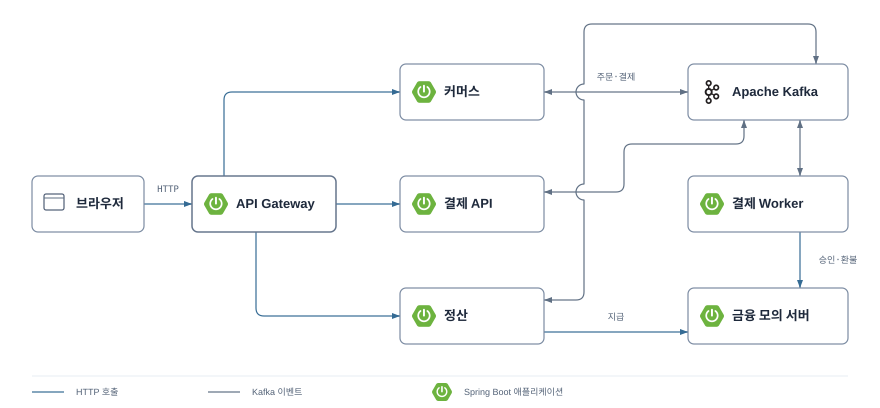

# commerce-settle

**구매자의 주문·결제·환불과 판매자 정산을 연결하는 커머스 MSA 플랫폼**

구매자는 상품과 수량을 고르고, 배송지·쿠폰·결제수단을 선택해 주문합니다. 구매자의 결제와 환불을 처리하고 판매자별 매출에서 환불·수수료를 반영해 정산·지급합니다. 주문이 몰리거나 외부 PG의 응답이 유실돼도 거래 상태와 금액을 일치시키는 데 집중합니다.

현재 저장소는 실행 기반이며, 아래 업무 기능은 구현할 설계 범위입니다. 방송·영상 송출·채팅은 포함하지 않습니다.

## 해결하려는 문제와 자동지급

판매자는 쿠폰·마일리지·환불·수수료를 반영해 얼마를 언제 받을지 알아야 합니다. 이 프로젝트는 정산 금액·시점의 불확실성과 요청 집중·외부 금융 장애·이벤트 중복으로 인한 금액 오류를 검증합니다. 판매자 인터뷰로 확인한 결과는 아닙니다.

**모의 배송완료 → 환불 요청 기간 7일 → 자동 구매확정 → 첫 일배치 자동지급**을 구현 기준으로 채택했습니다. 지급 준비가 끝난 거래를 상품별 14일 회차까지 기다리게 하지 않고, 판매자별로 합산합니다. 플랫폼이 준비한 모의 자금 안에서 PG 입금 전에도 지급하며, 환불 진행·재원 부족·지급 결과 미확정은 보류합니다.

예를 들어 월요일 10시에 발송해 2영업일 뒤 수요일 10시에 배송완료되면, 다음 수요일 10시까지 환불을 요청할 수 있습니다. 그 이후 구매확정과 원장 반영이 끝난 거래는 첫 지급 배치 대상입니다. 배치·지급 가능일·보류에 따라 실제 지급은 늦어질 수 있습니다. [업무 정책](docs/policies.md#정산재처리)과 [선택 이유](docs/decisions/0001-payout-after-purchase-confirmation.md)를 따릅니다.

기능 API·이벤트·저장 구조는 [API](docs/api.md)·[OpenAPI](docs/openapi.json)·[데이터 모델](docs/data-model.md)에 정의했습니다. 아래 업무 기능과 금융 정합성·성능은 아직 구현·검증 전입니다.

## 수익 모델과 판매자 구독

상품 거래 수수료를 기본 수익원으로 두고, 거래액이 많은 판매자는 월 구독료를 내고 낮은 요율을 선택하도록 제안합니다. 판매자는 월 비용을 비교하고, 플랫폼은 구독료·할인 후 수수료에서 PG·쿠폰·마일리지·운영 비용을 뺀 수익을 검증합니다. 입점·구매자 유입과 유료 구독 수요는 아직 검증 전입니다.

기본 수수료는 [업무 정책](docs/policies.md#금액과-주문)의 **PG·부가세 포함 15%**입니다. 다음 구독 요금은 비교용 제안이며, 구독 API·저장 구조·청구 기능은 아직 정의하거나 구현하지 않았습니다.

| 요금제 | 월 구독료·부가세 포함 | 거래 수수료율·PG·부가세 포함 |
| --- | --- | --- |
| 기본 | 없음 | 15% |
| Pro | 30,000원 | 14.75% |

수수료 기준액은 `B=G−S`로, 상품대금 G에서 판매자 쿠폰 S를 뺀 금액입니다. 플랫폼 쿠폰을 차감하기 전 금액이므로 구매자의 실제 결제액과 구분합니다. 한 달 전체 이용·거래별 원 미만 버림 생략을 가정하면 `30,000 ÷ (0.15−0.1475) = 12,000,000원`에서 두 요금제의 비용이 같습니다. 대상은 구독 유효기간에 요율이 확정된 할인 대상 거래 중 결제가 완료되고 전액 환불되지 않은 거래의 B 합계입니다. 대상 금액이 2,000만원이면 기본은 300만원, Pro는 구독료를 포함해 298만원입니다.

Pro 요율은 기존 쿠폰의 최소 주문금액과 손익 목표를 유지하는 비교안입니다. [판매자 구독과 수수료 적용 제안](docs/design.md#판매자-구독과-수수료-적용-제안)에 거래별 요율 보존과 쿠폰별 비용 계산을 정리합니다. 정상 지급·환불·중복 방지는 모든 요금제의 기본 계약이며 구독 혜택은 거래 수수료 할인입니다.

## 목표 기능

| 영역 | 범위 |
| --- | --- |
| 사용자·인증 | 구매자·판매자 계정별 가입·로그인과 권한, 구매자 기본 배송지 관리 |
| 판매자·상품 | 판매자 계정·판매 상태·정산 정보, 상품·가격·판매 가능 수량 관리 |
| 주문·쿠폰 | 단일 판매자·단일 상품 주문, 배송지 사본·가격 확정, 쿠폰·재고 예약 |
| 선착순 이벤트 | 판매자의 특정 상품·한정 수량·시작/종료 시각 설정, 구매 예약, 판매 진행률·매진 종료 |
| 결제 | 신용카드·체크카드·상품권·간편결제 대역, 우리 마일리지 사용, 접수·조회·멱등 처리 |
| 환불 | 배송완료 후 7일 이내 요청·배송 전 취소·지급 예약 전 전액 환불, 원결제수단 취소·사용 마일리지 복원, 정산금 예약·해제 |
| 정산 | 매출·환불·수수료 계산, 배치 생성, 모의 지급 |
| 거래 알림 | 구매자·판매자 거래 결과, 마일리지 사용·복원 잔액, 판매 묶음·정산·지급 안내의 카카오 모의 발송 |
| 운영 | 미확정 거래·작업 적체·자원 부족 알람, 원키 재처리, 지표·추적 관측 |

구매자와 판매자는 가입·로그인 계정을 분리합니다. 구매자 계정은 주문·배송지·결제·환불을 이용하고, 판매자 계정은 상품·발송·반품 승인·정산을 관리합니다. 같은 사람이 양쪽을 이용하려면 각각 가입합니다. 주문에는 결제한 `buyerId`와 정산받을 `sellerId`를 각각 기록합니다. 계정·권한의 기준은 [사용자와 거래 주체](docs/design.md#사용자와-거래-주체)를 따릅니다.

배송지 저장·발송·모의 배송완료·자동 구매확정은 포함하고 택배사 연동·실제 배송 추적은 제외합니다. 외부 PG·간편결제·지급 API는 `finance-mock`으로 대체합니다.

모의 배송은 발송 시각부터 2~3영업일이며 주문별로 한 번 결정해 보존합니다. 배송완료 후 달력일 7일의 환불 요청 기간이 지나고 진행 중인 취소·반품·환불이 없을 때 자동 구매확정합니다. 배송 전 취소도 받습니다. 택배사 연동·실제 배송 증명은 제외합니다. [배송·환불 정책](docs/policies.md#배송환불-기한과-자동-구매확정)을 따릅니다.

쿠폰은 플랫폼 부담 웰컴·월간 우수고객 쿠폰과 판매자 부담 쿠폰으로 구분합니다. 주문당 한 장을 사용하며 쿠폰과 우리 마일리지의 동시 사용은 금지합니다. 마일리지는 1점=1원인 플랫폼 부담 결제 재원이며, 쿠폰 없는 주문은 외부 수단과 함께 사용할 수 있습니다. 마일리지 전액 결제도 포함하며, 외부 결제액이 0원이면 PG·간편결제를 호출하지 않습니다. [결제수단과 마일리지](docs/design.md#결제수단과-마일리지)에 상세 계약을 둡니다.

판매자는 자기 상품의 선착순 이벤트를 열 수 있습니다. 게이지는 **누적 결제 확정 수량 ÷ 이벤트 한정 수량 × 100%**이며, 100%면 매진·종료합니다. 예약 중인 수량은 별도로 표시합니다. [선착순 상품 이벤트](docs/design.md#선착순-상품-이벤트)는 특정 상품으로 주문과 조회가 몰리는 시험의 배경입니다.

이벤트 이름은 판매자가 직접 정하며 특정 행사명에 고정하지 않습니다. 웰컴은 가입 후 14일 안에 한 번 예약할 수 있습니다. 월간 우수고객 쿠폰은 플랫폼 전체 전월 구매 실적 상위 100위와 동점자에게 지급하고, 판매자 쿠폰은 판매자가 대상·기간·수량을 정합니다. [쿠폰 정책](docs/policies.md#쿠폰)과 [결정 근거](docs/decisions/coupon-funding-and-monthly-rewards.md)를 따릅니다.

거래 알림은 커머스가 비동기로 모의 발송하고 운영 장애는 Slack 알람으로 전달하도록 설계합니다. [알림 정책](docs/policies.md#거래-알림)·[알람 기준](docs/policies.md#운영-알람)·[알림 구조도](docs/architecture.md#거래-알림)를 따릅니다. 실제 발송·알람 연결은 아직 없습니다.

## 통합 인프라 구조도

Compose 개발·CI 환경의 목표 구성입니다. 실제 구현 범위와 상세 연결은 [인프라 설계](docs/architecture.md#인프라-구조도)를 따릅니다.


## 서비스 설계

다음은 업무 연동을 완성한 상태를 가정한 목표 서비스 구조입니다. 녹색 Spring Boot 로고는 우리 애플리케이션, Kafka는 별도 메시지 브로커입니다. 그림은 구현 여부를 구분하지 않으며 실제 구현 범위는 위 설명을 따릅니다.



| 서비스 | 책임·데이터 소유권 |
| --- | --- |
| 커머스 (`seller` 모듈) | 구매자·판매자 계정과 인증, 상품·재고·주문·쿠폰·배송지·선착순 이벤트·거래 알림 |
| Payment | 결제·시도 이력·마일리지 잔액/원장·환불·실행 작업·SAGA 조정 |
| Settlement | 거래별 원장·예약·정산 배치·지급 |

업무 서비스는 커머스·Payment·Settlement 3개로 시작합니다. 사용자·주문 같은 도메인이 각각 독립 서비스여야 하는 것은 아닙니다. 기존 `seller` 모듈·DB 이름은 유지하며, 그 안에 커머스 도메인을 구현하는 안입니다. 아직 사용자·주문 API나 테이블이 구현됐다는 뜻은 아닙니다.

Payment API와 Worker는 같은 모듈·DB를 사용하며 각각 확장하는 구조입니다. 서비스 간에는 API·이벤트로 연동하고 다른 서비스의 테이블에 직접 접근하지 않습니다. 내부 코드는 표현·응용·도메인·인프라 4계층으로 나눕니다.

### 정합성 설계

- **중복 방지:** API 멱등키, Inbox와 원장 업무 키에 유니크 제약을 둡니다. 같은 키로 다른 본문이 들어오면 거절합니다.
- **안전한 인계:** 상태와 Outbox를 같은 DB 트랜잭션으로 저장하고, 수신 측은 Inbox·실행 작업을 저장한 뒤 offset을 커밋합니다. 거래 스트림 key는 `paymentId`이며 토픽 간 전역 순서는 가정하지 않습니다.
- **PG 장애 복구:** 외부 호출 동안 DB 잠금을 유지하지 않습니다. 타임아웃만으로 실패를 확정하지 않고 멱등키·상태 조회로 응답 유실을 확인합니다.
- **주문과 예약:** 서버가 상품 가격·쿠폰·구매자를 확인하고 주문 당시 금액·배송지를 저장합니다. 주문·재고/쿠폰 예약·결제 요청 Outbox는 같은 커머스 DB 트랜잭션에 저장합니다. 결제가 미확정이면 시간 경과만으로 예약을 해제하지 않습니다.
- **환불 SAGA:** 정산금 예약→원결제수단 환불·사용 마일리지 복원→원장 상쇄와 주문 복구 순서로 추적합니다. 외부 환불이 확정 실패하면 예약을 해제하고, 미확정이면 예약을 유지합니다. 마일리지 복원은 원결제별 한 번만 반영하고 내부 반영이 끝나기 전에는 전체 환불 완료로 표시하지 않습니다.
- **금액 보존:** 상품대금에서 판매자 쿠폰을 뺀 금액을 B로 두고, `외부 결제액+사용 마일리지+플랫폼 쿠폰액=B=판매자 순정산액+수수료`를 보존합니다. 수수료는 B의 15%·원 미만 버림이며 PG·부가세 포함입니다. 플랫폼 쿠폰·마일리지 때문에 판매자 몫을 다시 줄이지 않고, 환불은 최초 금액을 상쇄합니다. [금액·예약 규칙](docs/policies.md#금액과-주문)을 따릅니다.

## 성능 목표와 검증

로컬 목표는 **결제 확정 1,000 TPS를 15분 유지**하는 시험입니다. 별도 자원을 확보하면 3천·5천·1만 TPS로 확장하고 피크 이후 대기열 배출·복구를 확인합니다.

결제 확정 TPS는 **서로 다른 신규 결제에서 필요한 외부 승인과 마일리지 차감이 Payment DB에 반영된 건수**입니다. 기존 승인 완료 목표도 이 기준으로 집계하고, PG 승인 건수·간편결제 승인 건수·마일리지 전액 결제 건수는 따로 표시합니다. 접수·조회·재시도 요청 수와 구분합니다.

판매자 2만 곳을 가정한 CSV로 균등 분산과 상위 1%에 결제 70%가 몰리는 부하를 비교합니다. 지연 p95·p99, 정산 반영 지연, Kafka lag, DB·발생기 자원과 `dropped_iterations`를 함께 기록합니다. 종료 후 외부 대역·Payment의 결제/마일리지·Settlement를 대조해 누락·중복·금액 불일치를 검증합니다. `finance-mock`의 지연·실패율은 시험용 가정이며 실제 금융 서비스 성능을 뜻하지 않습니다.

[PG 3종 시험 설정](docs/design.md#pg-3종과-장애-시나리오)은 PG별 응답 지연·확정 실패확률을 달리하고, 성공 후 응답 유실·조회 장애를 구분합니다. [금융 대역 구조도](docs/architecture.md#pg-대역-3종-설계)는 한 Mock 안의 PG A·B·C, 간편결제와 지급 대역을 보여줍니다. 현재는 구현 안내이며 대역 동작·설정·업무 부하 스크립트가 구현됐다는 뜻은 아닙니다.

[선착순 이벤트 집중 부하](docs/design.md#선착순-이벤트-집중-부하)는 별도 시험입니다. 한정 수량으로 성공 건수가 제한되므로 지속 결제 처리량 시험과 나누고, 초과 판매·중복 참여·마일리지 과차감/과복원·게이지 불일치를 확인합니다.

## 실행

Java 21, Docker·Compose v2, Python 3가 필요합니다.

```bash
git clone https://github.com/500-internal-server-error-team/commerce-settle.git
cd commerce-settle
git switch develop
python3 scripts/init_env.py
./gradlew --continue clean build
docker compose up -d --build --wait --wait-timeout 300
python3 scripts/smoke.py
```

[Swagger UI](http://localhost:8080/swagger-ui.html) · [Zipkin](http://localhost:9411)

Prometheus·Grafana·Kafka-UI는 `docker compose --profile observability up -d --wait`로 실행합니다. k6 도구 확인은 다음 명령을 사용합니다.

```bash
docker compose --profile tools run --rm --no-deps k6
```

Gradle은 포맷·Checkstyle·계층 경계·패키징을 검사합니다. smoke는 기동·DB 접근 경계·Kafka·Redis 왕복·Zipkin 추적 전파를 확인합니다. 기본 k6 스크립트는 명세 조회를 검사하며 결제 완료 TPS와는 별도입니다.

## 기술·개발 안내

Java 21 · Spring Boot · Spring Cloud Gateway · PostgreSQL·Flyway · Kafka · Redis · Micrometer·OpenTelemetry·Zipkin · Prometheus·Grafana · Docker Compose · k6

기술 버전은 [build.gradle](build.gradle)·[Compose](compose.yml)·[앱 Dockerfile](Dockerfile)·[DB Dockerfile](infra/postgres/Dockerfile)을 기준으로 합니다. `.env`는 Git에서 제외하며 비밀번호는 환경 초기화 스크립트로 생성합니다.

- [실행·접속·종료·검증](docs/development.md)
- [인프라 구조도·컨테이너·관측 구성](docs/architecture.md#인프라-구조도)
- [서비스·DB·코드 경계](docs/architecture.md)
- [DB 변경 절차](docs/migrations.md)
- [협업 규칙](CONTRIBUTING.md)
- [프로젝트 초안·검증 목표·역할 배분안](docs/proposal.md)
- [상세 설계 초안·범위와 가정·예상 질문](docs/design.md)

## 참고

[Kafka 전달 보장](https://kafka.apache.org/42/design/design/) · [Outbox 이벤트 ID·집계 키](https://debezium.io/documentation/reference/stable/transformations/outbox-event-router.html) · [결제 멱등성](https://docs.tosspayments.com/blog/what-is-idempotency)
