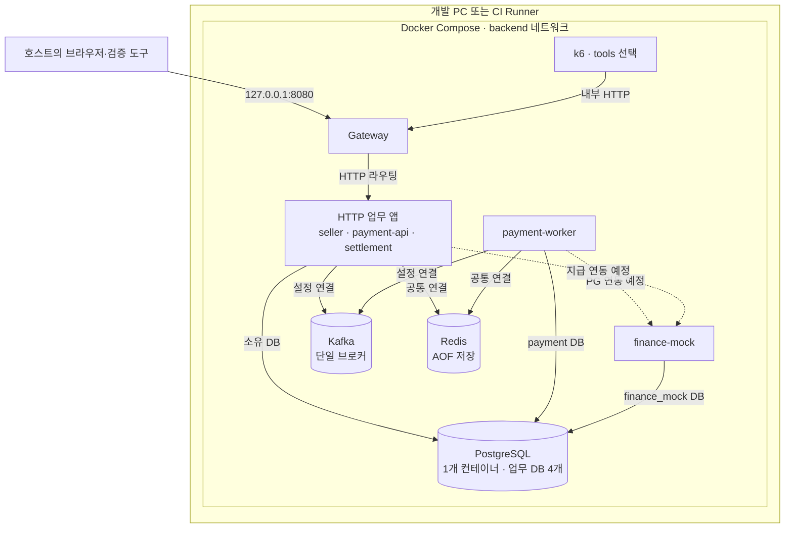
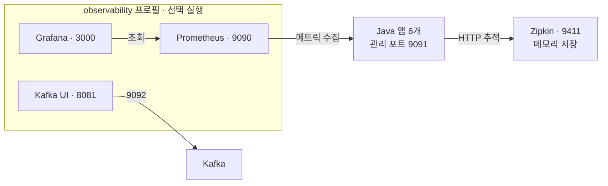

# 서비스와 코드 경계

업무 설계는 [README](../README.md#서비스-설계)를 기준으로 하며, 여기서는 초기 실행 구성과 코드 배치를 정의합니다. 업무 책임은 구현할 설계이며 현재 실행 기반의 기동·명세 라우팅과 구분합니다.

## 인프라 구조도

[Compose 설정](../compose.yml)을 기준으로 한 로컬 개발·CI 구성입니다. AWS 배포 구성은 별도 설계 대상입니다. [CI](../.github/workflows/ci.yml)도 같은 Compose로 빈 볼륨 기동·검증·데이터 유지 재기동을 검사하도록 구성돼 있습니다.

### 컨테이너와 저장소

실선은 현재 설정된 주요 연결, 점선은 구현할 금융 연동입니다. HTTP 라우팅 대상은 `seller`·`payment-api`·`settlement`이며 Worker·Mock은 Gateway에 공개하지 않습니다. 점선의 PG 호출은 Payment Worker, 지급 호출은 Settlement의 책임입니다. Kafka 연결과 업무 이벤트·SAGA 구현도 구분합니다. 공통 Redis 설정은 Gateway·Finance Mock에도 전달되며, 그림에는 업무 앱·Worker의 연결을 대표해서 표시합니다.

PostgreSQL의 업무 DB는 `seller`·`payment`·`settlement`·`finance_mock` 네 개이며 하나의 컨테이너 안에서 계정·스키마를 분리합니다. Payment API와 Worker는 같은 `payment` DB를 사용합니다. 물리 DB 네 대나 고가용성 구성을 뜻하지 않습니다.

PostgreSQL·Kafka·Redis는 각각 `postgres-data`·`kafka-data`·`redis-data` 볼륨을 사용합니다. 모든 컨테이너는 같은 `backend` 네트워크에 연결되며, 이 네트워크를 외부 통신까지 차단하는 방화벽으로 간주하지 않습니다. 호스트에 게시한 포트와 접근 범위는 [네트워크와 관측](#네트워크와-관측)을 따릅니다.

### 관측 구성

[Prometheus 설정](../infra/prometheus/prometheus.yml)은 Gateway·Seller·Payment API·Payment Worker·Settlement·Finance Mock의 `/actuator/prometheus`를 15초마다 수집합니다. Grafana는 [내부 Prometheus 주소](../infra/grafana/provisioning/datasources/prometheus.yml)를 조회합니다.

Prometheus·Grafana는 각각 `prometheus-data`·`grafana-data` 볼륨을 사용하고, Zipkin 추적은 재시작하면 사라집니다. 그림의 관측 도구 포트는 호스트에 게시한 기본 포트이며 모두 루프백에 바인딩됩니다. 앱 관리 포트 9091·DB·Kafka·Redis는 호스트에 게시하지 않습니다.

## 실행 단위

| Gradle 모듈 | Compose 실행 이름 | 역할·소유 DB |
| --- | --- | --- |
| `gateway` | `gateway` | 공개 경로 라우팅·Swagger UI, DB 없음 |
| `seller` | `seller` | 커머스: 구매자·판매자 계정/인증, 상품·주문·재고·쿠폰·배송지, `seller` DB·계정 |
| `payment` | `payment-api` | 결제 요청·조회 역할, `payment` DB·계정 |
| `payment` | `payment-worker` | PG 호출·후속 작업 역할, 같은 `payment` DB·계정 |
| `settlement` | `settlement` | 원장·예약·정산·지급, `settlement` DB·계정 |
| `finance-mock` | `finance-mock` | 외부 PG·지급 API 모의 서버, `finance_mock` DB·계정 |

Payment 두 실행은 같은 jar·DB를 사용하며 `PAYMENT_ROLE=api|worker`로 실행 역할·메트릭 태그를 구분합니다.

기존 `seller` 모듈·실행·DB·패키지 이름을 유지한 채 커머스 책임을 구현하는 안입니다. 회원·인증 도메인은 구매자와 판매자의 별도 가입·로그인을 소유하고, 상품·주문·쿠폰 도메인과 같은 서비스 안에 둡니다. 주문·재고·쿠폰 예약을 같은 DB 트랜잭션에서 확정하기 위한 선택이며 계정 종류마다 서버를 나누지는 않습니다. 계정·권한 관계는 [사용자와 거래 주체](design.md#사용자와-거래-주체)를 따릅니다.

PostgreSQL 컨테이너 1대에서 DB·계정·스키마를 분리합니다. 계정은 자기 DB에만 연결할 수 있고, 다른 서비스 DB에 대한 CONNECT 권한은 없습니다. 애플리케이션에는 자기 DB 자격만 주며, Flyway가 각 스키마를 관리합니다. 개발용 공용 PostgreSQL 컨테이너는 독립 운영 DB의 장애 격리를 제공하지 않습니다.

이는 물리 분산·샤딩이 아닌 논리적 소유권 분리입니다. [DB 변경·삭제·FK 정책](migrations.md)을 함께 확인합니다.

Compose DNS로 서비스를 찾습니다. 초기 구성에 별도 서비스 레지스트리·공통 업무 모듈은 두지 않습니다. 추후 Support/RAG는 구현할 때 독립 모듈로 추가합니다.

## 4계층

루트 패키지는 `com.livesettle.<seller|payment|settlement|financemock>`입니다.

`finance-mock`은 모듈·실행 이름입니다. Java 패키지는 `financemock`, DB·계정·스키마는 `finance_mock`, 비밀번호 변수는 `FINANCE_MOCK_DB_PASSWORD`로 표기합니다.

| 패키지 | 책임·의존 방향 |
| --- | --- |
| `presentation` | Controller·입출력 DTO·오류 변환. `application` 호출, DB·Kafka 어댑터 직접 참조 금지 |
| `application` | 유즈케이스·트랜잭션·SAGA 조정. `domain`과 포트 사용, presentation·infrastructure 의존 금지 |
| `domain` | 상태 전이·금액 불변식·엔티티·저장소 계약. HTTP·응용·인프라·Spring 의존 금지. JPA 매핑 주석 허용 |
| `infrastructure` | DB·Kafka·PG 어댑터·설정. domain·application의 포트 구현, presentation 의존 금지 |

ArchUnit이 계층 경계와 다른 서비스 구현의 직접 import를 검사합니다. 업무 정합성은 도메인 테스트·통합 시나리오로 검증합니다.

## 서비스 내부 분류

루트는 계층별로 나누고, 각 계층 안에서는 아래 역할로 분류합니다. 실제 파일이 필요할 때 패키지를 추가하며 빈 디렉터리·인터페이스·공통 기반 클래스를 미리 만들지 않습니다. 구분할 업무가 늘면 같은 역할 아래 커머스의 `buyer`·`seller`·`catalog`·`order`·`coupon`, Payment의 `payment`·`refund` 같은 하위 패키지를 사용합니다. 계층별 구조와 기능별 루트 구조를 서비스마다 혼용하지 않습니다.

| 위치 | 넣을 코드·이름 예시 |
| --- | --- |
| `presentation/controller` | HTTP 경계 `PaymentController` |
| `presentation/dto` | 외부 요청·응답 `CreatePaymentRequest`, `PaymentResponse` |
| `presentation/exception` | MVC 예외→ProblemDetail 변환 `PaymentExceptionHandler` |
| `application/service` | 유즈케이스 `CreatePaymentService`, 환불 SAGA 조율 |
| `application/dto` | HTTP·메시징과 독립된 입력·결과가 필요할 때 `CreatePaymentCommand`, `PaymentResult` |
| `application/port` | PG·캐시·이벤트 발행 등 외부 기능 계약 `PgClient`, `PaymentEventPublisher` |
| `application/event` | 서비스 간 이벤트 envelope·payload `PaymentApprovedEvent`. 송수신 서비스가 자기 계약 타입 관리 |
| `domain/model` | 엔티티 `Payment`, 값 객체·상태 `Money`, `PaymentStatus` |
| `domain/repository` | 업무 저장소 인터페이스 `PaymentRepository`. Spring Data 상속 금지 |
| `domain/service` | 한 엔티티에 둘 수 없는 순수 업무 규칙·정책 |
| `domain/exception` | 업무 규칙 위반. HTTP 상태·ProblemDetail·응답 메시지와 분리 |
| `infrastructure/persistence` | JPA 어댑터 `JpaPaymentRepository`, Spring Data 인터페이스 `SpringDataPaymentRepository`, 기술용 Outbox·Inbox 저장 |
| `infrastructure/messaging` | Kafka Producer·Listener, Outbox 발행기·재처리 스케줄러 |
| `infrastructure/client` | HTTP PG 구현 `HttpPgClient`, 외부 전용 요청·응답 |
| `infrastructure/cache` | Redis 캐시·잠금 어댑터 |
| `infrastructure/config` | Spring 설정·클라이언트 구성·OpenAPI |

**엔티티는 `domain/model`에 둡니다.** 단순 CRUD까지 별도 JPA 엔티티와 도메인 모델로 이중화하지 않고 JPA 매핑을 함께 사용합니다. 엔티티의 상태 변경은 의미 있는 메서드로 제한하고 public setter·HTTP DTO·직렬화 책임을 넣지 않습니다. 식별자 참조와 DB 제약은 [FK·데이터 정책](migrations.md#데이터-보존과-제약-조건)을 따릅니다. 복잡한 영속 구조 때문에 분리가 필요해지면 이유·변환 비용과 함께 검토합니다.

트랜잭션 경계는 응용 서비스에서 시작합니다. 도메인에는 `@Service`·`@Transactional`·Spring Data·Kafka·Redis 호출을 넣지 않습니다. 순수 도메인 정책의 Bean 등록이 필요하면 인프라 설정에서 구성합니다. 포트의 입력·출력도 외부 클라이언트·JPA 구현 타입에 의존하지 않습니다.

Kafka Listener는 메시지 검증·응용 서비스 호출·처리 결과에 따른 ack를 맡습니다. 금액·상태 전이 규칙은 도메인, 흐름·원자 저장 경계는 응용 서비스가 맡습니다. Outbox·Inbox의 기술용 레코드는 업무 엔티티와 구분합니다. 생산자는 업무 상태와 Outbox, 소비자는 Inbox와 실행 작업을 각각 같은 DB 트랜잭션에 저장합니다.

유즈케이스에 구현체 하나뿐이면 인터페이스와 `Impl`을 쌍으로 만들지 않습니다. 생성자 주입을 사용합니다. 요청 DTO의 값을 응용 서비스 인자로 전달할 수 있으면 단순 중계를 위한 Command를 추가하지 않습니다. 응용 계층이 HTTP DTO를 참조하거나 외부 응답에 엔티티를 직접 사용하지 않습니다.

Payment API·Worker는 패키지를 복제하지 않습니다. HTTP와 비동기 실행 진입점을 구분하고 역할 전용 Bean을 추가할 때 `PAYMENT_ROLE`에 맞는 활성화 조건을 함께 설정·검증합니다. Gateway는 WebFlux 라우팅·필터 경계이므로 업무용 4계층을 억지로 만들지 않고 `config`, `filter`, `exception` 등 필요한 역할만 둡니다. 블로킹 JPA 호출·금융 업무 로직을 넣지 않습니다.

### 저장소 파일 위치

| 위치 | 기준 |
| --- | --- |
| `gateway/`, `seller/`, `payment/`, `settlement/`, `finance-mock/` | 독립 애플리케이션의 Gradle 모듈. 업무 모듈은 도메인 이름, 외부 대역은 대상·역할로 이름을 짓고 `-service`는 생략 |
| `<모듈>/src/main/resources` | 앱 설정과 서비스 소유 Flyway migration |
| `<모듈>/src/test/java`, `src/test/resources` | 단위·통합 테스트와 필요한 fixture. [테스트 규칙](../CONTRIBUTING.md#테스트-작성) 적용 |
| `infra/` | PostgreSQL 컨테이너 초기화·Prometheus·Grafana 등 실행 환경 파일 |
| `<모듈>/…/infrastructure/` | Java 어댑터 코드. 루트의 배포 설정 폴더와 역할이 다름 |
| `config/` | Checkstyle 등 저장소 공통 개발 도구 설정 |
| `scripts/` | 환경 초기화·기동 검증 같은 개발 보조 명령 |
| `tests/load/` | k6 JavaScript 부하 시나리오. 서비스 업무 구현과 분리 |
| `docs/` | 실행·설계·DB 정책. 기록 추가는 [작성 기준](../CONTRIBUTING.md#문서와-기록) 적용 |
| `.agents/skills/` | 반복하는 에이전트 작업 절차. 공통 개발 규칙은 복제하지 않고 링크 |

폴더 이름은 책임을 나타내며 DDD가 특정 이름·깊이를 강제하지는 않습니다. 새 역할이 기존 분류에 맞지 않으면 가장 가까운 책임과 변경 이유부터 검토합니다.

## Kafka

로컬 Kafka는 단일 브로커이며 토픽 자동 생성을 끕니다. smoke는 연결 확인용 임시 토픽 하나에서 메시지를 왕복시키고 삭제합니다.

주문 이벤트 key는 `orderId`, 금융 거래는 `paymentId`, 판매자 변경은 `sellerId`를 사용할 계획입니다. 주문·결제·판매자 사이에 전역 순서가 보장된다고 가정하지 않습니다. 업무 토픽·파티션·Consumer 그룹, Producer 보장 수준, Outbox 발행 순서·Inbox 저장 후 ack·재시도·DLT·Job 임대·SAGA는 이벤트 명세에서 결정합니다. 금융 이벤트에는 구매자·판매자 식별자와 필요한 금액/상태만 전달하고 배송지·비밀번호·인증 토큰을 넣지 않습니다.

## 네트워크와 관측

Gateway의 `/api/sellers/**`, `/api/payments/**`, `/api/refunds/**`, `/api/settlements/**` 경로를 각 서비스로 전달합니다. API 명세는 `/v3/api-docs/seller|payment|settlement`, Swagger UI는 `/swagger-ui.html`입니다.

위 경로는 현재 실행 기반의 설정입니다. 구매자/판매자별 인증·배송지·상품·주문·쿠폰 경로는 업무 API 명세에서 확정한 뒤 커머스로 라우팅하며, 아직 구현·공개된 경로로 간주하지 않습니다. 구매자의 주문·결제 요청과 판매자의 상품·정산 요청에 서로 다른 권한을 적용하고, 각 서비스에서도 계정 종류·거래 소유권을 검증합니다.

`v3`는 Springdoc의 OpenAPI 3 문서 경로이며 서비스 API의 세 번째 버전을 뜻하지 않습니다.

서비스 관리 포트 9091은 컨테이너 내부 전용입니다. Gateway 업무 포트와 분리해 `/actuator/**`·`finance-mock`·내부 API를 외부 경로에 연결하지 않습니다. 기본 호스트 포트는 Gateway `127.0.0.1:8080`과 Zipkin `127.0.0.1:9411`입니다. 선택 `observability` 프로필은 Prometheus·Grafana·Kafka-UI 포트를 루프백에 추가합니다.

Prometheus는 6개 실행의 JVM·프로세스·HTTP 메트릭을 수집합니다. Grafana 초기 대시보드는 대상 생존·CPU·힙·HTTP 요청률을 보여줍니다. 업무 관측은 승인 완료 TPS·정산 지연·Outbox/Job/DLT 지표를 기준으로 설계합니다.

## Redis·Zipkin·k6

Redis는 내부 네트워크에서 비밀번호로 연결합니다. 개발용 단일 Redis와 자격을 공유하므로 키 접두사는 보안 격리가 아닙니다. 키는 `live-settle:<domain>:<purpose>:<id>`로 구분하고 TTL·무효화·장애 시 동작은 해당 도메인 담당자가 설계합니다. 금액·멱등성의 최종 정합성을 캐시만으로 보장하지 않습니다. 128MB·noeviction 설정은 메모리 초과 쓰기를 거절하므로 사용량을 관측해야 합니다.

Zipkin은 Micrometer·OpenTelemetry의 HTTP 추적을 수집합니다. 샘플링 기본값은 10%이며 환경 변수로 조정합니다. smoke는 sampled `traceparent`로 Gateway CLIENT→Seller SERVER의 부모 관계를 확인합니다. Kafka 업무 이벤트의 추적 전파는 Producer·Consumer 구현 시 검증합니다. 개발용 메모리 저장소는 최대 10,000개 span을 보관하며 재시작하면 추적이 사라집니다.

k6는 `tools` 프로필에서 명령으로 실행합니다. 기본 스크립트는 Gateway의 Seller 명세 조회만 검증합니다. 결제 완료 TPS는 별도 업무 시나리오로 측정합니다. 부하 발생기를 서버와 같은 호스트에서 실행하면 자원을 공유하므로 측정 환경에 명시해야 합니다.
