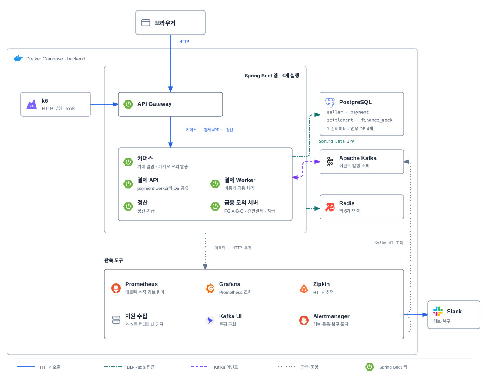
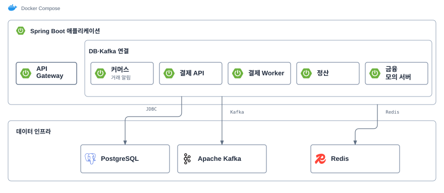
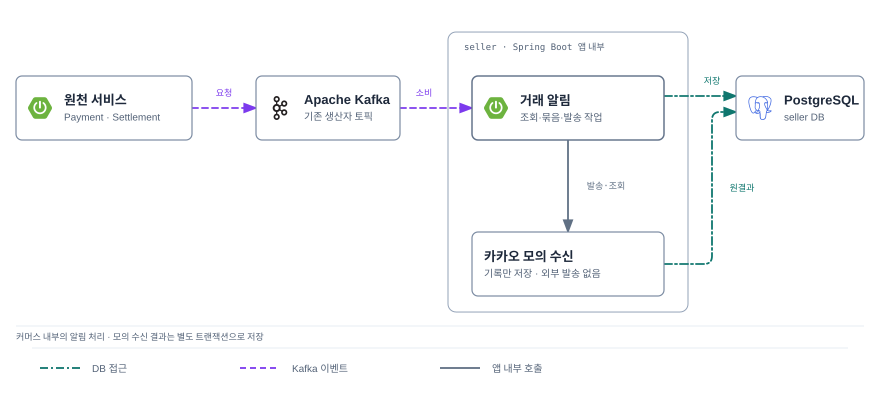
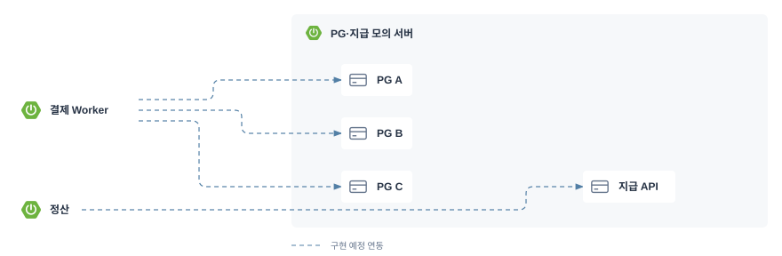
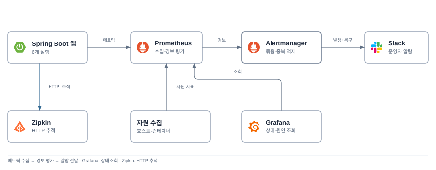

# 서비스와 코드 경계

구조도는 업무·알림·관측 연동을 완성한 목표 구조를 보여줍니다. 실제 구현 상태는 본문에서 설명하며 그림의 선 종류로 구분하지 않습니다. 업무 책임은 [README](../README.md#서비스-설계), 현재 실행 설정은 Compose와 각 앱 설정이 기준입니다.

[기능 API와 서비스 이벤트](api.md), [서비스별 ERD·컬럼·제약](data-model.md), [업무 정책](policies.md)을 구현 계약으로 사용합니다. ERD는 커머스 계정/주문/쿠폰/알림 뷰·Payment·Settlement·Finance Mock·서비스별 메시지/멱등성/감사 뷰로 나누며 서비스 간 SQL join이나 물리 FK를 추가하지 않습니다.

## 인프라 구조도

[Compose 설정](../compose.yml)을 기반으로 업무 연동을 갖춘 로컬 개발·CI 목표 구성입니다. AWS 배포 구성은 별도 설계 대상입니다. [CI](../.github/workflows/ci.yml)도 같은 Compose로 빈 볼륨 기동·검증·데이터 유지 재기동을 검사하도록 구성돼 있습니다.

### 전체 구성

Spring Boot 영역은 여섯 앱의 실행 범위입니다. Gateway는 커머스·결제 API·정산으로만 공개 요청을 전달합니다. 카카오 모의 발송은 커머스 내부 처리이며 금융 모의 서버와 함께 별도 상세도에서 설명합니다.

PostgreSQL·Kafka·Redis와 관측 도구는 별도 인프라입니다. 관측 도구를 묶어 표시했으며 메트릭·추적 선은 데이터 흐름을 나타냅니다. 각 연결·저장·포트와 실제 구현 범위는 아래 상세 설명을 따릅니다.

### 애플리케이션과 인프라

Spring Boot 영역의 여섯 실행은 우리가 빌드하는 애플리케이션입니다. PostgreSQL·Kafka·Redis는 별도 인프라 컨테이너입니다. Gateway를 제외한 다섯 실행에 DB·Kafka 연결이 설정돼 있으며, Redis 연결 설정은 여섯 실행 모두에 전달됩니다.

`payment-api`와 `payment-worker`는 같은 `payment` 모듈의 jar를 각각 실행하고 같은 DB를 사용합니다. 현재 `PAYMENT_ROLE`은 메트릭 태그 구분에 사용되며, 결제 접수·작업 소비·PG 호출은 구현 전입니다. Worker와 `finance-mock`은 Gateway의 공개 라우팅 대상에 포함하지 않습니다.

DB 접근은 Spring Data JPA를 사용합니다.

PostgreSQL의 업무 DB는 `commerce`·`payment`·`settlement`·`finance_mock` 네 개이며 하나의 컨테이너 안에서 계정·스키마를 분리합니다. Payment API와 Worker는 같은 `payment` DB를 사용합니다. 물리 DB 네 대나 고가용성 구성을 뜻하지 않습니다.

PostgreSQL·Kafka·Redis는 각각 `postgres-data`·`kafka-data`·`redis-data` 볼륨을 사용합니다. 모든 컨테이너는 같은 `backend` 네트워크에 연결되며, 이 네트워크를 외부 통신까지 차단하는 방화벽으로 간주하지 않습니다. 호스트에 게시한 포트와 접근 범위는 [네트워크와 관측](#네트워크와-관측)을 따릅니다.

### 사용자 인증과 내부 신원 전달

커머스(`commerce`)가 로그인·세션 발급/폐기와 계정별 인증 가드를 소유하고 Gateway는 [Redis 인증 데이터](data-model.md#redis-인증-데이터)를 읽어 사용자 세션을 검증합니다. 매 보호 요청에서 세션·가드·고정 만료를 확인하므로 커머스에 HTTP 인증 조회를 반복하지 않습니다. 다른 서비스의 PostgreSQL을 Gateway가 읽지 않습니다. 백엔드는 Gateway의 인증 결과와 별도로 역할·주문/상품/정산 소유권을 검사합니다.

외부 `Authorization: Bearer <sessionToken>`은 Gateway에서 검증한 뒤 백엔드로 전달하지 않습니다. 클라이언트가 보낸 `X-Authenticated-Actor-Kind`·`X-Authenticated-Actor-Id`·`X-Authenticated-Session-Hash`를 항상 제거하고, 보호 요청에만 검증한 계정 종류·ID를 넣습니다. 로그아웃 요청에는 현재 세션을 삭제할 수 있도록 검증한 세션의 SHA-256 해시도 전달합니다. 상류 요청의 Authorization은 대상 서비스 전용 Gateway 자격으로 교체합니다. 백엔드는 이 자격의 발신자가 Gateway이고 해당 공개 경로를 호출할 수 있는지 먼저 검사한 뒤 신원 헤더를 사용합니다. 다른 서비스·운영자 자격에 사용자 신원 헤더 발급 권한을 주지 않습니다. 토큰·자격·세션 해시는 로그·응답에 넣지 않습니다.

가입·로그인·복구·상품/이벤트 조회의 공개 여부는 OpenAPI의 PUBLIC 작업을 HTTP 메서드·정규화한 경로로 대조합니다. 경로 접두사만으로 공개하지 않으며 백엔드의 Gateway 허용 작업도 같은 기준을 사용합니다. 보호 작업에 검증된 계정 종류·ID가 없거나 로그아웃에 세션 해시가 없으면 `401`로 거절합니다. `/internal`·`/mock`는 Gateway 경로를 만들지 않으며 기존 서비스별/운영자별 자격과 허용 경로를 직접 확인합니다. Worker는 접수된 내부 명령·업무 키로 실행하며 사용자 세션을 재사용하지 않습니다. 컨테이너의 같은 네트워크나 클라이언트가 보낸 계정 ID만으로 호출을 신뢰하지 않습니다.

인증용 Redis 쓰기는 커머스에만 허용합니다. Gateway는 해당 세션·가드의 읽기와 읽기 전용 검증 스크립트, Redis 실행 식별자 확인만 허용하고 Payment·Settlement·Mock에는 인증 키 접근을 허용하지 않습니다. 키 접두사 대신 Redis ACL로 경계를 적용합니다. 현재 Compose의 공용 비밀번호 설정에는 이 ACL·세션 처리·Gateway 신원 전달이 아직 없으며 구현 시 함께 적용·검증해야 합니다.

### 거래 알림

알림은 `commerce` Spring Boot 앱 안의 응용 서비스·발송 스케줄러·모의 수신 어댑터로 설계합니다. `NotificationSender` 포트의 첫 구현은 `MockKakaoNotificationSender`이며 실제 카카오 HTTP 호출·전화번호·새 컨테이너는 없습니다. 모의 수신부는 `commerce` DB에 별도 트랜잭션으로 원결과를 저장해 응답 유실·재시작을 재현합니다. 설정의 지연·일시 거절·확정 거절·수신 후 응답 유실은 deliveryId와 고정 seed로 재현하며, 원결과는 설정 변경 뒤에도 유지합니다. 초기값은 지연 0ms·오류 없음입니다.

Payment·Settlement는 확정 상태와 알림 요청 Outbox를 함께 저장하고 기존 Kafka 생산자 토픽을 사용합니다. `commerce-notifications.v1` 소비자가 자기 Inbox·알림 항목을 저장한 뒤 ack합니다. 커머스 로컬 전이는 같은 DB에 알림을 원자 저장합니다. 발송은 별도 작업이며 알림 업체 장애로 주문·환불·지급을 롤백하지 않습니다. [정책](policies.md#거래-알림)·[API](api.md#거래-알림-사용-순서)·[ERD](data-model.md#거래-알림)가 상세 계약입니다.

### PG 대역 3종 설계

다음은 `finance-mock` 안에 구현할 논리 PG 3종·간편결제 1종과 지급 기관 대역입니다. 같은 Spring Boot 앱의 거래 영역이며 Compose 컨테이너를 늘리지 않습니다. 신용카드·체크카드는 PG A/B/C 중 한 곳을, 간편결제는 `EASY_PAY`만 호출합니다. [PG 시험 설정](design.md#pg-3종과-장애-시나리오)과 [간편결제 대역](design.md#간편결제-대역)을 따릅니다.

외부 수단·대역은 결제 시도에 고정하며 미확정 조회·환불도 원거래로 보냅니다. 마일리지 전액 결제는 외부 대역을 호출하지 않습니다. 하나의 Mock 프로세스는 실제 금융기관의 독립적인 인프라 장애 격리를 재현하지 않습니다.

### 관측 구성

[Prometheus 설정](../infra/prometheus/prometheus.yml)은 Gateway·Commerce·Payment API·Payment Worker·Settlement·Finance Mock의 `/actuator/prometheus`를 15초마다 수집합니다. Grafana는 [내부 Prometheus 주소](../infra/grafana/provisioning/datasources/prometheus.yml)를 조회합니다.

k6는 브라우저를 조작하지 않는 HTTP 부하 도구입니다. 현재는 Gateway의 Commerce 명세를 반복 조회하며 결제 업무를 실행하지 않습니다. Prometheus·Grafana·Kafka UI는 `observability`, k6는 `tools` 프로필에서 실행합니다.

Prometheus·Grafana는 각각 `prometheus-data`·`grafana-data` 볼륨을 사용하고, Zipkin 추적은 재시작하면 사라집니다. 관측 도구의 호스트 포트는 [네트워크와 관측](#네트워크와-관측)을 따르며 모두 루프백에 바인딩됩니다. 앱 관리 포트 9091·DB·Kafka·Redis는 호스트에 게시하지 않습니다.

목표 관측 구조에서는 Prometheus가 경보를 평가하고 Alertmanager가 묶음·중복 억제·복구 통지를 Slack으로 전달합니다. Linux node_exporter·cAdvisor는 자원 수집 후보이며 Mac 호스트 관측과 구분합니다. 현재 Compose에는 이 추가 구성이 없습니다. [운영 알람 정책](policies.md#운영-알람)이 임계값·등급·조치 기준입니다.

다이어그램의 [SVG와 로고 출처](diagrams/README.md)를 함께 관리합니다.

## 실행 단위

| Gradle 모듈 | Compose 실행 이름 | 역할·소유 DB |
| --- | --- | --- |
| `gateway` | `gateway` | 공개 경로 라우팅·Swagger UI, DB 없음 |
| `commerce` | `commerce` | 커머스: 계정/인증·상품·주문·재고·쿠폰·배송지·선착순 이벤트·거래 알림, `commerce` DB·계정 |
| `payment` | `payment-api` | 결제·마일리지·환불 요청/조회 역할, `payment` DB·계정 |
| `payment` | `payment-worker` | PG·간편결제 호출·후속 작업 역할, 같은 `payment` DB·계정 |
| `settlement` | `settlement` | 원장·예약·정산·지급, `settlement` DB·계정 |
| `finance-mock` | `finance-mock` | 외부 PG·간편결제·지급 API 모의 서버, `finance_mock` DB·계정 |

Payment 두 실행은 같은 jar·DB를 사용하고 `PAYMENT_ROLE=api|worker`로 메트릭 태그를 구분합니다. 실제 역할별 Bean 활성화와 업무 처리 로직은 구현해야 합니다.

커머스의 모듈·실행·패키지 이름은 `commerce`로 통일합니다. 판매자 업무의 `Seller`·`SELLER`·`sellerId`와 `/api/sellers`는 유지합니다. 배포 전 설계의 물리 DB·계정·스키마도 `commerce`, 비밀번호 변수도 `COMMERCE_DB_PASSWORD`로 맞춥니다. 회원·인증·상품·주문·쿠폰·선착순 이벤트는 같은 커머스 서비스에 두고 주문·재고·쿠폰·이벤트 수량 예약을 같은 DB 트랜잭션으로 처리합니다. 마일리지 잔액·예약·원장은 Payment 안에 두어 금융 결제 상태와 원자 저장합니다. [데이터 소유권](design.md#4-서비스-경계와-원천-데이터)과 [계정·권한](design.md#사용자와-거래-주체)을 따르며 신규 앱·DB는 추가하지 않습니다.

PostgreSQL 컨테이너 1대에서 DB·계정·스키마를 분리합니다. 계정은 자기 DB에만 연결할 수 있고, 다른 서비스 DB에 대한 CONNECT 권한은 없습니다. 애플리케이션에는 자기 DB 자격만 주며, Flyway가 각 스키마를 관리합니다. 개발용 공용 PostgreSQL 컨테이너는 독립 운영 DB의 장애 격리를 제공하지 않습니다.

이는 물리 분산·샤딩이 아닌 논리적 소유권 분리입니다. [DB 변경·삭제·FK 정책](migrations.md)을 함께 확인합니다.

Compose DNS로 서비스를 찾습니다. 초기 구성에 별도 서비스 레지스트리·공통 업무 모듈은 두지 않습니다. 추후 Support/RAG는 구현할 때 독립 모듈로 추가합니다.

## 4계층

루트 패키지는 `com.commercesettle.<commerce|payment|settlement|financemock>`입니다.

`finance-mock`은 모듈·실행 이름입니다. Java 패키지는 `financemock`, DB·계정·스키마는 `finance_mock`, 비밀번호 변수는 `FINANCE_MOCK_DB_PASSWORD`로 표기합니다.

| 패키지 | 책임·의존 방향 |
| --- | --- |
| `presentation` | Controller·입출력 DTO·오류 변환. `application` 호출, DB·Kafka 어댑터 직접 참조 금지 |
| `application` | 유즈케이스·트랜잭션·SAGA 조정. `domain`과 포트 사용, presentation·infrastructure 의존 금지 |
| `domain` | 상태 전이·금액 불변식·엔티티·저장소 계약. HTTP·응용·인프라·Spring 의존 금지. JPA 매핑 주석 허용 |
| `infrastructure` | DB·Kafka·PG 어댑터·설정. domain·application의 포트 구현, presentation 의존 금지 |

ArchUnit이 계층 경계와 다른 서비스 구현의 직접 import를 검사합니다. 업무 정합성은 도메인 테스트·통합 시나리오로 검증합니다.

### DDD 집계와 검증

업무 도메인은 규칙·모델·변경 책임의 구분입니다. 아래 책임을 기존 서비스 안에서 나누며, 도메인 수에 맞춰 배포 서비스나 Gradle 모듈을 늘리지 않습니다. 쿠폰·마일리지와 원장·정산·지급을 구분하는 이유와 대안은 [도메인 책임 분리 결정](decisions/0004-domain-responsibilities.md)에 둡니다.

| 소유 서비스 | 업무 도메인 | 최종 판단·변경 책임 |
| --- | --- | --- |
| 커머스 | 계정·인증 | 구매자·판매자 신원, 계정 상태·세션·복구 토큰. 각 기능은 인증된 주체와 자기 리소스 소유권을 대조 |
| 커머스 | 판매자 | 판매 상태·판매자 정보·수취 계좌와 버전. 지급 컨텍스트의 판매자 정보 원천 |
| 커머스 | 상품·재고 | 상품 가격·판매 조건, ProductInventory의 가용·예약 수량과 재고 복원 |
| 커머스 | 주문·이행 | Order의 가격·할인·결제 구성·배송지 사본, 배송·취소/반품 자격·자동 구매확정 |
| 커머스 | 쿠폰 | 세 종류의 발급 자격·할인 조건·비용 부담자, BuyerCoupon의 예약·사용·복구, coupon_history의 할인 비용 이력 |
| 커머스 | 선착순 이벤트 | SalesEvent의 행사 가격·배정 수량·참여 한도·확정 판매량·매진 |
| 커머스 | 거래 알림 | NotificationDelivery의 수신자·묶음·발송 상태. 원천 도메인이 확정한 사실을 안내하며 금융 상태를 변경하지 않음 |
| Payment | 결제 | Payment의 승인 회차·외부 시도·결제 결과, 확정 주문의 B와 적용 정책에 따른 수수료·판매자 순액 확정 |
| Payment | 마일리지 | MileageWallet의 가용 잔액·예약·차감·복원과 mileage_entries. 결제·환불 상태와 같은 로컬 트랜잭션으로 기록 |
| Payment | 금융 환불 | FinancialRefund의 원구성 환불, 응용 서비스의 SAGA 조율. 원장 상쇄·주문 복구 확인까지 전체 진행을 추적 |
| Settlement | 정산 원장 | settlement_entries의 금액 배분·업무 키·원거래 상쇄. SettlementItem과 함께 최초 금액 보존과 중복 반영 방지 |
| Settlement | 정산 | SettlementItem의 지급 가능 조건·환불/지급 단일 선점, SettlementBatch의 대상·합계 고정 |
| Settlement | 지급 | Payout의 수취/출금 계좌 사본·업무 키·외부 실행·조회·성공 결과 |
| Finance Mock | 모의 금융 거래·현금 | 대역의 승인·환불·지급·잔액과 mock_cash_entries. 모의 현금의 실제 증감을 자기 DB에 기록 |

같은 서비스의 여러 집계가 주문 예약처럼 한 원자 처리를 요구하면 응용 서비스가 같은 DB 트랜잭션으로 조율합니다. 주문 응용 서비스는 재고·쿠폰·이벤트의 각 규칙을 호출해 함께 저장하고, 해당 상태를 임의로 덮어쓰지 않습니다. 서비스 간 처리는 이벤트·SAGA를 사용합니다. Settlement는 Payment가 확정한 수수료·순액을 검증·기록·상쇄하며 현재 쿠폰·구독 상태로 과거 거래를 재계산하지 않습니다.

다른 집계는 ID로 참조하고 다른 서비스 엔티티를 가져오지 않습니다. 불변 금액·정책 사본은 값 객체, 상태 전이는 루트의 동작으로 표현합니다. 모든 테이블을 집계 루트로 만들거나 모든 엔티티마다 Repository를 만들지는 않습니다. Repository는 필요한 루트의 저장 경계를 제공합니다. 검증 책임은 [요청·응용·도메인·DB 경계](../CONTRIBUTING.md#검증-경계)를 따릅니다.

### 시간 정보와 감사 기록

생성·수정 시각을 가진 가변 엔티티에는 `domain/model/AuditableEntity`를 JPA `@MappedSuperclass`로 둘 계획입니다. `createdAt`은 생성 때 고정하고 `updatedAt`은 성공한 상태 변경에만 갱신합니다. 응용 서비스의 `Clock`에서 받은 UTC 시각을 마이크로초로 맞춰 생성자·상태 메서드에 전달합니다. public setter·클라이언트 시각·Spring Data 감사 주석으로 도메인을 프레임워크에 연결하지 않습니다. ID·`@Version`·논리삭제는 해당 엔티티에 필요한 경우만 둡니다. 추가 전용 원장·이벤트·감사 행에 수정 가능한 공통 부모를 강제하지 않습니다.

시간 정보만으로 누가 무엇을 바꿨는지는 알 수 없습니다. 주요 상태 전이·운영 재처리는 서비스별 `audit_logs`에 행위를 추가 기록합니다. 인증된 계정/서비스 신원과 명시적인 SYSTEM 실행 주체를 응용 경계에서 전달하며, 다른 서비스에서 온 명령의 실행자는 검증한 발신 서비스입니다. 불명확한 원사용자를 추정하지 않습니다. 감사 저장 어댑터는 `infrastructure/persistence/audit`에 두며 기술용 감사 엔티티를 업무 집계와 구분합니다. 업무 변경·감사 행을 같은 서비스 DB 트랜잭션으로 저장하고 다른 서비스 DB나 공통 업무 모듈을 만들지 않습니다. [감사 테이블](data-model.md#audit_logs)이 필드·보존 기준입니다. 아직 Java 클래스·DB migration은 없습니다.

## 서비스 내부 분류

루트는 계층별로 나누고, 각 계층 안에서는 아래 역할로 분류합니다. 실제 파일이 필요할 때 패키지를 추가하며 빈 디렉터리·인터페이스·공통 기반 클래스를 미리 만들지 않습니다. 구분할 업무가 늘면 같은 역할 아래 커머스의 `buyer`·`seller`·`catalog`·`order`·`coupon`·`notification`, Payment의 `payment`·`refund` 같은 하위 패키지를 사용합니다. 계층별 구조와 기능별 루트 구조를 서비스마다 혼용하지 않습니다.

| 위치 | 넣을 코드·이름 예시 |
| --- | --- |
| `presentation/controller` | HTTP 경계 `PaymentController` |
| `presentation/dto` | 외부 요청·응답 `CreatePaymentRequest`, `PaymentResponse` |
| `presentation/exception` | MVC 예외→ProblemDetail 변환 `PaymentExceptionHandler` |
| `application/service` | 유즈케이스 `CreatePaymentService`, 환불 SAGA 조율 |
| `application/dto` | HTTP·메시징과 독립된 입력·결과가 필요할 때 `CreatePaymentCommand`, `PaymentResult` |
| `application/port` | PG·캐시·이벤트 발행 등 외부 기능 계약 `PgClient`, `PaymentEventPublisher` |
| `application/event` | 서비스 간 이벤트 envelope·payload `PaymentApprovedEvent`. 송수신 서비스가 자기 계약 타입 관리 |
| `domain/model` | 엔티티 `Payment`, 값 객체·상태 `Money`, `PaymentStatus` |
| `domain/repository` | 업무 저장소 인터페이스 `PaymentRepository`. Spring Data 상속 금지 |
| `domain/service` | 한 엔티티에 둘 수 없는 순수 업무 규칙·정책 |
| `domain/exception` | 업무 규칙 위반. HTTP 상태·ProblemDetail·응답 메시지와 분리 |
| `infrastructure/persistence` | JPA 어댑터 `JpaPaymentRepository`, Spring Data 인터페이스 `SpringDataPaymentRepository`, 기술용 Outbox·Inbox 저장 |
| `infrastructure/messaging` | Kafka Producer·Listener, Outbox 발행기·재처리 스케줄러 |
| `infrastructure/client` | HTTP PG 구현 `HttpPgClient`, 외부 전용 요청·응답 |
| `infrastructure/cache` | Redis 세션·인증 가드·캐시·잠금 어댑터 |
| `infrastructure/config` | Spring 설정·클라이언트 구성·OpenAPI |

**엔티티는 `domain/model`에 둡니다.** 단순 CRUD까지 별도 JPA 엔티티와 도메인 모델로 이중화하지 않고 JPA 매핑을 함께 사용합니다. 엔티티의 상태 변경은 의미 있는 메서드로 제한하고 public setter·HTTP DTO·직렬화 책임을 넣지 않습니다. 식별자 참조와 DB 제약은 [FK·데이터 정책](migrations.md#데이터-보존과-제약-조건)을 따릅니다. 복잡한 영속 구조 때문에 분리가 필요해지면 이유·변환 비용과 함께 검토합니다.

트랜잭션 경계는 응용 서비스에서 시작합니다. 도메인에는 `@Service`·`@Transactional`·Spring Data·Kafka·Redis 호출을 넣지 않습니다. 순수 도메인 정책의 Bean 등록이 필요하면 인프라 설정에서 구성합니다. 포트의 입력·출력도 외부 클라이언트·JPA 구현 타입에 의존하지 않습니다.

커머스 인증도 같은 경계를 따릅니다. 표현 계층은 로그인·복구 DTO와 오류 변환, 응용 계층은 자격 확인·세션 발급·폐기·재조정 흐름, 도메인은 계정 상태·인증 버전 전이를 맡습니다. Redis·비밀번호 해시·복구 토큰 전달은 응용 포트 뒤의 인프라 어댑터로 구현합니다. Gateway의 세션 필터는 WebFlux에 맞는 비동기 Redis 접근을 사용하며 JPA·비밀번호 검증을 직접 수행하지 않습니다.

Kafka Listener는 메시지 검증·응용 서비스 호출·처리 결과에 따른 ack를 맡습니다. 금액·상태 전이 규칙은 도메인, 흐름·원자 저장 경계는 응용 서비스가 맡습니다. Outbox·Inbox의 기술용 레코드는 업무 엔티티와 구분합니다. 생산자는 업무 상태와 Outbox, 소비자는 Inbox와 실행 작업을 각각 같은 DB 트랜잭션에 저장합니다.

유즈케이스에 구현체 하나뿐이면 인터페이스와 `Impl`을 쌍으로 만들지 않습니다. 생성자 주입을 사용합니다. 요청 DTO의 값을 응용 서비스 인자로 전달할 수 있으면 단순 중계를 위한 Command를 추가하지 않습니다. 응용 계층이 HTTP DTO를 참조하거나 외부 응답에 엔티티를 직접 사용하지 않습니다.

Payment API·Worker는 패키지를 복제하지 않습니다. HTTP와 비동기 실행 진입점을 구분하고 역할 전용 Bean을 추가할 때 `PAYMENT_ROLE`에 맞는 활성화 조건을 함께 설정·검증합니다. Gateway는 WebFlux 라우팅·필터 경계이므로 업무용 4계층을 억지로 만들지 않고 `config`, `filter`, `exception` 등 필요한 역할만 둡니다. 블로킹 JPA 호출·금융 업무 로직을 넣지 않습니다.

### 저장소 파일 위치

| 위치 | 기준 |
| --- | --- |
| `gateway/`, `commerce/`, `payment/`, `settlement/`, `finance-mock/` | 독립 애플리케이션의 Gradle 모듈. 업무 모듈은 도메인 이름, 외부 대역은 대상·역할로 이름을 짓고 `-service`는 생략 |
| `<모듈>/src/main/resources` | 앱 설정과 서비스 소유 Flyway migration |
| `<모듈>/src/test/java`, `src/test/resources` | 단위·통합 테스트와 필요한 fixture. [테스트 규칙](../CONTRIBUTING.md#테스트-작성) 적용 |
| `infra/` | PostgreSQL 컨테이너 초기화·Prometheus·Grafana 등 실행 환경 파일 |
| `<모듈>/…/infrastructure/` | Java 어댑터 코드. 루트의 배포 설정 폴더와 역할이 다름 |
| `config/` | Checkstyle 등 저장소 공통 개발 도구 설정 |
| `scripts/` | 환경 초기화·기동 검증 같은 개발 보조 명령 |
| `tests/load/` | k6 JavaScript 부하 시나리오. 서비스 업무 구현과 분리 |
| `docs/` | 실행·설계·DB 정책. 기록 추가는 [작성 기준](../CONTRIBUTING.md#문서와-기록) 적용 |
| `.agents/skills/` | 반복하는 에이전트 작업 절차. 공통 개발 규칙은 복제하지 않고 링크 |

폴더 이름은 책임을 나타내며 DDD가 특정 이름·깊이를 강제하지는 않습니다. 새 역할이 기존 분류에 맞지 않으면 가장 가까운 책임과 변경 이유부터 검토합니다.

## Kafka

로컬 Kafka는 단일 브로커이며 토픽 자동 생성을 끕니다. smoke는 연결 확인용 임시 토픽 하나에서 메시지를 왕복시키고 삭제합니다.

전달·용량 산정과 선택 이유는 [Kafka 이벤트 전달과 용량 산정](decisions/0005-kafka-event-delivery-and-capacity.md)을 따릅니다. 생산자별 토픽·책임별 Consumer 그룹, 폴링 Outbox·Inbox 저장 후 offset 커밋·Worker 실행을 구현 기준으로 삼고 파티션·동시 실행·보존·접수 제한은 ADR의 초기값으로 시작하고 정상 부하와 장애 후 배출 시험으로 조정합니다. 이벤트 종류·key·그룹·payload는 [API 이벤트 계약](api.md#이벤트-연동)이 소유합니다. 토픽·서비스 사이의 전역 순서는 가정하지 않으며 금융 이벤트에 배송지·비밀번호·인증 토큰을 넣지 않습니다. 업무 전달·복구·성능은 아직 구현·검증 전입니다.

## 네트워크와 관측

Gateway의 `/api/sellers/**`, `/api/payments/**`, `/api/refunds/**`, `/api/settlements/**` 경로를 각 서비스로 전달합니다. API 명세는 `/v3/api-docs/commerce|payment|settlement`, Swagger UI는 `/swagger-ui.html`입니다.

위 경로는 현재 실행 기반의 설정입니다. 구매자/판매자별 인증·배송지·상품·주문·쿠폰 경로는 업무 API 명세에서 확정한 뒤 커머스로 라우팅하며, 아직 구현·공개된 경로로 간주하지 않습니다. 구매자의 주문·결제 요청과 판매자의 상품·정산 요청에 서로 다른 권한을 적용하고, 각 서비스에서도 계정 종류·거래 소유권을 검증합니다.

`v3`는 Springdoc의 OpenAPI 3 문서 경로이며 서비스 API의 세 번째 버전을 뜻하지 않습니다.

서비스 관리 포트 9091은 컨테이너 내부 전용입니다. Gateway 업무 포트와 분리해 `/actuator/**`·`finance-mock`·내부 API를 외부 경로에 연결하지 않습니다. 기본 호스트 포트는 Gateway `127.0.0.1:8080`과 Zipkin `127.0.0.1:9411`입니다. 선택 `observability` 프로필은 Prometheus·Grafana·Kafka-UI 포트를 루프백에 추가합니다.

Prometheus는 6개 실행의 JVM·프로세스·HTTP 메트릭을 수집합니다. Grafana 초기 대시보드는 대상 생존·CPU·힙·HTTP 요청률을 보여줍니다. 업무 관측은 승인 완료 TPS·정산 지연·Outbox/Job/DLT 지표를 기준으로 설계합니다.

### 로그 수집

현재는 Spring Boot 기본 콘솔 로그를 `docker compose logs`로 확인합니다. Loki·Alloy와 JSON 출력은 설정하지 않았으며, Prometheus 메트릭·Zipkin 추적과 중앙 로그 수집은 별개입니다. 구현할 형식은 [공통 로그 계약](../CONTRIBUTING.md#로그)을 따릅니다.

중앙 수집 도입안은 **stdout JSON → Grafana Alloy → Loki**, 조회는 기존 Grafana입니다. [Alloy의 Docker 로그 수집](https://grafana.com/docs/alloy/latest/monitor/monitor-docker-containers/)을 사용하며 앱은 수집 서버를 직접 호출하지 않습니다. [Loki 색인 라벨](https://grafana.com/docs/loki/latest/get-started/labels/bp-labels/)은 환경·서비스·역할처럼 값의 종류가 적은 항목으로 제한합니다. 주문·결제·추적 ID, 원본 URL은 라벨로 만들지 않고 JSON 본문에서 검색합니다.

도입 시 보존 기간·디스크 상한·수집기 재시작 후 조회·접근 범위를 정하고 Compose와 구조도를 함께 갱신합니다. 현재 구조도에는 이 후속 도입안을 포함하지 않습니다.

## Redis·Zipkin·k6

Redis는 내부 네트워크에서 비밀번호로 연결합니다. AOF는 Redis의 변경 내역을 디스크에 기록해 재시작 때 복원하는 영속화 방식이며, `redis-data` 볼륨에 보존합니다. 결제·정산의 기준 데이터를 Redis에 저장한다는 뜻은 아닙니다. 개발용 단일 Redis와 자격을 공유하므로 키 접두사는 보안 격리가 아닙니다. 키는 `commerce-settle:<domain>:<purpose>:<id>`로 구분하고 TTL·무효화·장애 시 동작은 해당 도메인 담당자가 설계합니다. 금액·멱등성의 최종 정합성을 캐시만으로 보장하지 않습니다. 128MB·noeviction 설정은 메모리 초과 쓰기를 거절하므로 사용량을 관측해야 합니다.

로그인 세션은 Redis를 원본으로 사용하며 [세션 정책](policies.md#인증공통-api-기준)을 따릅니다. 고정 만료는 expiresAt과 TTL을 함께 검사하고 메모리 초과·인증 가드 누락·저장소 오류를 우회하지 않습니다. 세션 세대와 승인한 Redis 실행 식별자는 Gateway·커머스에 동일하게 배포할 인증 설정이며 구현 시 추가합니다. Redis 재접속 뒤에는 AOF 복원만으로 인증을 재개하지 않고 [복구 절차](development.md#redis-세션-검증과-복구)를 거칩니다.

Zipkin은 Micrometer·OpenTelemetry의 HTTP 추적을 수집합니다. 샘플링 기본값은 10%이며 환경 변수로 조정합니다. smoke는 sampled `traceparent`로 Gateway CLIENT→Commerce SERVER의 부모 관계를 확인합니다. Kafka 업무 이벤트의 추적 전파는 Producer·Consumer 구현 시 검증합니다. 개발용 메모리 저장소는 최대 10,000개 span을 보관하며 재시작하면 추적이 사라집니다.

k6는 `tools` 프로필에서 명령으로 실행합니다. 기본 스크립트는 Gateway의 Commerce 명세 조회만 검증합니다. 결제 완료 TPS는 별도 업무 시나리오로 측정합니다. 부하 발생기를 서버와 같은 호스트에서 실행하면 자원을 공유하므로 측정 환경에 명시해야 합니다.
