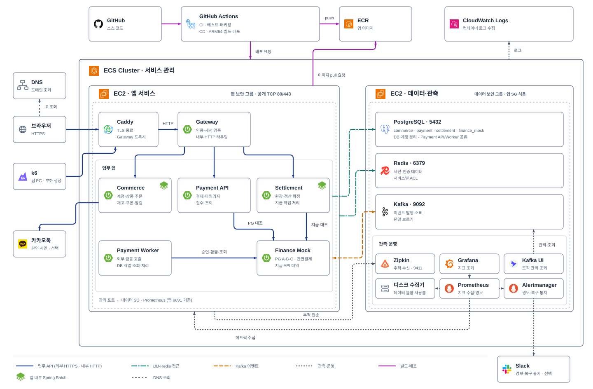
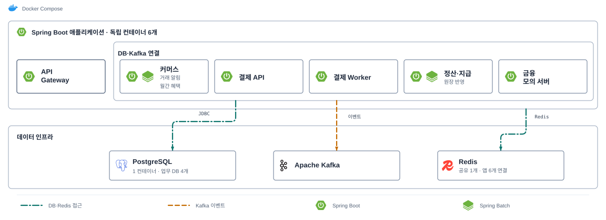
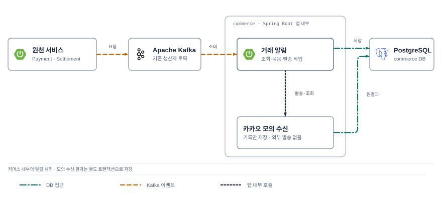
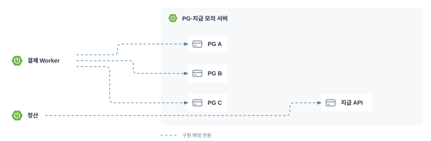
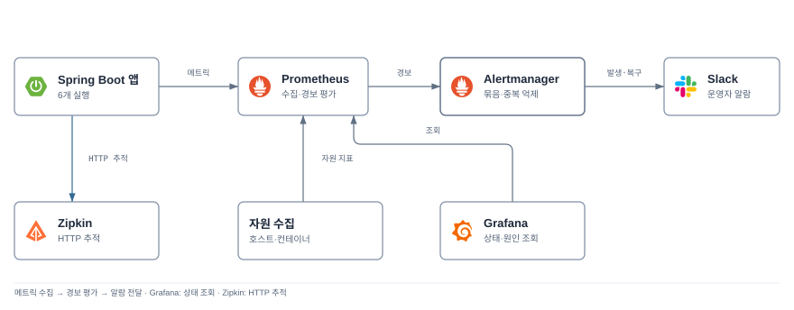
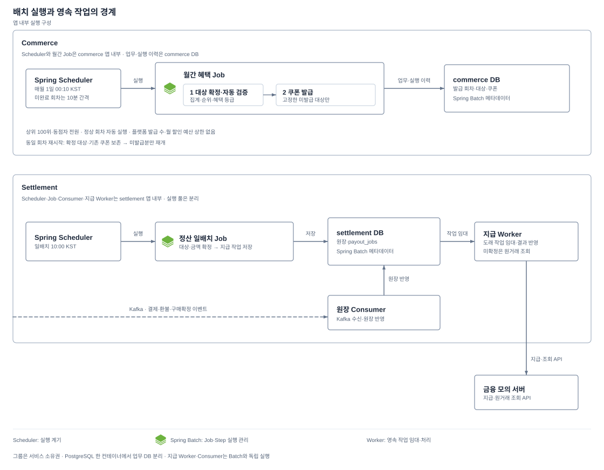

# 서비스와 코드 경계

구조도는 서비스 실행·저장·연결 경계를 보여줍니다. 통합 인프라 구조도는 팀 공용 환경의 ECS·EC2 최종 배포 설계를 보여 주며, 실제 AWS 적용 상태와 현재 개발·CI 실행 설정은 본문과 개발 환경 문서에서 구분합니다. 업무 책임은 [업무 설계](design.md#4-서비스-경계와-원천-데이터), 활성화·지원 범위는 본문과 [개발 환경](development.md)이 기준입니다.

[기능 API와 서비스 이벤트](api.md), [서비스별 ERD·컬럼·제약](data-model.md), [업무 정책](policies.md)을 구현 계약으로 사용합니다. ERD는 커머스 계정/주문/쿠폰/알림 뷰·Payment·Settlement·Finance Mock·서비스별 메시지/멱등성/감사 뷰로 나누며 서비스 간 SQL join이나 물리 FK를 추가하지 않습니다.

## 인프라 구조도

현재 개발·CI 구성은 [Compose 설정](../compose.yml)을 기반으로 하며, [CI](../.github/workflows/ci.yml)도 같은 Compose로 빈 볼륨 기동·검증·데이터 유지 재기동을 검사하도록 구성돼 있습니다.

### 배포 판단 기준

팀 공용 배포는 월 20~30만 원의 예산 안에서 **리소스 경합·장애 격리·확장**을 비교해 구성합니다. 서비스별 독립 실행·배포와 데이터 소유권을 기준으로 호스트 공유·분리의 효과와 한계를 판단하며, 서비스 수에 맞춰 EC2 대수를 정하지 않습니다.

아래는 배포 후보를 비교할 때 확인할 시나리오이며, 현재 측정 결과가 아닙니다.

| 기준 | 확인할 영향과 비교 시나리오 | 선택할 때 감수할 점 |
| --- | --- | --- |
| 리소스 경합 | 정산 배치와 결제 부하가 겹칠 때 결제 지연·작업 적체와 CPU·메모리·디스크 I/O·네트워크·DB 연결 사용량을 함께 확인합니다. 자원 상한·동시 실행량 조절과 호스트 분리를 비교합니다. | 호스트 공유는 자원을 함께 활용하지만 한 작업의 부하가 다른 서비스에 영향을 줄 수 있습니다. 분리하면 자원 여유가 있어도 다른 호스트의 서비스가 바로 활용할 수 없습니다. |
| 장애 격리 | 프로세스 종료·호스트 중단·PostgreSQL·Kafka·Redis 장애별로 영향받는 기능과 복구 시간을 구분하고, 복구 뒤 거래 상태·금액을 대조합니다. | 프로세스 분리만으로 호스트 장애를 격리하지 못합니다. 앱 호스트를 나눠도 공유 DB·메시징·인증 저장소의 장애 영향은 남으며, 호스트 분리만으로 복제·자동 복구가 제공되지는 않습니다. |
| 확장 | 스케일업은 EC2의 CPU·메모리 등 사양을 높이는 것이고, 스케일아웃은 서비스 실행 개수나 서버를 늘리는 것입니다. Payment Worker를 늘릴 때 처리량·작업 지연뿐 아니라 호스트와 DB·Kafka의 병목이 어떻게 바뀌는지 확인합니다. | 공유 호스트의 스케일업은 여러 서비스가 사용할 자원을 함께 늘립니다. 서비스별 스케일아웃에는 호스트 여유와 하위 저장소의 처리 여력이 필요하며, 앱 증설만으로 저장소 병목이 해결되지는 않습니다. |

배치를 선정할 때는 사양·서비스 위치·자원 상한·예상 총비용, 감수하는 경합과 공동 장애 범위, 배치를 다시 검토할 조건을 함께 기록합니다. 총비용에는 EC2뿐 아니라 디스크·백업·공인 IP·로드 밸런서·네트워크·로그와 모니터링 비용을 포함합니다. 로그와 지표는 위 세 기준의 영향과 복구 결과를 확인하는 근거로 사용합니다.

동일한 업무 부하와 측정 기간으로 후보를 비교하고, 지연·처리량·작업 적체와 거래 정합성은 [업무 검증 기준](design.md#검증-지표와-완료-기준)에 연결합니다. 기준을 충족하지 못하면 관측한 병목과 장애 영향에 따라 자원 조정·서비스 분리·증설 또는 저장소 개선을 선택합니다. 검증 전에는 특정 배치를 최적이라고 단정하지 않습니다.

팀 공용 배포는 **ECS 클러스터 하나에 앱 서비스용 EC2 1대와 공유 인프라용 EC2 1대를 등록**하는 구성으로 정했습니다. 각 실행은 ECS 서비스로 관리하며, 컨테이너를 실행하는 단위인 Task를 사용합니다. EC2의 역할 속성과 배치 제약으로 앱·인프라 위치를 구분합니다.

사양 후보·2주 예산·시험 데이터 운영 조건은 [EC2 2대 배포·부하 시험 제안](decisions/0013-ec2-deployment-and-load-test.md)에서 비교합니다. 병목 판정 순서와 병렬도 시험 범위는 [병렬도 결정 절차](decisions/0015-parallelism-decision-and-load-scope.md)에서 정합니다.

### 전체 구성

통합도는 공개 진입·배포 위치·공유 자원·금융 대역·관측 의존성을 보여줍니다. 브라우저는 DNS로 도메인을 조회한 뒤 앱 EC2의 Caddy에 HTTPS 요청을 보냅니다. Caddy는 Gateway 앞에서 TLS를 종료하고 내부 HTTP 요청을 전달합니다. DNS 제공자와 인증서 설정은 [HTTPS 설정](development.md#배포용-https)을 따릅니다. Gateway의 공개 라우팅과 Finance Mock의 주요 호출을 파란 API 선으로 표시합니다. Payment Worker는 승인·환불·조회, Payment API는 PG 대조, Settlement는 지급·대조를 요청합니다.

‘업무 앱’은 Gateway 이외 다섯 실행의 DB·Kafka 연결을 묶어 표현한 기능 그룹입니다. 주문 요청·결제 결과·정산 반영의 주요 이벤트 연계는 Kafka 연결로 요약합니다. 대조·환불 확인 등의 업무별 HTTP 조회는 [업무 흐름](design.md#6-핵심-업무-흐름)과 [API 명세](api.md)를 따릅니다.

ECS는 서비스별 배포·재시작·실행 개수를 관리합니다. 앱 여섯 실행은 앱용 EC2에, PostgreSQL·Redis·Kafka와 관측 도구는 인프라용 EC2에 배치합니다. 역할별 호스트가 한 대이므로 앱 호스트 중단 시 앱 전체, 인프라 호스트 중단 시 공유 저장소·메시징·관측이 함께 영향을 받습니다. 같은 클러스터에 등록해도 다른 역할의 호스트로 자동 대체되는 구성은 아닙니다. [ECS 클러스터](https://docs.aws.amazon.com/AmazonECS/latest/developerguide/clusters.html)와 [배치 제약](https://docs.aws.amazon.com/AmazonECS/latest/developerguide/task-placement-constraints.html)을 기준으로 설정합니다.

CloudWatch Logs는 두 EC2의 컨테이너 로그를 모으는 관리형 서비스로 사용하며, 수집·보존 기준은 [로그 수집](#로그-수집)을 따릅니다. Grafana는 Prometheus를 조회하고 Prometheus는 앱과 디스크 수집기의 메트릭을 가져옵니다. 디스크 수집기는 PostgreSQL·Kafka 데이터 볼륨의 파일시스템 사용률을 측정합니다. Zipkin은 추적, Kafka UI는 메시징 운영을 담당합니다. [본인 카카오톡 시연](#본인-카카오톡-시연-어댑터)은 Commerce에서 클러스터 밖의 카카오 메시지 API를 호출하는 선택적 연동이며 별도 EC2를 추가하지 않습니다. DB·Kafka·Redis의 영속 데이터 보존·백업·복구는 ECS의 컨테이너 재시작과 별도로 관리합니다.

### 보안 그룹과 호스트 간 통신

보안 그룹은 각 EC2의 통신을 제한하는 경계로 표시합니다. 앱은 공개 HTTP·HTTPS를 받고 데이터 서비스는 앱 측 사설 통신만 받습니다. 관측 기능에도 호스트 간 연결이 필요하므로 다음 인바운드 기준을 함께 적용합니다.

| 수신 보안 그룹 | 허용 출처 | TCP 서비스 포트 | 용도 |
| --- | --- | --- | --- |
| 앱 | 인터넷 | 80, 443 | Caddy의 HTTPS 전환·인증서 검증·공개 HTTPS |
| 앱 | 데이터 측 보안 그룹 | 앱 관리 포트 9091 기준 | Prometheus의 앱 메트릭 수집 |
| 데이터 | 앱 측 보안 그룹 | 5432 | PostgreSQL |
| 데이터 | 앱 측 보안 그룹 | 6379 | Redis |
| 데이터 | 앱 측 보안 그룹 | 9092 | Kafka 클라이언트 |
| 데이터 | 앱 측 보안 그룹 | 9411 | Zipkin의 추적 수신 |
| 데이터 | 앱 측 보안 그룹 | 3000, 9090, 8081 | Caddy의 Grafana·Prometheus·Kafka UI 프록시 |
| 데이터 | 앱 측 보안 그룹 | 9090 | Commerce의 Prometheus 기반 주문 진입 판단 |

표는 서비스 수신 포트 기준입니다. ECS `awsvpc`는 Task ENI의 보안 그룹·포트를, `bridge`·`host`는 EC2의 실제 노출 포트를 확인해 허용합니다. 여러 앱의 관리 포트를 서로 다른 `hostPort`로 매핑하면 그 포트들을 데이터 측에만 허용합니다. 허용 출처도 실제 송신 ENI에 연결된 보안 그룹을 참조하며 앱 EC2의 공인 IP를 사용하지 않습니다. [AWS의 보안 그룹 참조 규칙](https://docs.aws.amazon.com/vpc/latest/userguide/security-group-rules.html#security-group-referencing)을 따릅니다.

DB·메시징·관리·관측 포트는 인터넷에 공개하지 않습니다. 팀원은 앱 EC2의 Caddy가 제공하는 도구별 HTTPS 주소로 접속합니다. Grafana는 자체 로그인, Prometheus·Zipkin·Kafka UI는 Caddy의 Basic 인증으로 보호합니다. Zipkin의 공개 프록시는 조회만 허용하고 앱의 추적 수집은 사설 9411을 유지합니다. 주소·인증·배포·복구는 [모니터링 HTTPS 접속](development.md#모니터링-https-접속)을 따릅니다. 실제 보안 그룹 ID·규칙과 포트 매핑은 배포 환경에서 대조합니다.

아래 실행·연결·포트·프로필 설명과 세부 도식은 현재 Compose 설정을 기준으로 합니다. ECS 앱의 초기 실행 정의 생성과 태그 배포는 [앱 배포 절차](development.md#ecs-ec2-앱과-태그-배포)를 따릅니다.

### CI/CD와 이미지 배포

GitHub Actions는 테스트·JAR 패키징·Compose 통합 검증을 통과한 `v*` 태그의 앱 이미지 다섯 종을 서울 리전(`ap-northeast-2`)의 ECR에 `linux/arm64`로 저장합니다. 이미지 태그는 `<모듈>-<Git 태그>`이며 Payment API·Worker는 같은 `payment` 이미지를 사용합니다. 브랜치 push는 이미지를 게시하지 않습니다.

이미지가 모두 게시되면 현재 `main` 커밋을 가리키는 태그만 ECS 앱 서비스를 순차 갱신합니다. 같은 릴리스의 digest를 기존 Task Definition에 넣어 환경·자격·포트를 보존하며, ECS 안정화 뒤 실제 실행 정의와 공개 HTTPS의 서비스별 OpenAPI 응답을 확인합니다. 실패하면 이번 실행이 갱신을 시도한 서비스를 직전 실행 정의로 복구합니다. 서비스 간 전환은 원자적이지 않으며 앱 호스트 한 대의 고정 포트를 교체하므로 중단 시간이 있습니다. EC2의 ECS 에이전트가 [ECR에서 이미지를 가져와](https://docs.aws.amazon.com/AmazonECS/latest/developerguide/pull-behavior.html) 실행합니다.

최초 앱·SSM·IAM·HTTPS 연결과 실제 AWS 배포 검증은 별도로 수행해야 합니다. GitHub 변수·서비스 이름·허용 포트·배포 기록·실패 복구는 [앱 배포 절차](development.md#ecs-ec2-앱과-태그-배포)가 기준입니다. DB·Kafka·Redis·관측 도구·Caddy는 앱 태그 배포에 포함하지 않습니다. ECR 앱 이미지는 배포 성공과 실제 실행 digest 검증 후 모듈별 1개를 보관합니다. 정리 조건과 권한은 [ECR 이미지 자동 정리](development.md#ecr-이미지-자동-정리)를 따릅니다. GitHub 호스팅 러너와 ECR은 EC2 2대에 포함되는 추가 호스트가 아닙니다.

### 애플리케이션과 인프라

Spring Boot 영역의 여섯 실행은 우리가 빌드하는 애플리케이션입니다. PostgreSQL·Kafka·Redis는 별도 인프라 컨테이너입니다. Gateway를 제외한 다섯 실행에 DB·Kafka 연결이 설정돼 있으며, Redis 연결 설정은 여섯 실행 모두에 전달됩니다.

`payment-worker`와 `finance-mock`은 Gateway의 공개 라우팅 대상에서 제외합니다. 활성화 플래그는 각 앱 설정을 확인합니다.

각 앱은 HTTP 요청 외에 배치·스케줄러·이벤트 소비·Worker로도 업무를 시작합니다. 아래 [정기 작업과 비동기 실행](#정기-작업과-비동기-실행)이 작업별 실행 책임을 연결합니다. Spring Batch는 해당 앱에 포함하는 라이브러리이며 별도 서버·DB·컨테이너를 뜻하지 않습니다.

DB 접근은 Spring Data JPA를 사용합니다.

PostgreSQL·Kafka·Redis는 각각 `postgres-data`·`kafka-data`·`redis-data` 볼륨을 사용합니다. 모든 컨테이너는 같은 `backend` 네트워크에 연결되며, 이 네트워크를 외부 통신까지 차단하는 방화벽으로 간주하지 않습니다. 호스트에 게시한 포트와 접근 범위는 [네트워크와 관측](#네트워크와-관측)을 따릅니다.

### 사용자 인증과 내부 신원 전달

커머스(`commerce`)가 로그인·세션 발급/폐기와 계정별 인증 가드를 소유하고 Gateway는 [Redis 인증 데이터](data-model.md#redis-인증-데이터)를 읽어 사용자 세션을 검증합니다. 매 보호 요청에서 세션·가드·고정 만료를 확인하므로 커머스에 HTTP 인증 조회를 반복하지 않습니다. 다른 서비스의 PostgreSQL을 Gateway가 읽지 않습니다. 백엔드는 Gateway의 인증 결과와 별도로 역할·주문/상품/정산 소유권을 검사합니다.

외부 `Authorization: Bearer <sessionToken>`은 Gateway에서 검증한 뒤 백엔드로 전달하지 않습니다. 클라이언트가 보낸 `X-Authenticated-Actor-Kind`·`X-Authenticated-Actor-Id`·`X-Authenticated-Session-Hash`를 항상 제거하고, 보호 요청에만 검증한 계정 종류·ID를 넣습니다. 로그아웃 요청에는 현재 세션을 삭제할 수 있도록 검증한 세션의 SHA-256 해시도 전달합니다. 상류 요청의 Authorization은 대상 서비스 전용 Gateway 자격으로 교체합니다. Gateway·서비스·운영자 자격의 형식과 백엔드 판정 순서는 [내부 호출 자격](development.md#내부-호출-자격)을 따릅니다. 백엔드는 이 자격의 발신자가 Gateway이고 해당 공개 경로를 호출할 수 있는지 먼저 검사한 뒤 신원 헤더를 사용합니다. 다른 서비스·운영자 자격에 사용자 신원 헤더 발급 권한을 주지 않습니다. 토큰·자격·세션 해시는 로그·응답에 넣지 않습니다.

가입·로그인·복구·상품/이벤트 조회의 공개 여부는 OpenAPI의 PUBLIC 작업을 HTTP 메서드·정규화한 경로로 대조합니다. 경로 접두사만으로 공개하지 않으며 백엔드의 Gateway 허용 작업도 같은 기준을 사용합니다. 보호 작업에 검증된 계정 종류·ID가 없거나 로그아웃에 세션 해시가 없으면 `401`로 거절합니다. `/internal`·`/mock`는 Gateway 경로를 만들지 않으며 기존 서비스별/운영자별 자격과 허용 경로를 직접 확인합니다. Worker는 접수된 내부 명령·업무 키로 실행하며 사용자 세션을 재사용하지 않습니다. 컨테이너의 같은 네트워크나 클라이언트가 보낸 계정 ID만으로 호출을 신뢰하지 않습니다.

인증용 Redis 쓰기는 커머스만 허용하며 Gateway에는 세션·가드·실행 식별자 읽기와 읽기 전용 검증만 허용합니다. Payment·Settlement·Mock에는 인증 키 접근 권한을 주지 않습니다. 키 접두사가 아닌 [Compose](../compose.yml)의 앱별 ACL로 경계를 적용하며 `default` 사용자는 앱에 전달하지 않습니다. 커머스의 `EVAL`·`EVALSHA`와 금지 명령은 [Compose ACL](../compose.yml), Gateway의 `EVALSHA_RO`·제한된 재적재 권한은 [인증 정책](policies.md#인증공통-api-기준)을 따릅니다. 로그인·폐기의 가드/버전 전이는 [세션 정책](policies.md#폐기와-저장소-복구), 대상별 서비스 자격 설정은 [내부 호출 자격](development.md#내부-호출-자격)을 따릅니다.

Gateway는 `EVALSHA_RO`로 세션을 검증합니다. `NOSCRIPT`이면 고정 검증 스크립트를 `EVAL_RO`로 한 번 실행해 재적재하며 다른 Redis 오류는 503으로 중단합니다. 일반 `EVAL`·`EVALSHA`·`SCRIPT LOAD`와 인증 키 쓰기는 허용하지 않습니다.

### 거래 알림

알림의 응용 처리·발송·수신 어댑터는 Commerce 앱 안에 둡니다. 기본 모의 발송과 명시적 본인 시연 채널을 구분하며 새 컨테이너·알림 DB는 만들지 않습니다. 모의 수신 원결과는 별도 트랜잭션으로 저장해 응답 유실·재시작을 재현하고, 설정 변경으로 기존 결과를 바꾸지 않습니다. [실행·장애 설정](development.md#모의-거래-알림)을 따릅니다.

Payment·Settlement는 확정 상태와 알림 요청 Outbox를 함께 저장하고 기존 Kafka 생산자 토픽을 사용합니다. `commerce-notifications.v1` 소비자가 자기 Inbox·알림 항목을 저장한 뒤 ack합니다. 커머스 로컬 전이는 같은 DB에 알림을 원자 저장합니다. 발송은 별도 작업이며 알림 업체 장애로 주문·환불·지급을 롤백하지 않습니다. [정책](policies.md#거래-알림)·[API](api.md#거래-알림-사용-순서)·[ERD](data-model.md#거래-알림)가 상세 계약입니다.

### PG 대역 3종 설계

`finance-mock`은 논리 PG 3종·간편결제 1종과 지급 기관 대역으로 나눕니다. 같은 Spring Boot 앱의 거래 영역이며 Compose 컨테이너를 늘리지 않습니다. 신용카드·체크카드는 PG A/B/C 중 한 곳을, 간편결제는 `EASY_PAY`만 호출합니다. [PG 시험 설정](design.md#pg-3종과-장애-시나리오)과 [간편결제 대역](design.md#간편결제-대역)을 따릅니다.

외부 수단·대역은 결제 시도에 고정하며 미확정 조회·환불도 원거래로 보냅니다. 마일리지 전액 결제는 외부 대역을 호출하지 않습니다. 하나의 Mock 프로세스는 실제 금융기관의 독립적인 인프라 장애 격리를 재현하지 않습니다.

### 관측 구성

[Prometheus 설정](../infra/prometheus/prometheus.yml)은 Gateway·Commerce·Payment API·Payment Worker·Settlement·Finance Mock의 `/actuator/prometheus`를 15초마다 수집합니다. Grafana는 [내부 Prometheus 주소](../infra/grafana/provisioning/datasources/prometheus.yml)를 조회합니다.

Prometheus와 데이터 파일시스템 수집기는 신규 접수 판단에 필요하므로 기본 Compose에서 실행합니다. Grafana·Alertmanager·Kafka UI는 `observability`, k6는 `tools` 프로필에서 실행합니다.

Prometheus·Grafana는 각각 `prometheus-data`·`grafana-data` 볼륨을 사용하고, Zipkin 추적은 재시작하면 사라집니다. 관측 도구의 호스트 포트는 [네트워크와 관측](#네트워크와-관측)을 따르며 모두 루프백에 바인딩됩니다. 앱 관리 포트 9091·DB·Kafka·Redis는 호스트에 게시하지 않습니다.

Prometheus가 경보를 평가하고 Alertmanager가 묶음·중복 억제·복구 통지를 처리합니다. 소유 서비스의 DB·Kafka·데이터 볼륨을 별도 수집 경계에서 관측하고 요청·scrape 경로가 DB를 직접 조회하지 않게 합니다. 데이터 볼륨은 읽기 전용이며 Docker 소켓·DB 자격을 사용하지 않습니다. 신호·시효·임계값은 [접수·알람 정책](policies.md#신규-접수-제한과-재개), 연결·검증은 [금융 관측](development.md#금융-관측과-접수-복구)을 따릅니다.

다이어그램의 [SVG와 로고 출처](diagrams/README.md)를 함께 관리합니다.

## 실행 단위

| Gradle 모듈 | Compose 실행 이름 | 역할·소유 DB |
| --- | --- | --- |
| `internal-auth` | 없음 | 내부 호출 자격 판정 라이브러리. 커머스·Payment·Settlement·Finance Mock이 의존하며 DB 없음 |
| `gateway` | `gateway` | 공개 경로 라우팅·Swagger UI, DB 없음 |
| `commerce` | `commerce` | 커머스: 계정/인증·상품·주문·재고·쿠폰·배송지·선착순 이벤트·거래 알림, `commerce` DB·계정 |
| `payment` | `payment-api` | 결제·마일리지·환불 요청/조회 역할, `payment` DB·계정 |
| `payment` | `payment-worker` | PG·간편결제 호출·후속 작업 역할, 같은 `payment` DB·계정 |
| `settlement` | `settlement` | 원장·예약·정산·지급, `settlement` DB·계정 |
| `finance-mock` | `finance-mock` | 외부 PG·간편결제·지급 API 모의 서버, `finance_mock` DB·계정 |

Payment API와 Worker는 같은 jar를 사용하며 `PAYMENT_ROLE`로 역할별 Bean 활성화와 메트릭 태그를 구분합니다.

PostgreSQL 컨테이너 1대에서 표의 네 업무 DB·계정·스키마를 분리합니다. 계정은 자기 DB에만 연결할 수 있고, 다른 서비스 DB에 대한 CONNECT 권한은 없습니다. 애플리케이션에는 자기 DB 자격만 주며, 스키마 생성·변경 절차는 [DB 정책](migrations.md)을 따릅니다. 이 구성은 고가용성이나 독립 운영 DB의 장애 격리를 제공하지 않습니다.

이는 물리 분산·샤딩이 아닌 논리적 소유권 분리입니다. [DB 변경·삭제·FK 정책](migrations.md)을 함께 확인합니다.

Compose DNS로 서비스를 찾으며 별도 서비스 레지스트리는 두지 않습니다.

## 정기 작업과 비동기 실행

그룹은 서비스의 소유 범위이며 DB는 별도 PostgreSQL에 있습니다. Scheduler가 Job을 시작하고, 일배치가 저장한 지급 작업은 Worker가 임대합니다. 원장 Consumer는 이 흐름과 독립적으로 이벤트를 반영합니다.

아래는 전체 서비스의 실행 구조입니다. 조건·금액·상태는 연결한 업무 정책이 소유하고, 이 절은 실행 앱·방식과 복구 경계를 소유합니다. 활성화 조건과 검증 명령은 개발 환경 문서를 따릅니다. 정산 배치·지급의 세부 동작은 [정산 정책](policies.md#정산재처리), 정산 대조의 대상·판정은 [정산 대조](policies.md#정산-대조)를 따릅니다.

| 작업 | 실행 앱 | 방식·시작 조건 | 기준 |
| --- | --- | --- | --- |
| 월간 우수고객 선정·등급·쿠폰 발급 | `commerce` | Spring Batch Job 하나에서 대상 확정 → 발급. 월 마감 후 실행하고 미완료 회차 재개 | [월간 혜택](policies.md#발급-대상주기예산), [아래 단계](#월간-혜택-job) |
| 미결제 주문 기한 처리 | `commerce` | 스케줄러가 도래 주문의 취소 절차를 시작. Payment의 승인 차단 확인 전에는 예약 유지 | [주문 기한](policies.md#금액과-주문) |
| 모의 배송완료·자동 구매확정 | `commerce` | 각각 매분 도래 대상을 재조회하고 주문·Outbox를 원자 저장 | [배송·확정](policies.md#배송환불-기한과-자동-구매확정) |
| 선착순 이벤트 종료·미사용 재고 반환 | `commerce` | 스케줄러가 종료 시각을 확인. 신규 참여를 막고 미확정 예약을 제외한 잔여만 반환 | [이벤트 수량](design.md#선착순-상품-이벤트) |
| 쿠폰 만료·할인 약속액 상쇄 | `commerce` | 스케줄러가 만료된 미사용 쿠폰을 처리. 예약·금융 미확정 건은 유지 | [만료 처리](policies.md#쿠폰-만료-처리) |
| 판매 알림 묶음 확정·발송·조회 | `commerce` | 1분 구간 종료 때 묶음 확정, 발송 Worker는 1초마다 도래 작업 임대 | [알림 복구](policies.md#소유권과-복구) |
| 주문 주소 마스킹·알림 보존 처리 | `commerce` | 보존 기한이 지난 종결 거래를 주기 조회. 보존 보류·살아 있는 발송 제외 | [보존 처리](policies.md#보존과-삭제) |
| 외부 승인·환불·미확정 조회 | `payment-worker` | 영속 금융 작업을 임대해 실행·조회·복구. `payment-api`에서는 Worker를 활성화하지 않음 | [금융 Worker](policies.md#금융-worker-임대와-결과-반영) |
| 정산 대상·금액 확정 | `settlement` | 정산 배치가 항목·합계·지급 작업을 저장 | [정산 정책](policies.md#정산재처리), [배치 실행·복구](development.md#정산-일배치-실행과-복구) |
| 지급 실행·보류 재개·미확정 조회 | `settlement` | 저장된 지급 작업을 Worker가 임대·실행 | [지급 복구](policies.md#정산재처리) |
| 업무 Inbox 고정 대상 재판정 | `settlement` | 앱 내부 스케줄러가 영속 실행의 대상을 하나씩 임대해 기존 판정기로 처리. 중단·재개와 재기동 시 같은 대상을 유지 | [재판정·복구](policies.md#업무-inbox-재판정) |
| 일일 정산 대조·중단 회차 재개 | `settlement` | 10:30 KST에 마감 10:00 회차를 요청. 영속 Worker가 고정 snapshot·cursor·미완료 키를 이어 처리 | [대조 정책](policies.md#정산-대조), [실행·재개](development.md#정산-대조-실행과-재개) |
| PG 입금 반영 | `finance-mock` | 매분 도래한 미처리 입금을 원승인당 한 번 반영 | [PG 회수](policies.md#선지급-재원과-pg-회수) |
| Outbox 발행·선행 상태 대기 재처리 | 각 생산·소비 앱 | Commerce Relay는 커밋 후·슬롯 부족이나 후행 대기 중의 결과 저장·시작 시 깨우고 신호 누락·재시도·만료 임대는 기본 1초 복구 조회로 처리. 소비자는 영속 대기한 원업무를 재판정 | [Kafka 전달·용량 기준](architecture.md#kafka) |
| 신규 접수 제한·재개 판정 | `commerce` | 15초마다 묶어서 관측하고 기존 작업의 처리·복구는 계속 허용 | [접수 제한](policies.md#신규-접수-제한과-재개) |

기본 실행 주기는 미결제 기한·이벤트 종료·쿠폰 만료 스케줄러 매분, 주소·알림 보존 작업 매일 한 번입니다. 실행 시각·묶음 크기·동시성은 서버 설정으로 명시하고 검증합니다. 사용 가능 여부는 요청 시에도 기한과 상태를 검사하므로 스케줄러 지연으로 만료 쿠폰·종료 이벤트를 허용하지 않습니다. 대량 작업은 제한된 묶음과 재시작 지점을 사용합니다.

웰컴 쿠폰은 가입 트랜잭션, 판매자 쿠폰은 발급 요청에서 처리합니다. Redis 세션은 서버의 만료 검사와 TTL, Kafka 토픽은 보존 설정을 사용합니다. 구매 적립은 별도 작업 없이 결제 완료 반영·자동 구매확정 트랜잭션의 Outbox 이벤트로 Payment에 전달합니다([ADR 0014](decisions/0014-purchase-mileage-accrual.md)). 마일리지 만료와 판매자 구독 갱신은 이 실행 계약의 범위에서 제외합니다. Outbox·Inbox·금융 Job·원장의 자동 삭제는 [보존과 삭제](policies.md#보존과-삭제)에 따라 비활성입니다.

### 정산 대조 실행

일일 정산 집계는 Spring Batch를 사용하고, 대조는 짧은 DB 임대·페이지 체크포인트를 사용하는 앱 내부 Worker가 진행합니다. 같은 마감의 수동 요청·재시작은 원회차의 기준선과 미완료 키를 이어 처리합니다. Batch 실행 메타데이터와 대조 진행 정보를 이중 관리하지 않습니다.

대조는 자기 DB와 [Payment 내부 조회](api.md#정산-대조-조회)·대역 조회·자기 Consumer 그룹 offset을 사용하며 다른 업무 DB에 직접 접근하지 않습니다. Settlement→Payment·Finance Mock, Payment API→Finance Mock에 대상별 서비스 자격을 전달합니다. 활성화·자격·검증 범위는 [대조 실행과 재개](development.md#정산-대조-실행과-재개)를 따릅니다.

### 월간 혜택 Job

`commerce`의 `gradeCouponJob`은 **대상·등급 확정과 자동 검증 → 쿠폰 발급**의 두 Step으로 실행합니다. 업무 회차·대상은 [쿠폰 발급 테이블](data-model.md#coupon_issue_runs)에 보존하며 Batch 실행 이력과 구분합니다. 같은 `targetMonth`·`runId`로 재시작하고 확정한 대상을 재선정하지 않습니다.

선정·교정은 [월간 혜택 정책](policies.md#발급-대상주기예산), 활성화·기한 경과 처리는 [실행 안내](development.md#주문-업무-흐름)를 따릅니다.

### 실행·장애·자원 경계

- 스케줄러는 실행 계기를 제공하고 업무 상태는 DB에 보존합니다. 기동·장애 복구 시 놓친 도래 대상과 미완료 회차를 확인하며, 실행 시각 한 번을 놓쳤다는 이유로 다음 월까지 기다리지 않습니다. 월 마감 자료가 없으면 현재 자료로 대체하지 않습니다.
- 여러 인스턴스가 같은 작업을 조회해도 업무 키·조건부 상태 전이·임대 token으로 실행·결과 반영을 보호합니다. `@Scheduled`나 한 JVM의 잠금만으로 중복 실행이 차단됐다고 보지 않습니다. 예약 중인 쿠폰·미확정 금융 작업은 시간 경과만으로 해제하지 않습니다.
- 실행 위치는 위 앱 안이며 새 컨테이너·공통 업무 DB를 추가하지 않습니다. API·Consumer·배치·Worker의 실행 풀과 동시성 상한을 정하고, 공유 JDBC 풀의 대기·API 지연을 함께 측정합니다. 앱 내부 풀 구분이 프로세스 장애 격리를 제공하지는 않으며 분리는 실제 경합·운영 필요로 판단합니다.
- 운영 지표는 작업·역할별 마지막 성공 회차/시각, 실행 시간·처리 건수, 실패·미완료 건수와 도래 후 최장 대기를 포함합니다. 월간 실행 누락·마감 자료 부재도 탐지하고 정상 미래 대기와 보존 보류는 적체에서 제외합니다. 계정·주문 ID는 label로 사용하지 않으며 알람 기준은 [운영 알람](policies.md#운영-알람)에 연결합니다.

## 4계층

각 서비스가 자기 업무의 진행·완료·보상을 소유하며 [핵심 업무 흐름](design.md#6-핵심-업무-흐름)으로 연결합니다.

업무 모듈의 루트 패키지는 `com.commercesettle.<commerce|payment|settlement|financemock>`입니다.

| 패키지 | 책임·의존 방향 |
| --- | --- |
| `presentation` | Controller·입출력 DTO·오류 변환. `application` 호출, DB·Kafka 어댑터 직접 참조 금지 |
| `application` | 유즈케이스·트랜잭션·SAGA 조정. `domain`과 포트 사용, presentation·infrastructure 의존 금지 |
| `domain` | 상태 전이·금액 불변식·엔티티·저장소 계약. HTTP·응용·인프라·Spring 의존 금지. JPA 매핑 주석 허용 |
| `infrastructure` | DB·Kafka·PG 어댑터·설정. domain·application의 포트 구현, presentation 의존 금지 |

ArchUnit이 계층 경계와 다른 서비스 구현의 직접 import를 검사합니다. 업무 정합성은 도메인 테스트·통합 시나리오로 검증합니다.

### DDD 집계와 검증

업무 도메인은 규칙·모델·변경 책임의 구분입니다. 아래 책임을 기존 서비스 안에서 나누며, 도메인 수에 맞춰 배포 서비스나 Gradle 모듈을 늘리지 않습니다.

| 소유 서비스 | 업무 도메인 | 최종 판단·변경 책임 |
| --- | --- | --- |
| 커머스 | 계정·인증 | 구매자·판매자 신원, 계정 상태·세션·복구 토큰. 각 기능은 인증된 주체와 자기 리소스 소유권을 대조 |
| 커머스 | 판매자 | 판매 상태·판매자 정보·수취 계좌와 버전. 지급 컨텍스트의 판매자 정보 원천 |
| 커머스 | 상품·재고 | 상품 가격·판매 조건, ProductInventory의 가용·예약 수량과 재고 복원 |
| 커머스 | 주문·이행 | Order의 가격·할인·결제 구성·배송지 사본, 배송·취소/반품 자격·자동 구매확정 |
| 커머스 | 쿠폰 | 세 종류의 발급 자격·할인 조건·비용 부담자, BuyerCoupon의 예약·사용·복구, coupon_history의 할인 비용 이력 |
| 커머스 | 선착순 이벤트 | SalesEvent의 행사 가격·배정 수량·참여 한도·확정 판매량·매진 |
| 커머스 | 거래 알림 | NotificationDelivery의 수신자·묶음·발송 상태. 원천 도메인이 확정한 사실을 안내하며 금융 상태를 변경하지 않음 |
| Payment | 결제 | Payment의 승인 회차·외부 시도·결제 결과, 확정 주문의 B와 적용 정책에 따른 수수료·판매자 순액 확정 |
| Payment | 마일리지 | MileageWallet의 가용 잔액·예약·차감·복원과 mileage_entries. 결제·환불 상태와 같은 로컬 트랜잭션으로 기록 |
| Payment | 금융 환불 | FinancialRefund의 원구성 환불, 응용 서비스의 SAGA 조율. 원장 상쇄·주문 복구 확인까지 전체 진행을 추적 |
| Settlement | 정산 원장 | settlement_entries의 금액 배분·업무 키·원거래 상쇄. SettlementItem과 함께 최초 금액 보존과 중복 반영 방지 |
| Settlement | 정산 | SettlementItem의 지급 가능 조건·환불/지급 단일 선점, SettlementBatch의 대상·합계 고정 |
| Settlement | 지급 | Payout의 수취/출금 계좌 사본·업무 키·외부 실행·조회·성공 결과 |
| Finance Mock | 모의 금융 거래·현금 | 대역의 승인·환불·지급·잔액과 mock_cash_entries. 모의 현금의 실제 증감을 자기 DB에 기록 |

같은 서비스의 여러 집계가 주문 예약처럼 한 원자 처리를 요구하면 응용 서비스가 같은 DB 트랜잭션으로 조율합니다. 주문 응용 서비스는 재고·쿠폰·이벤트의 각 규칙을 호출해 함께 저장하고, 해당 상태를 임의로 덮어쓰지 않습니다. 서비스 간 처리는 이벤트·SAGA를 사용합니다. Settlement는 Payment가 확정한 수수료·순액을 검증·기록·상쇄하며 현재 정책으로 과거 거래를 재계산하지 않습니다.

다른 집계는 ID로 참조하고 다른 서비스 엔티티를 가져오지 않습니다. 불변 금액·정책 사본은 값 객체, 상태 전이는 루트의 동작으로 표현합니다. 모든 테이블을 집계 루트로 만들거나 모든 엔티티마다 Repository를 만들지는 않습니다. Repository는 필요한 루트의 저장 경계를 제공합니다. 검증 책임은 [요청·응용·도메인·DB 경계](../CONTRIBUTING.md#검증-경계)를 따릅니다.

### 시간 정보와 감사 기록

가변 엔티티의 생성 시각은 고정하고 수정 시각은 성공한 상태 변경에만 갱신합니다. 업무 시계의 `Instant`를 마이크로초로 맞춰 저장하고 [공통 시간 규약](../CONTRIBUTING.md#요청과-응답)을 따르며 클라이언트·프레임워크가 상태 변경을 우회하지 않습니다. 서비스 안에서 공통 매핑을 재사용하되 추가 전용 원장·이벤트·감사 행에는 수정 가능한 부모를 강제하지 않습니다.

주요 상태 전이·운영 재처리는 인증된 실행 주체와 업무 변경을 서비스별 감사 기록에 함께 커밋합니다. 신뢰한 발신자를 기록하고 원사용자를 추정하지 않습니다. 시간 정보·진단 로그는 행위 감사나 금융 원장을 대신하지 않으며 필드·보존은 [감사 테이블](data-model.md#audit_logs)이 기준입니다.

## 서비스 내부 분류

루트는 위 4계층으로 나누고 그 안에서 아래 역할을 사용합니다. 업무가 늘면 `application/service/order`처럼 역할 아래에 도메인 패키지를 둡니다. 빈 패키지·인터페이스·기반 클래스를 미리 만들거나 서비스마다 기능별 루트와 계층별 루트를 혼용하지 않습니다.

| 위치 | 책임 |
| --- | --- |
| `presentation/controller` | HTTP 요청 진입점 |
| `presentation/dto` | 외부 요청·응답 DTO |
| `presentation/exception` | MVC 예외→ProblemDetail 변환 |
| `application/service` | 유즈케이스·SAGA 조율 |
| `application/dto` | HTTP·메시징과 독립된 입력·결과가 필요할 때 |
| `application/port` | PG·캐시·이벤트 발행 등 외부 기능 계약 |
| `application/event` | 서비스 간 이벤트 envelope·payload. 송수신 서비스가 자기 계약 타입 관리 |
| `domain/model` | 엔티티·값 객체·상태 |
| `domain/repository` | 업무 저장소 인터페이스. Spring Data 상속 금지 |
| `domain/service` | 한 엔티티에 둘 수 없는 순수 업무 규칙·정책 |
| `domain/exception` | 업무 규칙 위반. HTTP 상태·ProblemDetail·응답 메시지와 분리 |
| `infrastructure/persistence` | JPA 어댑터·Spring Data 인터페이스·기술용 Outbox/Inbox 저장 |
| `infrastructure/messaging` | Kafka Producer·Listener, Outbox 발행기·재처리 스케줄러 |
| `infrastructure/client` | 외부 HTTP 구현·클라이언트 전용 요청/응답 |
| `infrastructure/cache` | Redis 세션·인증 가드·캐시·잠금 어댑터 |
| `infrastructure/config` | Spring 설정·클라이언트 구성·OpenAPI |
| `infrastructure/observability` | 자기 저장소·Kafka의 읽기 전용 관측과 불변 메트릭 snapshot |

**엔티티는 `domain/model`에 둡니다.** 단순 CRUD까지 별도 JPA 엔티티와 도메인 모델로 이중화하지 않고 JPA 매핑을 함께 사용합니다. 엔티티의 상태 변경은 의미 있는 메서드로 제한하고 public setter·HTTP DTO·직렬화 책임을 넣지 않습니다. 식별자 참조와 DB 제약은 [FK·데이터 정책](migrations.md#데이터-보존과-제약-조건)을 따릅니다. 복잡한 영속 구조 때문에 분리가 필요해지면 이유·변환 비용과 함께 검토합니다.

트랜잭션 경계는 응용 서비스에서 시작합니다. 도메인에는 `@Service`·`@Transactional`·Spring Data·Kafka·Redis 호출을 넣지 않습니다. 순수 도메인 정책의 Bean 등록이 필요하면 인프라 설정에서 구성합니다. 포트의 입력·출력도 외부 클라이언트·JPA 구현 타입에 의존하지 않습니다.

인증의 Redis·비밀번호 해시·복구 토큰 전달도 응용 포트 뒤의 인프라 어댑터로 둡니다. Gateway의 세션 필터는 WebFlux의 비동기 Redis 접근을 사용하며 JPA·비밀번호 검증을 수행하지 않습니다.

Kafka Listener는 메시지 검증·응용 서비스 호출·처리 결과에 따른 ack를 맡습니다. 금액·상태 전이 규칙은 도메인, 흐름·원자 저장 경계는 응용 서비스가 맡습니다. Outbox·Inbox의 기술용 레코드는 업무 엔티티와 구분합니다. 생산자는 업무 상태와 Outbox, 소비자는 Inbox와 실행 작업을 각각 같은 DB 트랜잭션에 저장합니다.

유즈케이스에 구현체 하나뿐이면 인터페이스와 `Impl`을 쌍으로 만들지 않습니다. 생성자 주입을 사용합니다. 요청 DTO의 값을 응용 서비스 인자로 전달할 수 있으면 단순 중계를 위한 Command를 추가하지 않습니다. 응용 계층이 HTTP DTO를 참조하거나 외부 응답에 엔티티를 직접 사용하지 않습니다.

Payment API·Worker는 패키지를 복제하지 않습니다. HTTP와 비동기 실행 진입점을 구분하고 역할 전용 Bean을 추가할 때 `PAYMENT_ROLE`에 맞는 활성화 조건을 함께 설정·검증합니다. Gateway는 WebFlux 라우팅·필터 경계이므로 업무용 4계층을 억지로 만들지 않고 `config`, `filter`, `exception` 등 필요한 역할만 둡니다. 블로킹 JPA 호출·금융 업무 로직을 넣지 않습니다.

### 저장소 파일 위치

업무 모듈은 도메인 이름, 외부 대역은 대상·역할로 이름을 짓고 `-service`는 생략합니다.

애플리케이션 모듈은 위 [실행 단위](#실행-단위), 문서·테스트는 [문서 구조](../CONTRIBUTING.md#문서-구조와-기준-위치)와 [테스트 작성](../CONTRIBUTING.md#테스트-작성)을 따릅니다.

| 위치 | 책임 |
| --- | --- |
| `<모듈>/src/main/resources` | 앱 설정 |
| `infra/` | Compose가 사용하는 DB 초기화·관측 설정. 서비스 DDL은 `infra/postgres/schema` |
| `<모듈>/…/infrastructure/` | Java 어댑터. 루트 실행 환경 설정과 구분 |
| `config/`, `scripts/`, `tests/load/` | 개발 도구 설정, 보조 명령, k6 부하 시나리오 |
| `internal-auth/` | 내부 호출 자격 판정의 공유 라이브러리. 업무 엔티티·DTO·상태는 공유하지 않음 |

새 파일은 가장 가까운 기존 책임에 두고, 실제 역할이 늘 때 패키지를 추가합니다.

### 본인 카카오톡 시연 어댑터

Commerce의 `infrastructure/client/kakao`가 공식 self-send HTTP와 본인 토큰 파일의 갱신을 맡습니다. 별도 알림 서비스·금융 진행 상태를 만들지 않습니다. 최초 동의는 Git 밖 비밀 파일을 생성하는 loopback 로그인 도구로 받고 Gateway에 인증 콜백이나 토큰 조회 API를 공개하지 않습니다. 기본 앱에는 실제 발송 클라이언트가 없으며 명시적 시연 설정과 시험 계정 목록을 사용합니다. [시연 설정](development.md#본인-카카오톡-시연)을 따릅니다.

ECS 배포에서도 기본은 모의 발송을 유지하고, 본인 수신 시연을 켤 때는 Commerce의 외부 HTTPS 통신·비밀 파일 마운트·갱신된 토큰의 보존을 설정하고 검증합니다. 현재 Compose 시연 설정이 ECS에 자동 적용되지는 않습니다. 본인 시연은 고객 대상 실제 알림톡과 다르며, 실제 알림톡 전환 범위는 [채널 정책](policies.md#본인-카카오톡-시연)을 따릅니다.

## Kafka

로컬 Kafka는 단일 브로커이며 토픽 자동 생성을 끕니다. Commerce·Payment·Settlement가 생산자별 원본 3개와 소비자별 DLT 4개 토픽을 준비합니다. smoke는 실제 7개 토픽의 파티션·복제·보존 설정을 확인하고, 별도 임시 토픽에서 메시지를 왕복시킨 뒤 삭제합니다.

생산자별 토픽·책임별 Consumer 그룹, 업무 상태·Outbox의 원자 저장과 Inbox·처리 대기 작업의 커밋 후 offset 승인을 구현 기준으로 삼고 파티션·동시 실행·보존은 [실행 설정](development.md#kafka-전달-기반), 접수 제한은 [업무 정책](policies.md#신규-접수-제한과-재개)을 따릅니다. 이벤트 종류·key·그룹·payload는 [API 이벤트 계약](api.md#이벤트-연동)이 소유합니다. 토픽·서비스 사이의 전역 순서는 가정하지 않으며 금융 이벤트에 배송지·비밀번호·인증 토큰을 넣지 않습니다.

Outbox·Inbox·원문 격리·DLT 작업의 저장 관계는 [메시지 데이터 모델](data-model.md#메시지멱등성감사), 활성화와 복구 절차는 [Kafka 전달 기반](development.md#kafka-전달-기반)을 따릅니다. Kafka 응답은 DB 트랜잭션 밖에서 기다립니다.

### 용량과 장애 후 배출

정상 성공 결제 1건은 Commerce의 `OrderPaymentRequested` 1개와 Payment의 접수·확정·알림 3개 이벤트를 만듭니다. 결제 확정 1,000 TPS는 초기 흐름 약 4,000메시지/초이며 구매확정·정산·환불·취소·재발행은 별도입니다. 여러 그룹의 구독은 발행량 대신 소비·전송·DB 비용을 늘립니다. 평균 1kB 가정의 15분 payload는 약 3.6GB이며 실측 디스크 요구량과 구분합니다.

파티션 수는 `ceil(토픽 유입량 / (파티션당 측정 처리량 × 목표 사용률))`과 메시지 크기·key 편향으로 산정합니다. 일반 그룹의 소비 병렬도는 파티션 수가 상한이며 DB·Worker 능력은 별도입니다. 증설 시 key 재배치와 순서 안전성을 검증하고 DB 잠금·연결·외부 호출 병목을 먼저 확인합니다.

중단 D초, 유입 λ건/초이면 적체 B=λD이며 T초 내 배출에는 `μ≥λ+B/T`의 처리 능력이 필요합니다. 예를 들어 1,000건/초를 5분 멈추고 유입을 유지하며 5분 안에 배출하려면 2,000건/초 이상이 필요합니다. 재시도·편향·여유 용량은 추가합니다. lag가 0이어도 DB 작업이 남으면 정합 복구 완료가 아닙니다. 시험 전 원본·복제·인덱스·DB/WAL·기존 점유를 합산하고 저장 공간 30% 이상 여유를 확보합니다. 로컬 단일 브로커의 ACK나 같은 호스트 컨테이너 증설은 호스트 장애 내성을 제공하지 않습니다.

## 네트워크와 관측

배포 환경의 TLS는 기존 앱 EC2에 배치한 Caddy에서 종료하고, Caddy→Gateway·업무 앱 간 호출은 HTTP를 유지합니다. 그림의 브라우저·k6→Gateway 선은 Caddy를 거치는 논리적 진입 경로입니다. [Caddy Task 템플릿](../infra/caddy/task-definition.json)은 EC2의 `bridge` 모드에서 TCP 80/443만 고정 게시하며, `workload=app` 속성의 컨테이너 인스턴스에 한 개를 배치합니다. 추가 EC2·ALB는 사용하지 않습니다.

Gateway의 ECS Task 정의·네트워크 모드는 아직 저장소에 없습니다. 배포 시 실제 모드를 조회하고 Caddy에서 접근 가능한 Gateway의 내부 주소를 `GATEWAY_UPSTREAM`으로 주입합니다. 다른 Task의 `localhost`나 Compose 서비스 이름을 사용하지 않습니다. 인증서는 앱 EC2의 영속 디스크에 보존하며, 주소·포트 제한·재배치 조건은 [HTTPS 운영 절차](development.md#배포용-https)를 따릅니다. 아래 Compose 주소와 기존 HTTP 실행은 로컬 개발용입니다.

Gateway는 빌드에 포함한 [OpenAPI](openapi.json)의 `/api/` 작업을 HTTP 메서드·경로와 `x-owner-service`로 대조해 커머스·Payment API·Settlement로 전달합니다. 경로 접두사가 같은 판매자 API도 상품·계정은 커머스, 정산·지급 조회는 Settlement로 구분합니다. 명세에 없는 경로·메서드와 `/internal`·`/mock`·관리 경로는 전달하지 않습니다. API 명세는 `/v3/api-docs/commerce|payment|settlement`, Swagger UI는 `/swagger-ui.html`입니다.

백엔드는 컨트롤러 전에 대상별 호출 자격과 허용 발신자를 검사하고, 사용자 작업에는 계정 종류·거래 소유권도 대조합니다. MVC 앱의 자격 판정은 `internal-auth`를 사용하며 설정·교체는 [내부 호출 자격](development.md#내부-호출-자격)을 따릅니다. 내부 HTTP는 평문이므로 공용 배포에서 내부 포트를 외부에 공개하지 않고 네트워크 접근을 제한합니다. Gateway 자체 오류는 [공통 오류 계약](../CONTRIBUTING.md#오류)으로 응답하고 백엔드 오류는 보존합니다. 전송 계층의 자동 재시도를 끄며 연결 단절을 금융 실패로 확정하지 않습니다.

`v3`는 Springdoc의 OpenAPI 3 문서 경로이며 서비스 API의 세 번째 버전을 뜻하지 않습니다.

서비스 관리 포트 9091은 컨테이너 내부 전용입니다. Gateway 업무 포트와 분리해 `/actuator/**`·`finance-mock`·내부 API를 외부 경로에 연결하지 않습니다. 기본 호스트 포트는 Gateway `127.0.0.1:8080`, Zipkin `127.0.0.1:9411`, Prometheus `127.0.0.1:9090`입니다. 선택 `observability` 프로필은 Alertmanager·Grafana·Kafka-UI 포트를 루프백에 추가합니다. 데이터 파일시스템 수집기는 호스트 포트를 게시하지 않습니다.

수집 대상과 전달 경계는 위 [관측 구성](#관측-구성)을 따릅니다. 금융 지표·접수 복구는 [금융 관측](development.md#금융-관측과-접수-복구), 격리 지표·조치는 [DLT 관측](development.md#dlt-관측과-조치)에서 확인합니다. 업무 완료 TPS와 주문 결제 접수→정산 최초 반영 지연은 각 소유 DB의 커밋된 이력으로 최근 60/300/900초 창을 집계합니다. Payment API·Worker의 중복 표본은 단일 source selector로 제거하고, bucket·sum·count는 같은 snapshot을 사용합니다. 최초 주문 `created_at`은 Commerce Outbox → Payment Inbox/Outbox → Settlement Inbox의 별도 `order_accepted_at`과 Kafka 관측 헤더에 보존합니다. 재시도 cycle의 이벤트 `occurredAt`은 별도로 유지하며 전체 지연의 시작점을 바꾸지 않습니다. 원문·해시·업무 이벤트 버전은 바꾸지 않으며, 누락된 과거 시각은 소급 추정하지 않습니다. 정산 최초 반영은 일배치·실제 지급 완료가 아닙니다. HTTP 서버 histogram과 업무 지연 분포는 [전후 비교](../tests/load/README.md#업무-완료전구간-지연의-전후-비교)로 연결합니다.

### 로그 수집

현재 Compose에서는 KST 시각·`+09:00`이 있는 콘솔 로그를 `docker compose logs`로 확인하며, JSON 출력·중앙 로그 수집은 지원하지 않습니다. 기록 항목·민감값 처리는 [공통 로그 계약](../CONTRIBUTING.md#로그)을 따릅니다.

ECS 배포에서는 Task 정의의 `awslogs` 로그 드라이버로 컨테이너의 표준 출력·오류를 CloudWatch Logs에 모읍니다. 서비스별 로그 그룹과 Task별 스트림을 사용하고, 로그 그룹의 보존 기간은 우선 7일로 정합니다. 앱·프레임워크 기본 등급은 `WARN`이며 기동 기록·일 정산 배치 완료 외의 `INFO`는 쓰지 않고 상시 `DEBUG` 출력을 끕니다. 등급 기준은 [공통 로그 계약](../CONTRIBUTING.md#로그)을 따릅니다. 지표·추적은 기존 Prometheus·Grafana·Zipkin 구성을 유지하며, Container Insights는 초기 계획에 포함하지 않습니다. [ECS 로그 연동](https://docs.aws.amazon.com/AmazonECS/latest/developerguide/using_awslogs.html)을 기준으로 전송 권한·통신 경로와 실제 수집·조회·보존 설정을 적용 전에 검증합니다.

CloudWatch Logs 비용은 수집·저장·조회량과 리전에 따라 달라지므로 로그량과 청구액을 확인해 보존 기간·출력량을 조정합니다. 7일 보관은 팀 공용 환경의 초기 진단용 기준이며 금융 원장·행위 감사의 보존 정책을 대체하지 않습니다. [AWS 요금 안내](https://aws.amazon.com/cloudwatch/pricing/)를 기준으로 예산에 포함합니다.

## Redis·Zipkin·k6

Redis는 내부 네트워크에서 앱별 ACL 사용자로 연결합니다. AOF는 `redis-data` 볼륨에 보존합니다. 결제·정산의 기준 데이터를 Redis에 저장한다는 뜻은 아닙니다. 키 접두사 자체는 보안 격리가 아니며, 앱이 접근할 수 있는 키는 [위 ACL](#사용자-인증과-내부-신원-전달)이 제한합니다. 키는 `commerce-settle:<domain>:<purpose>:<id>`로 구분하고 TTL·무효화·장애 시 동작은 해당 도메인 담당자가 설계합니다. 금액·멱등성의 최종 정합성을 캐시만으로 보장하지 않습니다. 128MB·noeviction 설정은 메모리 초과 쓰기를 거절하므로 사용량을 관측해야 합니다.

로그인 세션은 Redis를 원본으로 사용하며 [세션 정책](policies.md#인증공통-api-기준)을 따릅니다. 고정 만료는 expiresAt과 TTL을 함께 검사하고 메모리 초과·인증 가드 누락·저장소 오류를 우회하지 않습니다. 세션 세대와 승인한 Redis 실행 식별자는 Gateway·커머스에 동일하게 배포할 인증 설정입니다. 세션 세대는 `AUTH_SESSION_EPOCH`, 실행 식별자는 `AUTH_REDIS_RUN_ID`로 Gateway·커머스에 적용합니다. 두 서비스는 연결한 Redis의 run_id가 승인값과 같을 때만 사용자 인증 게이트를 열고, 연 뒤 연결이 끊기거나 run_id가 다르면 재기동 전까지 닫습니다. Redis 재접속 뒤에는 AOF 복원만으로 인증을 재개하지 않고 [복구 절차](development.md#redis-세션-검증과-복구)를 거칩니다.

Zipkin은 Micrometer·OpenTelemetry의 HTTP·Kafka·JDBC와 금융 비동기 작업을 수집합니다. 공통 `observability` 모듈은 업무 타입 없이 W3C 부모의 저장·복원, 대기·실행 계측과 예외 정제만 담당합니다. 각 서비스는 자기 Outbox·Inbox·금융 Job의 별도 nullable 메타데이터를 소유하며 원문 Envelope·해시와 분리합니다. 저장 부모를 스레드마다 복원해 콜백·재시도·재기동 뒤에도 연결하고, 트랜잭션 종료 때 scope를 닫습니다. 지급은 배치 문맥에서 시작하므로 개별 주문 trace와 다를 수 있습니다. 샘플링 기본값 10%와 개발용 메모리 10,000개 span 보관 한도는 유지하며 재시작하면 추적이 사라집니다. 측정 경계·비교 조건·검증 범위는 [금융 처리 시간과 비동기 추적](development.md#금융-처리-시간과-비동기-추적), Kafka 전달은 [Kafka 전달 기반](development.md#kafka-전달-기반)을 따릅니다.

k6는 `tools` 프로필에서 명령으로 실행합니다. 기본 스크립트는 Gateway의 Commerce 명세 조회만 검증합니다. 결제 완료 TPS는 별도 업무 시나리오로 측정합니다. 부하 발생기를 서버와 같은 호스트에서 실행하면 자원을 공유하므로 측정 환경에 명시해야 합니다.

## 로컬 데모 제어와 화면

`demo-ui`는 역할별 화면·조회 캐시·시연 탐색을 소유합니다. 기능별 화면과 API 연결을 함께 배치하고 명세 타입·공통 입력·결과 표시를 재사용합니다. 거래의 최종 상태·금액은 소유 서비스 응답으로 확인하며 브라우저에서 업무 정책을 복제하지 않습니다.

`demo-control`은 로컬 전용 실행 앱입니다. 명세의 고정 작업 ID·메서드·경로와 설정된 목적지만 사용합니다. 공개 작업은 기존 Gateway의 세션·권한 검증을 거치며 OPERATOR 요청은 서버가 가진 해당 소유 서비스 자격으로 전달합니다. SERVICE 전용 금융 경로·임의 URL·shell 명령을 브라우저에 제공하지 않습니다. 부하는 별도 프로젝트에서 기존 CLI를 실행하는 제어이며 새 금융 처리기를 만들지 않습니다. 실행·제약·종료는 [데모 UI](development.md#데모실험-ui)를 따릅니다.
