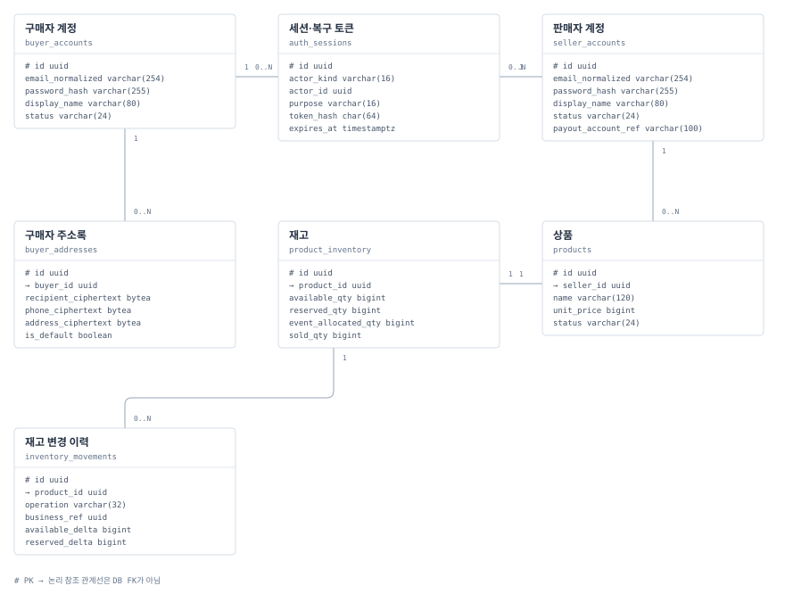
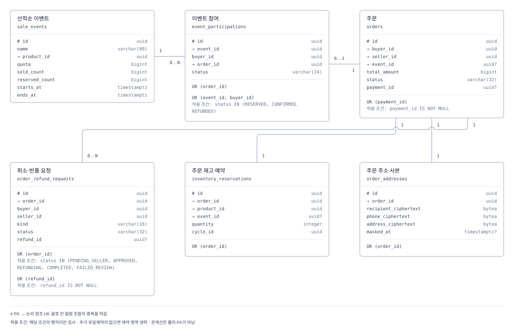
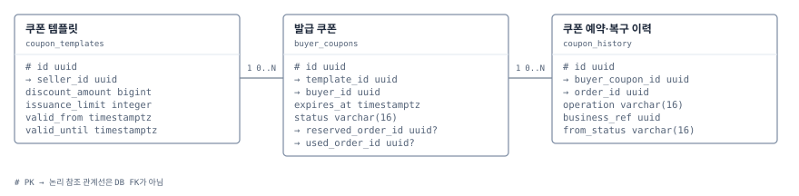
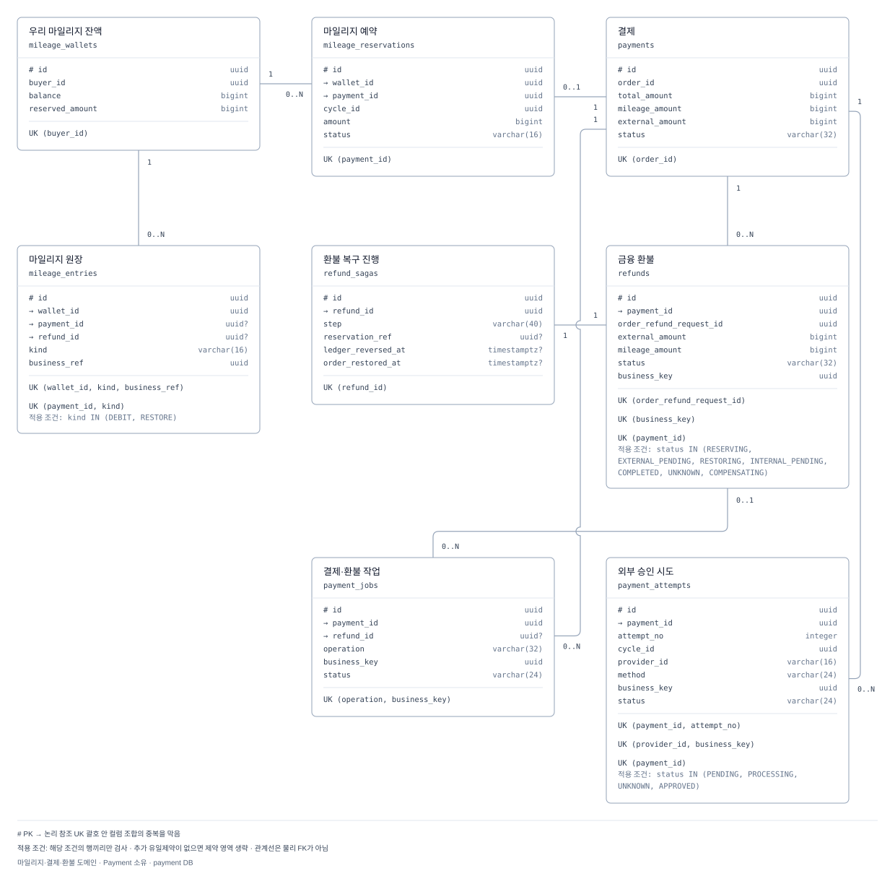
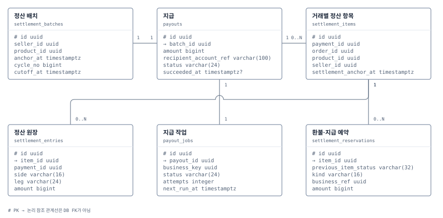
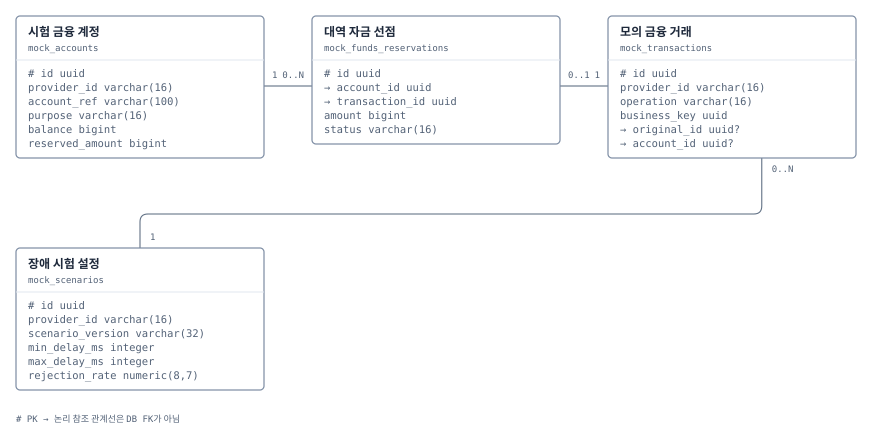
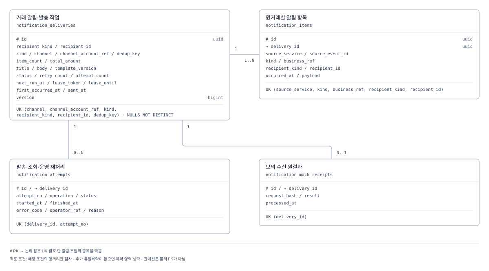
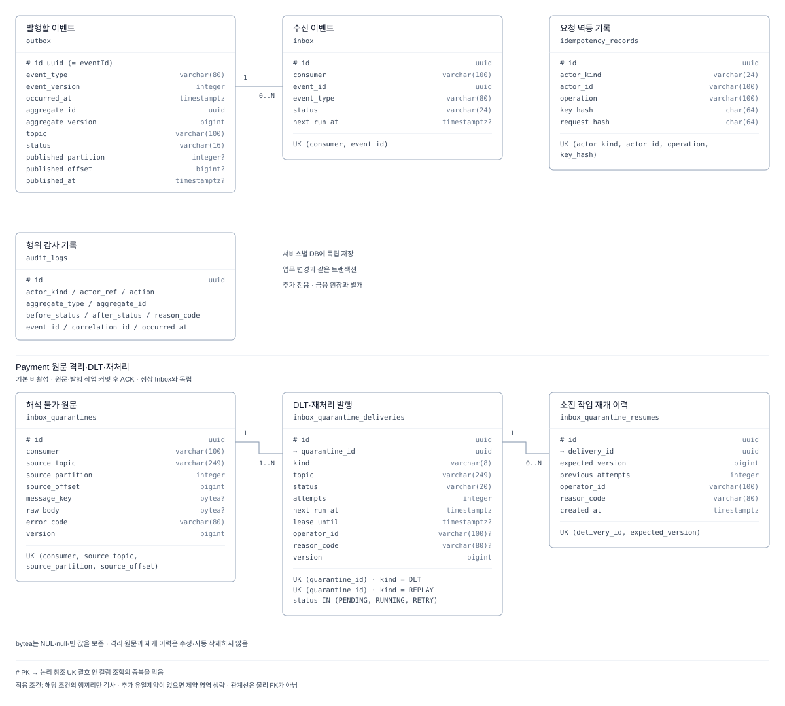

# 데이터 모델

서비스별 PostgreSQL과 [Redis 인증 데이터](#redis-인증-데이터)의 설계입니다. PostgreSQL의 물리 FK는 만들지 않고 아래 관계를 애플리케이션에서 검증합니다. 공통 시간 컬럼은 [시간 정보와 감사 기록](architecture.md#시간-정보와-감사-기록)에 따라 채웁니다. 생성/수정 시각과 행위 감사 로그는 별개입니다. 식별자는 서버 생성 UUID, 금액·누적 수량은 bigint, PostgreSQL 시각은 `timestamptz`이며 조회 시간대는 KST입니다. 내부 저장은 같은 절대시각을 유지합니다. `?`는 nullable, 나머지 컬럼은 NOT NULL입니다. 비고의 `—`는 별도 설명이 없다는 뜻이며 공통 기준과 테이블 제약은 그대로 적용합니다. 숫자 버전은 0부터 시작하고 조건부 갱신마다 증가합니다.

테이블·컬럼·제약·인덱스와 저장 상태를 정의합니다. 실제 DDL과 적용 방식은 [DB 정책](migrations.md), 실행·연결 조건은 [개발 환경](development.md)을 따릅니다. 설계의 존재만으로 구현 완료를 판단하지 않습니다.

아래 컬럼·제약·인덱스가 기준이고 ERD는 주요 필드와 관계를 요약합니다. 각 뷰는 같은 DB 안의 관계를 보여주며 외부 서비스 ID는 값으로만 저장합니다. 주소·연락처는 별도 암호화 사본이고 금융 이벤트에 포함하지 않습니다.

소유 표기의 `commerce`는 커머스 앱과 그 앱이 소유한 DB·계정·스키마 이름입니다. 판매자 계정·컬럼의 `seller`는 업무 식별자입니다.

## 계정·상품

### buyer_accounts

소유: `commerce`. 구매자 계정.

| 컬럼 | 타입 | 비고 |
| --- | --- | --- |
| `id` | `uuid` | PK; 서버 생성 |
| `email_normalized` | `varchar(254)` | — |
| `password_hash` | `varchar(255)` | — |
| `display_name` | `varchar(80)` | — |
| `status` | `varchar(24)` | — |
| `auth_version` | `bigint` | 인증 버전; 기본 0 |
| `created_at` | `timestamptz` | — |
| `updated_at` | `timestamptz` | — |
| `version` | `bigint` | NOT NULL; 낙관적 버전 |
| `deleted_at` | `timestamptz?` | 논리삭제 |

**제약:** UNIQUE(email_normalized), 삭제 뒤에도 유지. 이메일은 앞뒤 공백을 지우고 소문자로 맞춰 저장하며 로그인·요청 제한 키도 같은 값을 쓴다. status=ACTIVE/SUSPENDED/DELETED. auth_version은 인증에 영향 주는 계정 상태·비밀번호 변경과 가드 복구 때 증가하며 일반 엔티티 version과 구분한다.

**인덱스:** (status,id).

### password_reset_tokens

소유: `commerce`. PostgreSQL의 일회용 비밀번호 복구 토큰. 로그인 세션은 Redis에 저장한다.

| 컬럼 | 타입 | 비고 |
| --- | --- | --- |
| `id` | `uuid` | PK; 서버 생성 |
| `actor_kind` | `varchar(16)` | — |
| `actor_id` | `uuid` | — |
| `purpose` | `varchar(16)` | — |
| `token_hash` | `char(64)` | — |
| `expires_at` | `timestamptz` | — |
| `consumed_at` | `timestamptz?` | — |
| `revoked_at` | `timestamptz?` | — |
| `delivery_ciphertext` | `bytea?` | 복구전달용암호문 |
| `delivery_status` | `varchar(16)?` | — |
| `created_at` | `timestamptz` | — |
| `updated_at` | `timestamptz` | — |
| `version` | `bigint` | NOT NULL; 낙관적 버전 |

**제약:** UNIQUE(token_hash). actor_kind=BUYER/SELLER, purpose=PASSWORD_RESET. 목적·종류·10분 만료·소비/폐기를 DB에서 검사한다. 발급은 계정 잠금 아래 이전 복구 토큰을 폐기한다. 비밀번호 교체·토큰 소비·다른 복구 토큰 폐기·auth_version 증가는 같은 DB 트랜잭션이며 Redis 세션 폐기는 [정책의 차단·재조정](policies.md#폐기와-저장소-복구)을 따른다. 토큰 원문은 저장하지 않고, 토큰 ID에 묶은 AES-GCM 전달용 암호문을 delivery_status=PENDING으로 둔다. 실제 전달과 이후 상태는 알림 전달 구현 때 정한다.

**인덱스:** (actor_kind,actor_id,purpose); (expires_at).

### seller_accounts

소유: `commerce`. 판매자 계정.

| 컬럼 | 타입 | 비고 |
| --- | --- | --- |
| `id` | `uuid` | PK; 서버 생성 |
| `email_normalized` | `varchar(254)` | — |
| `password_hash` | `varchar(255)` | — |
| `display_name` | `varchar(80)` | — |
| `status` | `varchar(24)` | — |
| `auth_version` | `bigint` | 인증 버전; 기본 0 |
| `payout_account_ref` | `varchar(100)` | — |
| `created_at` | `timestamptz` | — |
| `updated_at` | `timestamptz` | — |
| `version` | `bigint` | NOT NULL; 낙관적 버전 |
| `deleted_at` | `timestamptz?` | 논리삭제 |

**제약:** UNIQUE(email_normalized), 구매자 계정과 별도·같은 정규화. status=ACTIVE/SUSPENDED/DELETED. 지급 계정은 시험용 참조. auth_version은 인증에 영향 주는 계정 상태·비밀번호 변경과 가드 복구 때 증가하며 일반 엔티티 version과 구분한다.

**인덱스:** (status,id).

### buyer_addresses

소유: `commerce`. 구매자 주소록.

| 컬럼 | 타입 | 비고 |
| --- | --- | --- |
| `id` | `uuid` | PK; 서버 생성 |
| `buyer_id` | `uuid` | →buyer_accounts.id |
| `recipient_ciphertext` | `bytea` | — |
| `phone_ciphertext` | `bytea` | — |
| `address_ciphertext` | `bytea` | — |
| `is_default` | `boolean` | — |
| `created_at` | `timestamptz` | — |
| `updated_at` | `timestamptz` | — |
| `version` | `bigint` | NOT NULL; 낙관적 버전 |
| `deleted_at` | `timestamptz?` | 논리삭제 |

**제약:** 부분 UNIQUE(buyer_id) WHERE is_default AND deleted_at IS NULL. CHECK(삭제한 주소는 기본 아님). 세 암호문은 AES-GCM이며 주소 ID·칸 이름에 묶습니다. 주소록 쓰기는 구매자 계정 행의 배타 잠금으로 직렬화합니다. 주문은 같은 행을 공유 잠금해 주문끼리 병렬 처리하되 주소 변경과 겹치지 않습니다. 없거나 삭제된 계정은 인증 실패입니다. 타인 주소 접근 금지.

**인덱스:** (buyer_id,deleted_at,created_at,id).

### product_inventory

소유: `commerce`. 재고.

| 컬럼 | 타입 | 비고 |
| --- | --- | --- |
| `id` | `uuid` | PK; 서버 생성 |
| `product_id` | `uuid` | →products.id |
| `available_qty` | `bigint` | — |
| `reserved_qty` | `bigint` | — |
| `event_allocated_qty` | `bigint` | — |
| `sold_qty` | `bigint` | — |
| `created_at` | `timestamptz` | — |
| `updated_at` | `timestamptz` | — |
| `version` | `bigint` | NOT NULL; 낙관적 버전 |

**제약:** UNIQUE(product_id). 모든 수량>=0. 이벤트 공개·일반 주문 예약·상품 변경·재고 조정은 이 행을 잠근 뒤 최신 상품을 검증하거나 변경([트랜잭션과 관계](#트랜잭션과-관계)). `sold_qty`는 환불·반품 복원을 뺀 순판매량이며 누적 판매량은 inventory_movements에서 계산. 수량별 증감은 [재고 예약과 복원](policies.md#재고-예약과-복원)을 따름.

**인덱스:** UNIQUE(product_id).

### products

소유: `commerce`. 상품.

| 컬럼 | 타입 | 비고 |
| --- | --- | --- |
| `id` | `uuid` | PK; 서버 생성 |
| `seller_id` | `uuid` | →seller_accounts.id |
| `name` | `varchar(120)` | — |
| `unit_price` | `bigint` | — |
| `status` | `varchar(24)` | — |
| `created_at` | `timestamptz` | — |
| `updated_at` | `timestamptz` | — |
| `version` | `bigint` | NOT NULL; 낙관적 버전 |
| `deleted_at` | `timestamptz?` | 논리삭제 |

**제약:** CHECK(1<=unit_price AND unit_price<=10000000). status=DRAFT/ON_SALE/STOPPED/DELETED.

**인덱스:** (seller_id,status,created_at,id); (status,created_at,id).

### inventory_movements

소유: `commerce`. 재고 변경 이력.

| 컬럼 | 타입 | 비고 |
| --- | --- | --- |
| `id` | `uuid` | PK; 서버 생성 |
| `product_id` | `uuid` | →products.id |
| `operation` | `varchar(32)` | — |
| `business_ref` | `uuid` | — |
| `available_delta` | `bigint` | — |
| `reserved_delta` | `bigint` | — |
| `allocated_delta` | `bigint` | — |
| `sold_delta` | `bigint` | — |
| `reason` | `varchar(200)` | — |
| `created_at` | `timestamptz` | — |

**제약:** UNIQUE(product_id,operation,business_ref). 증감과 현재 재고를 같은 트랜잭션으로 기록. 재전달·재처리는 이 유일성으로 한 번만 반영.

| operation | business_ref |
| --- | --- |
| `SELLER_ADJUSTMENT` | 판매자 조정 요청의 멱등 기록 ID |
| `ORDER_RESERVE`, `ORDER_CONSUME`, `ORDER_RELEASE` | 예약의 결제 회차 `cycle_id`. 재시도마다 새 값 |
| `REFUND_RESTORE` | 미발송 주문 복구의 원환불 `refundId` |
| `RETURN_RESTORE` | 재판매 가능으로 입고한 `order_refund_requests.id` |
| `RETURN_DISPOSE` | 재판매 불가로 입고한 `order_refund_requests.id`. 판매만 줄이고 가용은 바꾸지 않음 |
| `EVENT_ALLOCATE`, `EVENT_RETURN` | `sale_events.id` |

선착순 주문의 확정과 이벤트 종료 뒤 해제는 재고 행이 바뀌므로 `ORDER_CONSUME`·`ORDER_RELEASE`로 기록합니다. 선착순 예약과 이벤트 진행 중 해제는 이벤트의 `R`만 바뀌므로 이 이력을 남기지 않고 event_participations가 참여 기록을 맡습니다.

**인덱스:** (product_id,created_at,id).

## Redis 인증 데이터

소유: 커머스 인증 영역. Gateway는 읽기 전용으로 검증하며 [세션 정책](policies.md#인증공통-api-기준)을 따른다. 아래 구조는 PostgreSQL 테이블이 아니며 시간은 UTC epoch 밀리초 정수, 인증 버전은 0 이상의 정수다. 토큰 원문은 저장하지 않는다. 검증과 조건부 변경은 [인증 정책](policies.md#인증공통-api-기준)로 원자 실행한다.

### 로그인 세션

키는 `commerce-settle:auth:session:<epoch>:<tokenHash>`다. epoch는 배포한 인증 세대 UUID의 소문자 표기, tokenHash는 256비트 이상 임의 토큰(UTF-8)의 SHA-256 소문자 16진수다. 로그아웃의 `X-Authenticated-Session-Hash`도 같은 값이다.

| 필드 | 타입 | 의미 |
| --- | --- | --- |
| `actorKind` | `string` | BUYER/SELLER |
| `actorId` | `uuid` | 해당 종류의 PostgreSQL 계정 ID |
| `purpose` | `string` | SESSION |
| `authVersion` | `integer` | 발급 당시 계정의 auth_version |
| `issuedAt` | `integer` | 서버 발급 시각(epoch ms) |
| `expiresAt` | `integer` | issuedAt+30분(epoch ms); 변경 불가 |

**제약:** 발급 때 `PEXPIREAT`으로 키 만료를 expiresAt에 맞추고 조회로 연장하지 않는다. Gateway의 읽기 전용 스크립트가 현재 세대·목적·만료와 아래 ACTIVE 가드의 인증 버전을 원자적으로 검증하며, 만료는 Redis `TIME`과 expiresAt을 비교해 한 번 더 확인한다. 가드 키는 스크립트가 세션의 actorKind·actorId로 만들며 단일 노드를 전제로 한다. 세션 또는 가드 누락 시 허용하지 않으며 PostgreSQL에서 세션을 재생성하지 않는다.

### 계정별 인증 가드

키는 `commerce-settle:auth:subject:<epoch>:<actorKind>:<actorId>`다. 개별 세션 목록을 스캔하지 않고 해당 계정 종류·ID의 전체 세션을 차단한다.

| 필드 | 타입 | 의미 |
| --- | --- | --- |
| `authVersion` | `integer` | PostgreSQL에서 확정한 auth_version |
| `state` | `string` | ACTIVE/BLOCKED; 정지·삭제·변경 중이면 BLOCKED |
| `pendingChangeId` | `uuid?` | 진행 중인 인증 변경의 동일성·재조정 기준; 확정 반영 뒤 null |

**제약:** 가드는 현재 세대에서 TTL로 만료시키지 않는다. 최초 로그인에서 DB 계정 상태·인증 버전을 확인해 없는 가드를 조건부 생성할 수 있으나, 기존 BLOCKED 가드를 로그인으로 열지 않는다. 폐기는 가드의 상태·인증 버전·pendingChangeId를 조건부 변경해 직렬화한다. 세션 발급·가드 선차단·확정 반영은 커머스의 스크립트가 조건을 모두 확인한 뒤 마지막에 쓴다. DB 확정 상태 반영은 같은 변경만 허용하고 이전 버전의 지연 반영을 거절한다. 확정 정지/삭제 가드는 BLOCKED·pendingChangeId=null이며 401, 변경 중 가드·유효 세션의 가드 누락·Redis 검증 오류·복구 중 요청은 503이다. 재접속 때 이전 세션 세대를 계속 사용하지 않는다.

## 주문·선착순 이벤트

### sale_events

소유: `commerce`. 선착순 이벤트.

| 컬럼 | 타입 | 비고 |
| --- | --- | --- |
| `id` | `uuid` | PK; 서버 생성 |
| `seller_id` | `uuid` | →seller_accounts.id |
| `product_id` | `uuid` | →products.id |
| `name` | `varchar(80)` | — |
| `event_price` | `bigint` | — |
| `quota` | `bigint` | — |
| `sold_count` | `bigint` | — |
| `reserved_count` | `bigint` | — |
| `starts_at` | `timestamptz` | — |
| `ends_at` | `timestamptz` | — |
| `status` | `varchar(24)` | — |
| `published_at` | `timestamptz?` | — |
| `closed_at` | `timestamptz?` | — |
| `created_at` | `timestamptz` | — |
| `updated_at` | `timestamptz` | — |
| `version` | `bigint` | NOT NULL; 낙관적 버전 |

**제약:** name 1..80자, quota>0, event_price 1..10000000, 0<=S+R<=Q, starts_at<ends_at. status=DRAFT/SCHEDULED/OPEN/SOLD_OUT/CLOSED. 공개 후 사본 불변, 상품별 공개 기간 중복 검사는 product_inventory 잠금 아래 수행. version·updated_at은 판매자 변경·공개·종료와 기간 종료·매진만 반영하고, S·R 변경과 시각에 따른 SCHEDULED→OPEN 전이로는 바꾸지 않아 시작 전에 조회한 주문의 expectedEventVersion이 시작·참여 경쟁으로 어긋나지 않음.

**인덱스:** (product_id,starts_at,ends_at); (status,starts_at,ends_at); (seller_id,created_at,id).

### event_participations

소유: `commerce`. 이벤트 참여.

| 컬럼 | 타입 | 비고 |
| --- | --- | --- |
| `id` | `uuid` | PK; 서버 생성 |
| `event_id` | `uuid` | →sale_events.id |
| `buyer_id` | `uuid` | — |
| `order_id` | `uuid` | →orders.id |
| `status` | `varchar(24)` | — |
| `created_at` | `timestamptz` | — |
| `updated_at` | `timestamptz` | — |
| `version` | `bigint` | NOT NULL; 낙관적 버전 |

**제약:** UNIQUE(order_id). 부분 UNIQUE(event_id,buyer_id) WHERE status IN (RESERVED,CONFIRMED,REFUNDED). 실패/안전 취소=RELEASED만 재참여 가능.

**인덱스:** (event_id,status); (buyer_id,created_at,id).

### orders

소유: `commerce`. 주문.

| 컬럼 | 타입 | 비고 |
| --- | --- | --- |
| `id` | `uuid` | PK; 서버 생성 |
| `buyer_id` | `uuid` | →buyer_accounts.id |
| `seller_id` | `uuid` | →seller_accounts.id |
| `product_id` | `uuid` | →products.id |
| `event_id` | `uuid?` | →sale_events.id |
| `buyer_coupon_id` | `uuid?` | →buyer_coupons.id |
| `payment_id` | `uuid?` | 외부Payment참조 |
| `product_name` | `varchar(120)` | — |
| `unit_price` | `bigint` | — |
| `quantity` | `integer` | — |
| `gross_amount` | `bigint` | — |
| `coupon_amount` | `bigint` | S+P; 표시용 총할인액 |
| `seller_coupon_amount` | `bigint` | S; 판매자 부담 할인 |
| `platform_coupon_amount` | `bigint` | P; 플랫폼 부담 지원 |
| `settlement_base_amount` | `bigint` | B=G−S; 수수료·정산 기준 |
| `total_amount` | `bigint` | — |
| `mileage_amount` | `bigint` | — |
| `external_amount` | `bigint` | — |
| `payment_cycle_id` | `uuid` | — |
| `external_method` | `varchar(24)?` | — |
| `provider_id` | `varchar(16)?` | — |
| `method_account_ref` | `varchar(100)?` | 시험용 |
| `status` | `varchar(32)` | — |
| `fulfillment_status` | `varchar(24)` | UNSHIPPED/SHIPPED/DELIVERED/RETURN_RECEIVED |
| `demo_run_id` | `uuid?` | 선택한 불변 시연 회차 |
| `demo_delivery_seconds` / `demo_refund_seconds` | `integer?` | 회차에서 복사한 1~3600초. 세 필드는 함께 null 또는 설정 |
| `simulation_seed` | `bigint` | 주문별 배송 소요일을 정한 시험 seed |
| `delivery_business_days` | `integer` | 생성 때 고정한 2 또는 3 |
| `delivery_calendar_version` | `varchar(32)` | 불변 시험 달력 버전 |
| `delivery_calendar` | `jsonb` | 시간대·공휴일 목록 사본 |
| `shipped_at` | `timestamptz?` | 최초 서버 발송 시각 |
| `delivery_due_at` | `timestamptz?` | 발송 당시 계산한 모의 도착 시각 |
| `delivered_at` | `timestamptz?` | 배송완료 반영 시 delivery_due_at을 복사 |
| `payment_confirmed_at` | `timestamptz?` | — |
| `refund_deadline_at` | `timestamptz?` | — |
| `purchase_confirmed_at` | `timestamptz?` | — |
| `closed_at` | `timestamptz?` | 종결 상태 전이 때 고정. 주문 보존 기한의 시작 |
| `payment_wait_until` | `timestamptz` | — |
| `policy_version` | `varchar(32)` | — |
| `accrual_policy_version` | `varchar(40)?` | 주문 생성 때 고정한 구매 적립 정책 버전. 정책을 끈 상태의 주문은 null |
| `accrual_rate_bp` | `integer?` | 적립률(basis point) 사본 |
| `accrual_cap` | `bigint?` | 주문당 한도 사본 |
| `accrual_amount` | `bigint` | 적립 예정액. 기본 0 |
| `created_at` | `timestamptz` | — |
| `updated_at` | `timestamptz` | — |
| `version` | `bigint` | NOT NULL; 낙관적 버전 |

**제약:** G=unit_price*quantity, D=S+P, B=G-S, T=B-P=E+M; 1<=T<=10000000, S/P>=0이고 최대 하나만 양수, 0<=D<G, 0<=M<=T, E>=0. buyer_coupon_id가 있으면 M=0. 적립 사본은 모두 null이고 accrual_amount=0이거나, 모두 있고(1<=rate_bp<=10000, cap>0) accrual_amount=쿠폰 주문이면 0, 아니면 min(cap, floor(E*rate_bp/10000)). 쿠폰의 결제수단·소유권·예산 예약을 함께 검사. 일반 quantity 1..10; event_id가 있으면1. Payment 연결 ID는 알려진 경우 UNIQUE. 상태 전이는 아래 표.

배송 소요일·seed·달력 사본은 생성 후 불변입니다. 발송/도착 예정 시각은 함께 설정하고 발송 재요청으로 바꾸지 않습니다. 일반 주문은 배송완료 시 delivered_at=delivery_due_at, refund_deadline_at=delivered_at+168시간을 함께 저장합니다. 시연 주문은 저장한 초 단위 기간을 사용합니다. 배송 전 deadline은 NULL이며 진행 중 취소·반품·환불은 자동 구매확정을 막습니다. 늦은 배송 작업과 환불 접수도 같은 주문 잠금으로 기한을 검사합니다.

**인덱스:** (buyer_id,created_at,id); (seller_id,created_at,id); (fulfillment_status,delivery_due_at,id); (status,refund_deadline_at,id); (status,payment_wait_until,id); UNIQUE(payment_id) WHERE payment_id IS NOT NULL; 월간 우수고객 집계용 (purchase_confirmed_at) INCLUDE(buyer_id,external_amount) WHERE status=PURCHASE_CONFIRMED.

### order_refund_requests

소유: `commerce`. 취소·반품 요청.

| 컬럼 | 타입 | 비고 |
| --- | --- | --- |
| `id` | `uuid` | PK; 서버 생성 |
| `order_id` | `uuid` | →orders.id |
| `buyer_id` | `uuid` | — |
| `seller_id` | `uuid` | — |
| `kind` | `varchar(16)` | — |
| `status` | `varchar(32)` | — |
| `accepted_at` | `timestamptz` | — |
| `reason` | `varchar(200)` | — |
| `refund_id` | `uuid?` | 외부Payment참조 |
| `decision_at` | `timestamptz?` | — |
| `received_at` | `timestamptz?` | — |
| `receipt_resalable` | `boolean?` | 입고 검수 결과. 입고 때 함께 기록 |
| `closed_reason` | `varchar(200)?` | — |
| `closure_evidence_ref` | `varchar(200)?` | — |
| `created_at` | `timestamptz` | — |
| `updated_at` | `timestamptz` | — |
| `version` | `bigint` | NOT NULL; 낙관적 버전 |

**제약:** 부분 UNIQUE(order_id) WHERE status IN (PENDING_SELLER,APPROVED,REFUNDING,COMPLETED,FAILED_REVIEW). status=PENDING_SELLER/APPROVED/REFUNDING/COMPLETED/REJECTED/WITHDRAWN/FAILED_REVIEW/CLOSED. received_at과 receipt_resalable은 함께 NULL이거나 함께 값이 있음. 재고 재입고·폐기는 received_at과 원복 유일성으로 보호.

**인덱스:** (order_id,created_at,id); (seller_id,status,created_at,id); UNIQUE(refund_id) WHERE refund_id IS NOT NULL.

### refund_closure_confirmations · refund_closure_evidence

소유: `commerce`. 실패 환불의 구매자 의사와 운영 종결 증빙을 추가 전용으로 보존합니다.

| 테이블 | 필드·제약 |
| --- | --- |
| `refund_closure_confirmations` | `id` UUID PK, `request_id`·`refund_id`·`payment_id`·`order_id`·`buyer_id` UUID NOT NULL, `request_version`·`order_version` bigint≥0, `confirmed_at` timestamptz NOT NULL. `(request_id,confirmed_at)` 조회 인덱스 |
| `refund_closure_evidence` | `id` UUID PK, `request_id` UUID UNIQUE NOT NULL, `operator_ref` varchar(100) NOT NULL, `snapshot` jsonb object NOT NULL, `closed_at` timestamptz NOT NULL |

확인은 인증된 구매자와 원요청 소유권을 대조해 서버 시각·현재 버전으로 기록하며 본문에서 구매자·원환불·시각을 받지 않습니다. 종결의 `snapshot`에는 해당 확인과 원주문/요청 버전, Payment·Settlement의 증빙 응답과 버전, 확인 시각을 보존합니다. `order_refund_requests.closure_evidence_ref`가 증빙 UUID를 참조합니다. 상태·증빙·감사는 한 트랜잭션에 저장하며 금융 이력과 함께 보존하고 자동 삭제하지 않습니다. FK는 두지 않으며 응용 경계와 UNIQUE가 참조·중복을 보호합니다.

### inventory_reservations

소유: `commerce`. 주문 재고 예약.

| 컬럼 | 타입 | 비고 |
| --- | --- | --- |
| `id` | `uuid` | PK; 서버 생성 |
| `order_id` | `uuid` | →orders.id |
| `product_id` | `uuid` | →products.id |
| `event_id` | `uuid?` | →sale_events.id |
| `quantity` | `integer` | — |
| `cycle_id` | `uuid` | 현재 예약을 확보한 결제 회차; orders.payment_cycle_id와 일치 |
| `status` | `varchar(24)` | — |
| `expires_at` | `timestamptz` | 주문의 payment_wait_until; 취소 요청 대상 조회에만 사용 |
| `created_at` | `timestamptz` | — |
| `updated_at` | `timestamptz` | — |
| `version` | `bigint` | NOT NULL; 낙관적 버전 |

**제약:** UNIQUE(order_id). quantity>0. status=RESERVED/CONSUMED/RELEASED/RESTORED/DISPOSED. 기한만으로 RELEASED 전이 금지.

| 전이 | 근거 | 조건 |
| --- | --- | --- |
| →RESERVED | 주문 생성 | 가용 재고 또는 이벤트 남은 수량·참여 한도 충족 |
| RESERVED→CONSUMED | 결제 확정 | 결과의 결제 회차가 `cycle_id`와 같음 |
| RESERVED→RELEASED | 확정 거절·승인 차단된 취소 | 결과의 결제 회차가 `cycle_id`와 같음 |
| RELEASED→RESERVED | 확정 거절 뒤 재시도 | 새 회차로 수량을 다시 확보하고 `cycle_id` 교체 |
| CONSUMED→RESTORED | 미발송 주문의 환불 복구 또는 발송 주문의 재판매 가능 반품 입고 | 주문당 한 번 |
| CONSUMED→DISPOSED | 발송 주문의 재판매 불가 반품 입고 | 주문당 한 번. RESTORED와 함께 판매 종결 상태이며 서로 바뀌지 않음 |

재시도도 같은 행을 갱신하므로 주문당 예약 행은 하나입니다. 회차가 다른 늦은 결과와 이미 반영된 결과는 상태를 바꾸지 않습니다. 금지된 전이는 수량·이력을 바꾸지 않고 거절합니다. 수량 증감과 복원 시점은 [재고 예약과 복원](policies.md#재고-예약과-복원)을 따릅니다.

**인덱스:** (status,expires_at,id); (product_id,status).

### order_addresses

소유: `commerce`. 주문 주소 사본.

| 컬럼 | 타입 | 비고 |
| --- | --- | --- |
| `id` | `uuid` | PK; 서버 생성 |
| `order_id` | `uuid` | →orders.id |
| `recipient_ciphertext` | `bytea` | — |
| `phone_ciphertext` | `bytea` | — |
| `address_ciphertext` | `bytea` | — |
| `masked_at` | `timestamptz?` | — |
| `hold_reason` | `varchar(200)?` | — |
| `created_at` | `timestamptz` | — |
| `updated_at` | `timestamptz` | — |
| `version` | `bigint` | NOT NULL; 낙관적 버전 |

**제약:** UNIQUE(order_id). 주소록 암호문을 복사하지 않고 새 주문 주소 ID·칸 이름에 묶은 AES-GCM 사본으로 다시 암호화한다. 주문 생성 후 사본은 불변이며 정한 마스킹/보존 보류만 허용한다.

**인덱스:** UNIQUE(order_id).

## 쿠폰

### coupon_templates

소유: `commerce`. 발급 당시 혜택 조건과 할인 비용 집계. WELCOME는 가입 시, GRADE는 월 배치가 서버 규칙으로 자동 생성합니다. 판매자 API는 SELLER 템플릿만 생성합니다.

| 컬럼 | 타입 | 비고 |
| --- | --- | --- |
| `id` | `uuid` | PK; 서버 생성 |
| `kind` | `varchar(16)` | WELCOME/GRADE/SELLER |
| `funder` | `varchar(16)` | PLATFORM/SELLER; 종류에서 서버가 결정 |
| `seller_id` | `uuid?` | SELLER에만 필요 |
| `product_id` | `uuid?` | SELLER의 지정 상품; null이면 판매자 전체 |
| `grade` | `varchar(16)?` | GRADE 선정자에게 적용할 BRONZE/SILVER/GOLD 혜택 |
| `target_month` | `date?` | GRADE 혜택 월의 첫날; WELCOME/SELLER는 null |
| `name` | `varchar(80)` | 표시명 |
| `discount_amount` | `bigint` | 정액 할인 |
| `min_order_amount` | `bigint` | 적용 전 최소 상품대금 |
| `min_seller_net_amount` | `bigint` | SELLER가 승인한 최소 정산액; 플랫폼 캠페인은 0 |
| `allowed_methods` | `varchar(24)[]` | 승인된 CREDIT_CARD/DEBIT_CARD/EASY_PAY |
| `pg_cost_ceiling_bps` | `integer` | PG 비용 상한; 기본 400bp |
| `other_cost_allowance` | `bigint` | 주문당 기타 비용 충당액; 기본 1,000원 |
| `issuance_limit` | `integer?` | SELLER가 정한 발급 수 한도; 플랫폼 종류는 null |
| `issued_count` | `integer` | 누적 발급 수 |
| `total_budget` | `bigint?` | SELLER가 정한 명목 할인 예산; 플랫폼 종류는 null |
| `committed_budget` | `bigint` | 발급했으나 아직 사용하지 않은 약속액 |
| `consumed_budget` | `bigint` | 사용 누계에서 확정 환불 상쇄를 뺀 금액 |
| `valid_from` | `timestamptz` | 신규 발급 시작 |
| `valid_until` | `timestamptz?` | SELLER의 종료 시각, GRADE의 월말 경계; WELCOME는 null |
| `status` | `varchar(16)` | ACTIVE/CLOSED |
| `created_at` | `timestamptz` | — |
| `updated_at` | `timestamptz` | — |
| `version` | `bigint` | 낙관적 버전 |

**제약:** 할인액>0, 할인액<min_order_amount<=10000000. issued_count·committed_budget·consumed_budget는 비음수입니다. SELLER는 양수인 issuance_limit·total_budget와 valid_until이 필수이며 issued_count<=issuance_limit, committed_budget+consumed_budget<=total_budget를 보호합니다. WELCOME/GRADE는 두 상한이 null이고 비용 집계만 수행합니다. WELCOME/GRADE는 funder=PLATFORM이고 seller_id/product_id는 null; SELLER는 funder=SELLER이고 seller_id 필수입니다. grade와 target_month는 GRADE에만 필요하고 나머지 종류는 null입니다. WELCOME의 발급 기간은 종료 없이 유지하고 쿠폰 기한은 가입+14일로 정합니다. GRADE의 기간은 혜택 월입니다. 상품 소유·사용 수단·손익 하한·최소 정산액은 서버가 검증합니다. 발급 뒤 혜택 조건은 변경하지 않습니다.

**인덱스:** (seller_id,status,created_at,id); (kind,target_month,status). 활성 WELCOME 캠페인은 전체 한 개, GRADE는 (grade,target_month)에 부분 UNIQUE. SELLER의 월별 UNIQUE는 두지 않습니다.

### buyer_coupons

소유: `commerce`. 발급 당시 조건과 예산 약속을 보존한 쿠폰.

| 컬럼 | 타입 | 비고 |
| --- | --- | --- |
| `id` | `uuid` | PK; 서버 생성 |
| `template_id` | `uuid` | →coupon_templates.id |
| `buyer_id` | `uuid` | →buyer_accounts.id |
| `kind` | `varchar(16)` | WELCOME/GRADE/SELLER |
| `funder` | `varchar(16)` | PLATFORM/SELLER |
| `seller_id` | `uuid?` | SELLER에만 값 |
| `product_id` | `uuid?` | SELLER 지정 상품 |
| `target_month` | `date?` | GRADE의 발급 업무 키; WELCOME/SELLER는 null |
| `discount_amount` | `bigint` | 원할인 사본 |
| `min_order_amount` | `bigint` | 최소 상품대금 사본 |
| `allowed_methods` | `varchar(24)[]` | 사용 수단 사본 |
| `valid_from` | `timestamptz` | 사용 시작 |
| `expires_at` | `timestamptz` | WELCOME=가입+14일, GRADE=다음 달 1일 00:00 KST, SELLER=템플릿 종료 |
| `status` | `varchar(16)` | ISSUED/RESERVED/USED/EXPIRED |
| `reserved_order_id` | `uuid?` | →orders.id |
| `used_order_id` | `uuid?` | →orders.id |
| `created_at` | `timestamptz` | — |
| `updated_at` | `timestamptz` | — |
| `version` | `bigint` | 낙관적 버전 |

**제약:** UNIQUE(template_id,buyer_id). WELCOME는 buyer_id, GRADE는 (buyer_id,target_month)에 종류별 부분 UNIQUE. SELLER는 캠페인별 유일성만 적용하고 다른 캠페인의 쿠폰도 발급할 수 있습니다. 발급 수 증가·할인 약속액 반영·쿠폰 저장은 같은 트랜잭션입니다. 판매자 상한은 SELLER 발급에만 검사합니다. 원할인·부담자·기간·수단은 불변이며 상태와 시각을 함께 검사합니다. 재가입·캠페인 교체로 발급 이력을 지우지 않습니다.

**인덱스:** (buyer_id,status,expires_at,id); 만료 대상 조회용 (status,expires_at,id); UNIQUE(reserved_order_id) WHERE NOT NULL; UNIQUE(used_order_id) WHERE NOT NULL.

### coupon_history

소유: `commerce`. 발급·예약·사용·복구·만료와 예산 이동 이력.

| 컬럼 | 타입 | 비고 |
| --- | --- | --- |
| `id` | `uuid` | PK; 서버 생성 |
| `buyer_coupon_id` | `uuid` | →buyer_coupons.id |
| `order_id` | `uuid?` | 발급·미사용 만료는 null |
| `operation` | `varchar(16)` | ISSUE/RESERVE/USE/RELEASE/RESTORE/EXPIRE |
| `business_ref` | `uuid` | 발급 대상·결제 회차·원결제·만료의 업무 키 |
| `from_status` | `varchar(16)?` | ISSUE는 null |
| `to_status` | `varchar(16)` | 전이 결과 |
| `committed_delta` | `bigint` | 약속액 증감 |
| `consumed_delta` | `bigint` | 사용액 증감 |
| `created_at` | `timestamptz` | — |

**제약:** UNIQUE(buyer_coupon_id,operation,business_ref). RESERVE/RELEASE는 payment_cycle_id별, USE/RESTORE는 원결제별 한 번. 쿠폰 상태·할인 비용 집계·이력을 같은 트랜잭션으로 반영하고 미확정 결과로 약속액을 해제하지 않습니다.

**인덱스:** (buyer_coupon_id,created_at,id).

### coupon_issue_runs

소유: `commerce`. 플랫폼 월간 우수고객의 대상 고정과 재시작 가능한 발급 회차. 판매자 자유 발급은 포함하지 않습니다.

| 컬럼 | 타입 | 비고 |
| --- | --- | --- |
| `id` | `uuid` | PK; Job의 runId |
| `target_month` | `date` | 혜택 월 첫날; 취소되지 않은 회차만 월별 UNIQUE |
| `cutoff_at` | `timestamptz` | 원래 월 마감; 대체 회차도 보존 |
| `policy_version` | `varchar(32)` | 최초 회차의 서버 정책 버전; 대체·재시작에서 보존 |
| `replaces_run_id` | `uuid?` | 이전 CANCELLED 회차의 논리 참조; 최초 회차는 null |
| `target_count` | `integer?` | 동점자 포함 선정 인원; 확정 전 null |
| `cutoff_spend` | `bigint?` | 선정 대상의 최저 E 합계; 확정 전·대상 없음은 null |
| `status` | `varchar(24)` | PREPARING/ISSUING/COMPLETED/EXPIRED/CANCELLED |
| `cancelled_at` | `timestamptz?` | 서버가 기록한 교정 시각 |
| `cancelled_by` | `varchar(100)?` | 검증한 운영자 자격의 식별자; 이메일 금지 |
| `cancellation_reason_code` | `varchar(80)?` | AGGREGATION_ERROR; 운영자 임의 대상·금액 지정 불가 |
| `created_at` | `timestamptz` | — |
| `updated_at` | `timestamptz` | — |
| `version` | `bigint` | 낙관적 버전 |

**제약:** target_month·cutoff_at·policy_version·status는 NOT NULL. CHECK(replaces_run_id <> id). UNIQUE(target_month) WHERE status <> 'CANCELLED'; UNIQUE(replaces_run_id) WHERE replaces_run_id IS NOT NULL. target_month는 월 첫날이고 target_count>=0, cutoff_spend>0이다. 세 취소 필드는 CANCELLED일 때 모두 필수이며 다른 상태에서는 모두 null이다. 대체 회차는 같은 월·마감·정책 버전의 CANCELLED 부모 한 개를 참조하며, 부모·자식 연결과 취소를 같은 트랜잭션에 저장한다. 참조·상태는 앱에서 확인하며 물리 FK는 두지 않는다. 교정·만료 조건은 [월간 회차 정책](policies.md#월간-회차-검증과-오류-교정)을 따른다.

업무 상태가 ISSUING으로 커밋됐으면 Batch 첫 Step의 완료 이력이 없어도 확정 대상을 재사용합니다. 대상이 없으면 target_count=0/cutoff_spend=null로 완료합니다. 회차 잠금을 교정·실행 등록·대상 저장·발급이 공유하므로 취소와 첫 발급 중 하나만 커밋할 수 있습니다. 대상·원회차 이력은 보존합니다. [선정·교정 조건](policies.md#월간-회차-검증과-오류-교정)과 [Job 실행](architecture.md#월간-혜택-job)을 따릅니다.

**인덱스:** (status,target_month,id); 조건부 월 유일성과 replaces_run_id 유일성은 위 제약으로 관리한다.

### coupon_issue_targets

소유: `commerce`. 같은 회차의 플랫폼 월간 우수고객과 처리 결과.

| 컬럼 | 타입 | 비고 |
| --- | --- | --- |
| `id` | `uuid` | PK; 발급 업무 키 |
| `run_id` | `uuid` | →coupon_issue_runs.id |
| `template_id` | `uuid` | →coupon_templates.id |
| `buyer_id` | `uuid` | →buyer_accounts.id |
| `external_spend` | `bigint` | 고정한 대상 기간의 E 합계 |
| `rank_no` | `integer` | E 합계 내림차순 RANK; 1~100, 동점은 같은 순위 |
| `buyer_coupon_id` | `uuid?` | 처리된 원쿠폰 |
| `status` | `varchar(24)` | PENDING/ISSUED/EXPIRED |
| `created_at` | `timestamptz` | — |
| `updated_at` | `timestamptz` | — |
| `version` | `bigint` | 낙관적 버전 |

**제약:** UNIQUE(run_id,buyer_id), UNIQUE(buyer_coupon_id) WHERE buyer_coupon_id IS NOT NULL. template_id는 해당 월·등급의 GRADE 캠페인이며 external_spend>0, 1<=rank_no<=100입니다. 동점자 때문에 행 수가 100을 넘을 수 있습니다. 월별 마감의 불변 확정·취소 이력으로 대상과 합계를 고정합니다. 쿠폰·발급 이력·대상 ISSUED 전이는 같은 DB 트랜잭션으로 반영합니다. 회차 행을 먼저 잠그고 ISSUING·원래 발급 기한을 확인하며 CANCELLED 부모의 대상은 처리하지 않습니다.

## 결제·마일리지

### mileage_wallets

소유: `payment`. 우리 마일리지 잔액.

| 컬럼 | 타입 | 비고 |
| --- | --- | --- |
| `id` | `uuid` | PK; 서버 생성 |
| `buyer_id` | `uuid` | — |
| `balance` | `bigint` | — |
| `reserved_amount` | `bigint` | — |
| `created_at` | `timestamptz` | — |
| `updated_at` | `timestamptz` | — |
| `version` | `bigint` | NOT NULL; 낙관적 버전 |

**제약:** UNIQUE(buyer_id). CHECK(0<=reserved_amount AND reserved_amount<=balance). 갱신은 행 잠금/조건부 갱신.

**인덱스:** UNIQUE(buyer_id).

### mileage_reservations

소유: `payment`. 마일리지 예약.

| 컬럼 | 타입 | 비고 |
| --- | --- | --- |
| `id` | `uuid` | PK; 서버 생성 |
| `wallet_id` | `uuid` | →mileage_wallets.id |
| `payment_id` | `uuid` | →payments.id |
| `cycle_id` | `uuid` | — |
| `amount` | `bigint` | — |
| `status` | `varchar(16)` | — |
| `created_at` | `timestamptz` | — |
| `updated_at` | `timestamptz` | — |
| `version` | `bigint` | NOT NULL; 낙관적 버전 |

**제약:** UNIQUE(payment_id,cycle_id), amount>0. status=RESERVED/CONSUMED/RELEASED. 부분 UNIQUE(payment_id) WHERE status='RESERVED'로 결제마다 활성 예약은 하나만 허용합니다. 재시도는 새 cycle_id의 새 행을 만들고 이전 RELEASED 행을 보존합니다. 현재 예약 조회는 payments.current_cycle_id와 일치하는 행만 읽습니다. RESERVE/RELEASE business_ref는 cycle_id, DEBIT/RESTORE business_ref는 payment_id이며 원장도 보존합니다.

**인덱스:** (wallet_id,status); (status,updated_at,id).

### payments

소유: `payment`. 결제.

| 컬럼 | 타입 | 비고 |
| --- | --- | --- |
| `id` | `uuid` | PK; 서버 생성 |
| `order_id` | `uuid` | 외부커머스참조 |
| `buyer_id` | `uuid` | — |
| `seller_id` | `uuid` | — |
| `order_version` | `bigint` | — |
| `product_id` | `uuid` | — |
| `current_cycle_id` | `uuid` | — |
| `gross_amount` | `bigint` | — |
| `coupon_amount` | `bigint` | S+P; 표시용 총할인액 |
| `seller_coupon_amount` | `bigint` | S; 판매자 부담 할인 |
| `platform_coupon_amount` | `bigint` | P; 플랫폼 부담 지원 |
| `settlement_base_amount` | `bigint` | B=G−S; 수수료·정산 기준 |
| `total_amount` | `bigint` | — |
| `mileage_amount` | `bigint` | — |
| `external_amount` | `bigint` | — |
| `fee_amount` | `bigint` | — |
| `seller_net_amount` | `bigint` | — |
| `status` | `varchar(32)` | — |
| `confirmed_at` | `timestamptz?` | — |
| `policy_version` | `varchar(32)` | — |
| `created_at` | `timestamptz` | — |
| `updated_at` | `timestamptz` | — |
| `version` | `bigint` | NOT NULL; 낙관적 버전 |

**제약:** UNIQUE(order_id). T=E+M=B-P, fee=floor(B*15/100), seller_net=B-fee; D=S+P, B=G-S, 모두 비음수,T>=1. 쿠폰 사용 시 M=0. 확정 거절 뒤 같은 주문 재시도는 같은 결제 ID·생성 시각·불변 금액을 유지하며 current_cycle_id·order_version을 갱신하고 새 attempt를 만듭니다. attempt_no는 결제 행 잠금 안에서 전체 이력 다음 번호로 정합니다. 승인 준비·결과 반영은 작업 business_key와 현재 회차가 일치해야 하며 이전 회차 작업이 새 회차를 바꾸지 않습니다.

**인덱스:** (buyer_id,created_at,id); (status,updated_at,id).

### mileage_entries

소유: `payment`. 마일리지 원장.

| 컬럼 | 타입 | 비고 |
| --- | --- | --- |
| `id` | `uuid` | PK; 서버 생성 |
| `wallet_id` | `uuid` | →mileage_wallets.id |
| `payment_id` | `uuid?` | →payments.id |
| `refund_id` | `uuid?` | →refunds.id |
| `kind` | `varchar(16)` | — |
| `business_ref` | `uuid` | — |
| `amount` | `bigint` | — |
| `balance_after` | `bigint` | — |
| `created_at` | `timestamptz` | — |

**제약:** UNIQUE(wallet_id,kind,business_ref). kind=SEED/RESERVE/RELEASE/DEBIT/RESTORE/ACCRUAL. amount>0. DEBIT/RESTORE/ACCRUAL은 원결제별 각각 한 번(부분 UNIQUE). ACCRUAL은 business_ref=payment_id이고 AVAILABLE 적립과 금액이 같다.

**인덱스:** (wallet_id,created_at,id); UNIQUE(payment_id,kind) WHERE kind IN (DEBIT,RESTORE,ACCRUAL).

### mileage_accruals

소유: `payment`. 원결제의 구매 적립. 정책은 [구매 적립](policies.md#구매-적립)을 따릅니다.

| 컬럼 | 타입 | 비고 |
| --- | --- | --- |
| `id` | `uuid` | PK; 서버 생성 |
| `payment_id` | `uuid` | →payments.id; UNIQUE |
| `order_id` | `uuid` | Commerce 주문 ID |
| `buyer_id` | `uuid` | 원결제 구매자 |
| `base_amount` | `bigint` | 외부 결제액 E |
| `rate_basis_points` | `integer` | 주문 생성 때 고정한 적립률(bp) |
| `per_order_cap` | `bigint` | 주문당 한도 |
| `accrual_amount` | `bigint` | 적립액 |
| `policy_version` | `varchar(40)` | 정책 버전 |
| `status` | `varchar(16)` | PENDING/AVAILABLE/CANCELLED |
| `payment_confirmed_at` | `timestamptz` | 결제 확정 시각 |
| `purchase_confirmed_at` | `timestamptz?` | 구매확정 시각(AVAILABLE) |
| `available_at` | `timestamptz?` | 잔액 반영 시각 |
| `cancelled_at` | `timestamptz?` | 환불 완료로 취소한 시각 |
| `created_at` | `timestamptz` | — |
| `updated_at` | `timestamptz` | — |
| `version` | `bigint` | 낙관적 잠금 |

**제약:** UNIQUE(payment_id). base_amount>0, 1<=rate_basis_points<=10000, per_order_cap>0, accrual_amount=min(per_order_cap, floor(base_amount*rate_basis_points/10000))>0. PENDING은 전이 시각이 모두 null, AVAILABLE은 purchase_confirmed_at·available_at만, CANCELLED는 cancelled_at만 있다. PENDING에서 한 번만 AVAILABLE 또는 CANCELLED로 바뀐다.

**인덱스:** (buyer_id,status).

### refund_sagas

소유: `payment`. 환불 복구 진행.

| 컬럼 | 타입 | 비고 |
| --- | --- | --- |
| `id` | `uuid` | PK; 서버 생성 |
| `refund_id` | `uuid` | →refunds.id |
| `step` | `varchar(40)` | — |
| `reservation_ref` | `uuid?` | — |
| `ledger_reversed_at` | `timestamptz?` | — |
| `order_restored_at` | `timestamptz?` | — |
| `last_error_code` | `varchar(80)?` | — |
| `created_at` | `timestamptz` | — |
| `updated_at` | `timestamptz` | — |
| `version` | `bigint` | NOT NULL; 낙관적 버전 |

**제약:** UNIQUE(refund_id). 금융 성공/마일리지 복원/원장 상쇄/주문 복구를 별도 추적. 완료 ack 전 전체 완료 금지.

`step`은 RESERVATION_REQUESTED → EXTERNAL_REFUND_PENDING → MILEAGE_RESTORE_PENDING → LEDGER_REVERSAL_PENDING → ORDER_RESTORE_PENDING → COMPLETED이며, 외부 확정 거절은 RELEASE_PENDING → FAILED, 예약 거절은 RESERVATION_REQUESTED → FAILED입니다. 원장 상쇄 확인 때 `RefundCompleted`를 저장하고, `RefundOrderRestored`를 반영해야 환불이 COMPLETED가 됩니다. Settlement 응답(예약 결과·원장 상쇄·예약 해제)은 Settlement 토픽 수신기가 [inbox](#inbox)에 넘기고 결제 요청 처리기가 반영합니다. 반영하지 않은 응답은 Inbox `REVIEW_REQUIRED`(`REFUND_SETTLEMENT_REPLY_REJECTED`)로 남깁니다.

**인덱스:** (step,updated_at,id).

### refunds

소유: `payment`. 금융 환불.

| 컬럼 | 타입 | 비고 |
| --- | --- | --- |
| `id` | `uuid` | PK; 서버 생성 |
| `payment_id` | `uuid` | →payments.id |
| `order_refund_request_id` | `uuid` | 외부커머스참조 |
| `external_amount` | `bigint` | — |
| `mileage_amount` | `bigint` | — |
| `status` | `varchar(32)` | — |
| `business_key` | `uuid` | — |
| `external_status` | `varchar(24)` | — |
| `external_ref` | `uuid?` | — |
| `mileage_restored_at` | `timestamptz?` | — |
| `created_at` | `timestamptz` | — |
| `updated_at` | `timestamptz` | — |
| `version` | `bigint` | NOT NULL; 낙관적 버전 |

**제약:** UNIQUE(order_refund_request_id), UNIQUE(business_key). 부분 UNIQUE(payment_id) WHERE status IN (RESERVING,EXTERNAL_PENDING,RESTORING,INTERNAL_PENDING,COMPLETED,UNKNOWN,COMPENSATING). 원결제 E/M을 복사해 불변.

`RefundApproved`를 받으면 확정 결제의 E/M을 복사해 RESERVING으로 접수하고 `RefundAccepted`·`RefundReservationRequested`(판매자 순액 N)를 같은 트랜잭션에 저장합니다. 같은 취소·반품 요청의 재전달은 기존 환불로 연결하고, 같은 원결제의 다른 요청은 Inbox의 `REVIEW_REQUIRED`로 남깁니다. 정산금 예약 뒤 환불 작업(`payment_jobs` REFUND, 업무 키는 `business_key`)이 원승인 시도의 provider·원외부 거래·시나리오 버전으로 E만 환불합니다. `external_status`는 NOT_REQUIRED(E=0, 호출 생략)/PENDING/REQUESTED(호출했을 수 있어 조회부터 재개)/SUCCEEDED/DECLINED/UNKNOWN입니다. 외부 성공 확인과 같은 트랜잭션에 M 복원·RESTORE 원장·INTERNAL_PENDING·`RefundFinancialCompleted`를 저장합니다. 확정 거절은 복원 없이 COMPENSATING과 `RefundReleaseRequested`, 미확정은 예약을 유지한 UNKNOWN으로 원거래를 다시 조회합니다. 외부 연결과 stub의 검증 범위는 [실행 안내](development.md#kafka-전달-기반)를 따릅니다.

**인덱스:** (payment_id,created_at,id); (status,updated_at,id).

### payment_jobs

소유: `payment`. 결제·환불 작업.

| 컬럼 | 타입 | 비고 |
| --- | --- | --- |
| `id` | `uuid` | PK; 서버 생성 |
| `trace_parent` | `varchar(55)?` | Commerce·Payment·Settlement의 W3C v00 부모. 첫 저장 때만 설정하는 관측 메타데이터; 업무 원문·멱등성·상태 판정에 사용하지 않음 |
| `payment_id` | `uuid` | →payments.id |
| `refund_id` | `uuid?` | →refunds.id |
| `operation` | `varchar(32)` | — |
| `business_key` | `uuid` | — |
| `status` | `varchar(24)` | — |
| `attempts` | `integer` | — |
| `next_run_at` | `timestamptz` | — |
| `lease_owner` | `varchar(100)?` | — |
| `lease_token` | `uuid?` | 금융 Job 임대마다 새 UUID; 오래된 결과 반영 차단 |
| `lease_until` | `timestamptz?` | — |
| `last_error_code` | `varchar(80)?` | — |
| `created_at` | `timestamptz` | — |
| `updated_at` | `timestamptz` | — |
| `version` | `bigint` | NOT NULL; 낙관적 버전 |

**제약:** UNIQUE(operation,business_key). 작업 저장 뒤 메시지 ack. status=PENDING/RUNNING/RETRY/REVIEW_REQUIRED/DONE.

임대 소유자·token·만료는 함께 설정/해제하며 선점·회수 때 버전을 증가합니다. 결과 반영은 유효한 token·실행자·Job/금융 상태·회차·예상 버전을 같은 트랜잭션에서 검사합니다. 만료 RUNNING도 회수하며 원대역 조회부터 재개합니다. [금융 Worker 정책](policies.md#금융-worker-임대와-결과-반영)을 따릅니다. 운영 재처리는 같은 행의 원업무 키를 유지한 채 상태를 PENDING으로, `attempts`를 0으로 바꾸고 버전을 올립니다. DONE이거나 유효한 임대 중인 행은 바꾸지 않으며, 이 변경과 `idempotency_records`·`audit_logs`(`PAYMENT_JOB_REPLAYED`) 행을 같은 트랜잭션에 저장합니다.

**인덱스:** (status,next_run_at,lease_until,id); (created_at,id); 선점용 (operation,next_run_at,id) WHERE status IN (PENDING,RETRY,RUNNING).

### payment_attempts

소유: `payment`. 외부 승인 시도.

| 컬럼 | 타입 | 비고 |
| --- | --- | --- |
| `id` | `uuid` | PK; 서버 생성 |
| `payment_id` | `uuid` | →payments.id |
| `attempt_no` | `integer` | — |
| `cycle_id` | `uuid` | — |
| `provider_id` | `varchar(16)` | — |
| `method` | `varchar(24)` | — |
| `account_ref` | `varchar(100)` | — |
| `funding_account_ref` | `varchar(100)` | 승인 시도 생성 때 서버 설정에서 고정한 PAYOUT 재원 계정 |
| `business_key` | `uuid` | — |
| `external_ref` | `uuid?` | — |
| `amount` | `bigint` | — |
| `status` | `varchar(24)` | — |
| `scenario_version` | `varchar(32)` | 외부 승인 시도 생성 때 고정; 원키 재요청·원승인 환불에 유지 |
| `created_at` | `timestamptz` | — |
| `updated_at` | `timestamptz` | — |
| `version` | `bigint` | NOT NULL; 낙관적 버전 |

**제약:** UNIQUE(payment_id,attempt_no), UNIQUE(provider_id,business_key). 진행 중/성공 시도는 결제별1개(부분 UNIQUE). E>0인 경우만 생성. 상태=PENDING/PROCESSING/UNKNOWN/APPROVED/DECLINED/CANCELLED.

provider·method·account_ref·funding_account_ref·amount·scenario_version은 외부 호출 전 원본문의 사본으로 고정합니다. 호출 전 중단 뒤에도 이 값으로 승인 요청을 재구성하며 현재 서버 설정으로 재원·시나리오를 덮어쓰지 않습니다.

승인 작업을 임대한 뒤 PENDING 결제면 결제 요청 원문의 결제수단·계정과 서버 설정(카드 PG, 재원 계정, 시나리오 버전)으로 시도를 만들고 결제를 PROCESSING으로 바꿔 승인을 요청합니다. 결제 회차 ID를 대역 업무 키로 씁니다. 승인되면 마일리지 예약 차감·결제 확정·`PaymentConfirmed`, 확정 거절되면 예약 해제·`PaymentDeclined`를 작업 종료와 같은 트랜잭션에 저장합니다. 결과를 모르면 미확정으로 두고 다음 실행에서 원거래를 조회하며, 신뢰한 404만 같은 키·본문으로 재전송합니다. PG 선택·활성화는 [승인 실행 안내](development.md#pg-승인조회전액-환불)를 따릅니다.

**인덱스:** (status,updated_at,id); UNIQUE(payment_id) WHERE status IN (PENDING,PROCESSING,UNKNOWN,APPROVED).

## 정산·지급

### settlement_batches

소유: `settlement`. 정산 배치.

| 컬럼 | 타입 | 비고 |
| --- | --- | --- |
| `id` | `uuid` | PK; 서버 생성 |
| `seller_id` | `uuid` | — |
| `batch_date` | `date` | Asia/Seoul 마감 날짜 |
| `cutoff_at` | `timestamptz` | — |
| `policy_version` | `varchar(32)` | — |
| `status` | `varchar(24)` | — |
| `net_amount` | `bigint` | — |
| `closed_at` | `timestamptz?` | 실제 COMPLETED 전이 시각. 그 상태에만 필수이며 이후 고정 |
| `created_at` | `timestamptz` | — |
| `updated_at` | `timestamptz` | — |
| `version` | `bigint` | NOT NULL; 낙관적 버전 |

**제약:** 일반 배치(demo_run_id IS NULL)는 UNIQUE(seller_id,batch_date,policy_version)이며 cutoff_at은 해당 batch_date의 10:00 Asia/Seoul. 시연 배치는 nullable `demo_run_id`로 구분하고 UNIQUE(seller_id,demo_run_id), policy_version=demo-periods-v1, 실제 현재 시각 마감을 사용합니다. net_amount>=0, status=CREATED/RESERVED/PROCESSING/COMPLETED/REVIEW_REQUIRED.

**인덱스:** (status,created_at,id); (seller_id,created_at,id).

### payouts

소유: `settlement`. 지급.

| 컬럼 | 타입 | 비고 |
| --- | --- | --- |
| `id` | `uuid` | PK; 서버 생성 |
| `batch_id` | `uuid` | →settlement_batches.id |
| `seller_id` | `uuid` | — |
| `recipient_account_ref` | `varchar(100)` | — |
| `recipient_account_version` | `bigint` | — |
| `funding_account_ref` | `varchar(100)` | — |
| `scenario_version` | `varchar(32)` | 지급 생성 때 고정한 금융 실행 시나리오 버전 |
| `succeeded_at` | `timestamptz?` | — |
| `unknown_since` | `timestamptz?` | 최초 UNKNOWN 전이 시각. 같은 미확정의 반복 조회에도 유지하는 경보 원천 |
| `amount` | `bigint` | — |
| `business_key` | `uuid` | — |
| `external_ref` | `uuid?` | — |
| `status` | `varchar(24)` | — |
| `hold_reason` | `varchar(32)?` | UNKNOWN/CONFIRMED_REJECTION |
| `created_at` | `timestamptz` | — |
| `updated_at` | `timestamptz` | — |
| `version` | `bigint` | NOT NULL; 낙관적 버전 |

**제약:** UNIQUE(batch_id), UNIQUE(business_key), amount>0. 접수/외부 성공 구분. 수취/출금 계정 사본 불변. SUCCEEDED이면 succeeded_at 필수; 원대역의 최초 성공 시각을 복사해 재조회에도 유지.

**인덱스:** (seller_id,created_at,id); (status,updated_at,id).

### settlement_items

소유: `settlement`. 거래별 정산 항목.

| 컬럼 | 타입 | 비고 |
| --- | --- | --- |
| `id` | `uuid` | PK; 서버 생성 |
| `payment_id` | `uuid` | — |
| `order_id` | `uuid` | — |
| `product_id` | `uuid` | — |
| `seller_id` | `uuid` | — |
| `eligible_received_at` | `timestamptz?` | — |
| `ready_at` | `timestamptz?` | 구매확정과 선행 원장이 모두 준비된 시각 |
| `total_amount` | `bigint` | T; 구매자 부담액 |
| `platform_coupon_amount` | `bigint` | P; 플랫폼 지원 원금 |
| `settlement_base_amount` | `bigint` | B=T+P |
| `external_amount` | `bigint` | — |
| `mileage_amount` | `bigint` | — |
| `fee_amount` | `bigint` | — |
| `net_amount` | `bigint` | — |
| `status` | `varchar(32)` | — |
| `purchase_confirmed_at` | `timestamptz?` | — |
| `order_version` | `bigint` | — |
| `payout_id` | `uuid?` | →payouts.id |
| `created_at` | `timestamptz` | — |
| `updated_at` | `timestamptz` | — |
| `version` | `bigint` | NOT NULL; 낙관적 버전 |

**제약:** ready_at=max(purchase_confirmed_at,eligible_received_at). UNIQUE(payment_id). T=E+M, B=T+P=fee+net. fee=floor(B*15/100). 플랫폼 지원분을 포함한 선지급 재원은 항상 충분하게 준비. 상태 조건과 예약을 같은 트랜잭션으로 보호.

**인덱스:** (seller_id,status,ready_at,id); (seller_id,created_at,id); (payout_id); UNIQUE(payment_id). 배치는 ready_at<cutoff_at인 미선점 항목을 조회하며 payout_id가 있으면 다른 배치에 배정하지 않습니다.

### settlement_entries

소유: `settlement`. 정산 원장.

| 컬럼 | 타입 | 비고 |
| --- | --- | --- |
| `id` | `uuid` | PK; 서버 생성 |
| `item_id` | `uuid` | →settlement_items.id |
| `payment_id` | `uuid` | — |
| `side` | `varchar(16)` | — |
| `leg` | `varchar(24)` | — |
| `amount` | `bigint` | — |
| `business_ref` | `uuid` | — |
| `source_event_id` | `uuid` | 원장을 만든 원천 금융 이벤트 ID; 같은 이벤트의 각 leg가 공유 |
| `source_occurred_at` | `timestamptz` | 원천 Envelope의 occurredAt; 늦은 반영·재전달에도 불변 |
| `reversal_of` | `uuid?` | →settlement_entries.id |
| `policy_version` | `varchar(32)` | — |
| `created_at` | `timestamptz` | — |

**제약:** UNIQUE(payment_id,leg,business_ref), UNIQUE(reversal_of) WHERE NOT NULL. SOURCE:EXTERNAL/MILEAGE/PLATFORM_COUPON, ALLOCATION:SELLER/FEE. 각 측 합계=B=E+M+P; 환불은 원항목 반대 부호로 각 측을 0으로 상쇄. 두 측을 합쳐 매출을 두 배로 세지 않으며 판매자 잔액은 SELLER leg만 집계.

**인덱스:** (item_id,created_at,id); (payment_id,side); (source_occurred_at,payment_id,id); (source_event_id).

현재 `PaymentConfirmed` 반영 때 0원 leg를 포함한 최초 5 leg를 정산 항목과 같은 트랜잭션에 저장합니다. `RefundFinancialCompleted` 반영 때 최초 줄마다 반대 부호 상쇄 줄(business_ref=refundId, reversal_of=원 줄, policy_version=원 줄 값)을 만듭니다. 정책 버전은 최초 줄(reversal_of IS NULL)에서만 읽습니다. 대조는 생성 시각이 아닌 source_occurred_at으로 범위를 자릅니다. 최초 원장은 `PaymentConfirmed`, 환불 상쇄는 `RefundFinancialCompleted`의 ID·시각을 보존하고 기존 원금액·상쇄 유일성을 유지합니다. 다른 서비스 DB를 조회해 시각을 채우지 않습니다.

### payout_jobs

소유: `settlement`. 지급 작업.

| 컬럼 | 타입 | 비고 |
| --- | --- | --- |
| `id` | `uuid` | PK; 서버 생성 |
| `trace_parent` | `varchar(55)?` | Commerce·Payment·Settlement의 W3C v00 부모. 첫 저장 때만 설정하는 관측 메타데이터; 업무 원문·멱등성·상태 판정에 사용하지 않음 |
| `payout_id` | `uuid` | →payouts.id |
| `business_key` | `uuid` | — |
| `status` | `varchar(24)` | — |
| `attempts` | `integer` | — |
| `next_run_at` | `timestamptz` | — |
| `lease_owner` | `varchar(100)?` | — |
| `lease_token` | `uuid?` | 지급 Job 임대마다 새 UUID; 오래된 결과 반영 차단 |
| `lease_until` | `timestamptz?` | — |
| `created_at` | `timestamptz` | — |
| `updated_at` | `timestamptz` | — |
| `version` | `bigint` | NOT NULL; 낙관적 버전 |

**제약:** UNIQUE(payout_id), UNIQUE(business_key). 지급 항목 선점·금액·작업 생성 원자 저장. next_run_at은 Payout 응답의 nextAttemptAt 원천입니다. 임대가 만료된 RUNNING 작업은 시도가 상한 미만이면 lease_until을 nextAttemptAt으로 냅니다(다음 임대 때 회수돼 다시 실행). 상한에 닿았으면 회수 때 운영 확인으로 넘어가므로 null입니다. 주말·공휴일도 같은 실행·재시도 규칙을 적용하며 확정 거절은 REVIEW_REQUIRED입니다.

Payment Job과 같은 임대 필드 일치·만료 회수·결과 반영 조건을 적용합니다. 금융 결과와 지급 항목·Job을 함께 반영하고, 만료된 실행자의 결과는 모두 롤백합니다. 호출·조회·원키 재개는 [공통 복구](policies.md#공통-복구)를 따릅니다.

**인덱스:** (status,next_run_at,lease_until,id); (created_at,id) 운영 작업 목록.

### payout_job_replays

소유: `settlement`. 운영 재처리 이력. 원업무 키·금액·계정 사본은 `payouts`에 그대로 두고 다시 연 실행자·사유·이전 상태만 남깁니다.

| 컬럼 | 타입 | 비고 |
| --- | --- | --- |
| `id` | `uuid` | PK; 서버 생성 |
| `job_id` | `uuid` | →payout_jobs.id |
| `expected_version` | `bigint` | 재처리 요청의 예상 작업 버전 |
| `previous_status` | `varchar(24)` | 다시 열기 전 작업 상태(REVIEW_REQUIRED) |
| `previous_attempts` | `integer` | 다시 열기 전 시도 수. 재처리는 시도 수를 0으로 되돌린다 |
| `operator_id` | `varchar(100)` | 검증한 `operator:<식별자>` 발신자 |
| `reason` | `varchar(200)` | 운영자가 입력한 재처리 사유 |
| `created_at` | `timestamptz` | — |

**제약:** UNIQUE(job_id,expected_version). 작업 행 잠금 아래 작업·배치 전이·멱등 기록·감사 행과 같은 트랜잭션에 저장합니다. Settlement 운영 감사(재처리·배치 생성)의 `audit_logs.correlation_id`는 정산 배치 ID라 한 배치의 생성과 재처리를 함께 조회합니다.

### settlement_reservations

소유: `settlement`. 환불·지급 예약.

| 컬럼 | 타입 | 비고 |
| --- | --- | --- |
| `id` | `uuid` | PK; 서버 생성 |
| `item_id` | `uuid` | →settlement_items.id |
| `previous_item_status` | `varchar(32)` | — |
| `kind` | `varchar(16)` | — |
| `business_ref` | `uuid` | — |
| `amount` | `bigint` | — |
| `status` | `varchar(16)` | — |
| `payout_id` | `uuid?` | →payouts.id |
| `created_at` | `timestamptz` | — |
| `updated_at` | `timestamptz` | — |
| `version` | `bigint` | NOT NULL; 낙관적 버전 |

**제약:** UNIQUE(item_id,kind,business_ref). 부분 UNIQUE(item_id) WHERE status=ACTIVE, kind=REFUND/PAYOUT. amount=원항목 net_amount.

현재 지급 예약은 일배치 선점, 환불 예약은 `RefundReservationRequested`(business_ref=refundId)가 만듭니다. 두 경로 모두 항목 상태를 조건부 UPDATE로 바꾸고 예약 행을 같은 트랜잭션에 넣습니다. 환불 예약은 상쇄 때 CONSUMED, 해제 때 RELEASED가 되며 항목을 previous_item_status로 되돌립니다.

**인덱스:** UNIQUE(item_id) WHERE status=ACTIVE; (kind,business_ref,status).

## 금융 Mock

### mock_accounts

소유: `finance_mock`. 시험 금융 계정. 준비 API는 기존 테이블·유니크 키를 재사용하며 기초잔액·참조를 수정하지 않습니다.

| 컬럼 | 타입 | 비고 |
| --- | --- | --- |
| `id` | `uuid` | PK; 서버 생성 |
| `provider_id` | `varchar(16)` | — |
| `account_ref` | `varchar(100)` | — |
| `purpose` | `varchar(16)` | — |
| `opening_balance` | `bigint` | 시험 계정 생성 때 받은 불변 기초잔액 |
| `balance` | `bigint` | — |
| `reserved_amount` | `bigint` | — |
| `created_at` | `timestamptz` | — |
| `updated_at` | `timestamptz` | — |
| `version` | `bigint` | NOT NULL; 낙관적 버전 |

**제약:** UNIQUE(provider_id,account_ref,purpose). CHECK(0<=reserved_amount AND reserved_amount<=balance). purpose=WALLET/PAYOUT. PAYOUT의 balance=opening_balance+해당 계정 cash_entries 합계이며 예약액은 소비 전까지 차감하지 않습니다.

**인덱스:** UNIQUE(provider_id,account_ref,purpose).

### mock_funds_reservations

소유: `finance_mock`. 대역 자금 선점.

| 컬럼 | 타입 | 비고 |
| --- | --- | --- |
| `id` | `uuid` | PK; 서버 생성 |
| `account_id` | `uuid` | →mock_accounts.id |
| `transaction_id` | `uuid` | →mock_transactions.id |
| `amount` | `bigint` | — |
| `status` | `varchar(16)` | — |
| `created_at` | `timestamptz` | — |
| `updated_at` | `timestamptz` | — |
| `version` | `bigint` | NOT NULL; 낙관적 버전 |

**제약:** UNIQUE(transaction_id), amount>0, status=RESERVED/CONSUMED/RELEASED. 계정 잔액 검사·선점과 거래 기록 원자 저장.

**인덱스:** (account_id,status).

### mock_transactions

소유: `finance_mock`. 모의 금융 거래.

| 컬럼 | 타입 | 비고 |
| --- | --- | --- |
| `id` | `uuid` | PK; 서버 생성 |
| `provider_id` | `varchar(16)` | — |
| `operation` | `varchar(16)` | — |
| `business_key` | `uuid` | — |
| `original_id` | `uuid?` | →mock_transactions.id |
| `account_id` | `uuid?` | →mock_accounts.id |
| `method` | `varchar(24)?` | — |
| `funding_account_id` | `uuid?` | 외부 승인/지급의 PAYOUT 재원 계정 |
| `pg_calendar_version` | `varchar(32)?` | 승인 당시 입금 달력 버전 |
| `pg_calendar` | `jsonb?` | 시간대·공휴일 목록 사본 |
| `pg_receipt_due_at` | `timestamptz?` | 승인 시각+대역별 영업일 |
| `pg_received_at` | `timestamptz?` | 실제 입금/입금 전 환불 상쇄 처리 시각 |
| `pg_received_amount` | `bigint?` | 입금 처리 전 NULL, 처리 뒤 E 또는 0 |
| `amount` | `bigint` | — |
| `status` | `varchar(24)` | — |
| `succeeded_at` | `timestamptz?` | — |
| `scenario_version` | `varchar(32)` | — |
| `result_seed` | `bigint` | — |
| `created_at` | `timestamptz` | — |
| `updated_at` | `timestamptz` | — |
| `version` | `bigint` | NOT NULL; 낙관적 버전 |

**제약:** UNIQUE(provider_id,operation,business_key). 진행 중/성공 환불은 original_id별1개(부분 UNIQUE). amount>0. 카드 승인은 내부 잔액 차감 없이 결과만 모의. 최초 SUCCEEDED 시각 succeeded_at을 결과와 원자 저장하고 이후 불변.

기존 멱등 기록의 발신 서비스·provider·operation·업무 키 범위와 원본문 해시를 거래 생성·잔액 변경과 같은 트랜잭션에 저장합니다. 같은 키·다른 본문은 409이며 같은 본문은 원거래를 반환합니다. 금융 시나리오 버전은 원거래에 고정하고, GET의 조회용 버전으로 금융 결과를 바꾸지 않습니다. [원키 재요청 정책](policies.md#금융-결과-조회와-원키-재요청)을 따릅니다.

원승인당 입금은 한 번이며 입금/환불은 원승인 행 잠금으로 경합합니다. 승인 성공·입금 예정 정보는 같은 트랜잭션에서 저장합니다. 입금 전 확정 환불은 0 입금으로 종결하고, 입금 후 환불은 E 차감·환불 결과·원수단 잔액 복원을 원자 저장합니다. 입금 후 환불액도 사전 준비한 충분한 모의 재원에 포함합니다. pg_received_amount=0인 상쇄에는 현금 행을 만들지 않습니다. P/M은 PG 입금에 포함하지 않습니다.

**인덱스:** (operation,status,pg_receipt_due_at,id) WHERE pg_received_at IS NULL; (provider_id,status,created_at,id); (original_id).

### mock_cash_entries

소유: `finance_mock`. PAYOUT의 PG 입금·환불·지급 차감을 보존하는 추가 전용 현금 기록. 선지급 재원은 항상 충분하며 이 기록으로 재원 부족 보류를 만들지 않습니다.

| 컬럼 | 타입 | 비고 |
| --- | --- | --- |
| `id` | `uuid` | PK; 서버 생성 |
| `account_id` | `uuid` | →mock_accounts.id; purpose=PAYOUT |
| `kind` | `varchar(24)` | PG_RECEIPT/REFUND_DEBIT/PAYOUT_DEBIT |
| `transaction_id` | `uuid` | →mock_transactions.id |
| `amount` | `bigint` | 입금은 양수, 환불/지급 차감은 음수 |
| `created_at` | `timestamptz` | — |

**제약:** UNIQUE(kind,transaction_id). amount!=0, kind에 맞는 부호·거래 종류·계정을 검증합니다. 원래 거래 ID·금액을 한 번만 반영하고 행·계정 잔액을 같은 트랜잭션으로 갱신합니다. UPDATE/DELETE를 제공하지 않습니다. 지급 성공 차감은 대역 예약 소비와 원자 저장합니다.

**인덱스:** (account_id,created_at,id); UNIQUE(kind,transaction_id).

### mock_scenarios

소유: `finance_mock`. 장애 시험 설정. 준비 API는 기존 테이블·유니크 키에 새 버전만 추가하며 기존 행을 수정하지 않습니다. 확률 입력은 `numeric(8,7)`의 소수점 7자리까지 허용합니다.

| 컬럼 | 타입 | 비고 |
| --- | --- | --- |
| `id` | `uuid` | PK; 서버 생성 |
| `settlement_delay_business_days` | `integer?` | PG/EASY_PAY의 입금 지연 0~365; PAYOUT은 NULL |
| `provider_id` | `varchar(16)` | — |
| `scenario_version` | `varchar(32)` | — |
| `min_delay_ms` | `integer` | — |
| `max_delay_ms` | `integer` | — |
| `rejection_rate` | `numeric(8,7)` | — |
| `response_loss_rate` | `numeric(8,7)` | — |
| `lookup_failure_rate` | `numeric(8,7)` | — |
| `refund_min_delay_ms` | `integer?` | PG/EASY_PAY 환불 지연 최솟값; PAYOUT은 NULL |
| `refund_max_delay_ms` | `integer?` | PG/EASY_PAY 환불 지연 최댓값; PAYOUT은 NULL |
| `refund_rejection_rate` | `numeric(8,7)?` | 환불 확정 거절확률; PAYOUT은 NULL |
| `refund_response_loss_rate` | `numeric(8,7)?` | 환불 결과 저장 후 응답 유실확률; PAYOUT은 NULL |
| `lookup_min_delay_ms` | `integer` | GET 조회 지연 최솟값 |
| `lookup_max_delay_ms` | `integer` | GET 조회 지연 최댓값 |
| `seed` | `bigint` | — |
| `created_at` | `timestamptz` | — |

**제약:** UNIQUE(provider_id,scenario_version). 기존 min/max_delay_ms·rejection_rate·response_loss_rate는 APPROVE 또는 PAYOUT용입니다. PG/EASY_PAY는 환불 4필드가 필수이고 PAYOUT은 모두 NULL입니다. 각 작업별 0<=min<=max, 확률 0..1. GET은 명시한 조회 버전의 lookup 필드만 적용하고 설정 부재는 503입니다. 시나리오 행은 불변이며 조회 버전 교체로 저장 거래의 금융 결과를 바꾸지 않습니다.

**인덱스:** UNIQUE(provider_id,scenario_version).

## 거래 알림

네 테이블은 커머스(`commerce`)가 소유하며 `commerce` DB에 저장합니다. 알림 전용 DB나 물리 FK를 만들지 않습니다. [거래 알림 정책](policies.md#거래-알림)이 종류·수신자·묶음·재시도 기준입니다.

### notification_deliveries

소유: `commerce`. 거래 알림과 발송 작업.

| 컬럼 | 타입 | 비고 |
| --- | --- | --- |
| `id` | `uuid` | PK; deliveryId이자 모의 수신 멱등키 |
| `kind` | `varchar(40)` | 정책의 거래 알림 종류 |
| `recipient_kind` | `varchar(16)` | BUYER/SELLER |
| `recipient_id` | `uuid` | 종류에 맞는 계정 ID; 논리 참조 |
| `channel` | `varchar(24)` | 기본 MOCK_KAKAO; 지정한 본인 시연은 KAKAO_SELF. 생성 뒤 불변 |
| `channel_account_ref` | `char(64)?` | KAKAO_SELF는 앱 ID·카카오 사용자 ID 조합의 SHA-256. 생성 뒤 불변이며 현재 설정과 다르면 발송 차단; MOCK_KAKAO는 NULL |
| `dedup_key` | `varchar(200)` | 단건=원업무 ID, 판매 묶음=KST 구간 시작 |
| `item_count` | `integer` | 중복 제외 항목 수; 1 이상 |
| `first_occurred_at` | `timestamptz` | 항목 중 가장 이른 발생 시각 |
| `total_amount` | `bigint` | 판매 묶음의 주문 결제액 합계; 그 외 0 |
| `template_version` | `varchar(32)` | 최초 렌더 때 고정 |
| `title` | `varchar(120)` | 안내 제목 |
| `body` | `varchar(1000)` | 고정 안내 본문; COLLECTING이면 빈 값. 실제 self-send 텍스트는 200자 상한 |
| `status` | `varchar(24)` | COLLECTING/PENDING/SENDING/UNKNOWN/RETRY/SENT/REVIEW_REQUIRED |
| `bucket_start` | `timestamptz?` | 판매 묶음만 사용 |
| `bucket_end` | `timestamptz?` | 시작+1분; 닫힌 본문은 불변 |
| `attempt_count` | `integer` | 전체 시도 일련번호; 재처리 때 초기화 금지 |
| `retry_count` | `integer` | 현재 라운드의 SEND/LOOKUP 횟수 0..10 |
| `next_run_at` | `timestamptz` | 다음 마감/발송/조회 시각 |
| `lease_token` | `uuid?` | 작업 임대마다 새 값 |
| `lease_until` | `timestamptz?` | 임대 만료 |
| `last_error_code` | `varchar(80)?` | 민감값 없는 실패 코드 |
| `sent_at` | `timestamptz?` | MOCK_KAKAO 원수신 ACCEPTED 또는 카카오 self-send 성공 응답 확인 시각 |
| `created_at` | `timestamptz` | 생성 |
| `updated_at` | `timestamptz` | 갱신 |
| `version` | `bigint` | 낙관적 버전 |

**제약:** UNIQUE NULLS NOT DISTINCT(channel,channel_account_ref,kind,recipient_kind,recipient_id,dedup_key). MOCK_KAKAO의 계정 참조는 NULL, KAKAO_SELF는 소문자 SHA-256 64자리 필수다. recipient_kind에 맞는 계정을 검증한다. 모의 수신처는 mock:<종류>:<ID>, 실제 수신 참조는 kakao-self:<계정 해시>:<종류>:<ID>다. SALE_COMPLETED만 COLLECTING과 1분 구간을 사용한다. 마감 시 행 잠금 아래 항목 추가를 차단하고 본문·템플릿·합계를 고정한다. 같은 채널·물리 계정·논리 수신자의 동일 구간에 열린 묶음 하나만 존재한다. 그 외 종류의 bucket 값은 NULL이다. SENT에는 sent_at 필수. lease_token과 lease_until은 함께 설정/해제한다. attempt_count/retry_count>=0, retry_count<=10.

**인덱스:** (status,next_run_at,lease_until,id); (recipient_kind,recipient_id,created_at DESC,id DESC); 최근 금융 조치 알림 지표용 (created_at) WHERE kind IN (REFUND_ACTION_REQUIRED,PAYOUT_ACTION_REQUIRED). 알림 지표는 이 인덱스들의 조건으로 미완료·확인 대상·최근 조치 행만 읽고 SENT 이력은 훑지 않습니다.

### notification_items

소유: `commerce`. 원거래별 알림 항목.

| 컬럼 | 타입 | 비고 |
| --- | --- | --- |
| `id` | `uuid` | PK |
| `delivery_id` | `uuid` | →notification_deliveries.id |
| `source_service` | `varchar(16)` | commerce/payment/settlement |
| `source_event_id` | `uuid` | 수신 eventId 또는 로컬 전이에서 생성한 고정 ID |
| `kind` | `varchar(40)` | 알림 종류 |
| `business_ref` | `uuid` | 원주문/요청/결제/환불/배치/지급 ID |
| `recipient_kind` | `varchar(16)` | BUYER/SELLER |
| `recipient_id` | `uuid` | 계정 ID |
| `occurred_at` | `timestamptz` | 원업무 발생 시각 |
| `payload` | `jsonb` | 해당 수신자에게 허용된 거래·금액·잔액 사본 |
| `created_at` | `timestamptz` | 커머스 최초 접수 시각 |

**제약:** UNIQUE(source_service,kind,business_ref,recipient_kind,recipient_id). delivery와 종류·수신자가 같아야 한다. 항목·묶음 연결·item_count/first_occurred_at/total_amount 갱신은 한 트랜잭션으로 저장하며 중복이면 집계도 증가시키지 않는다. 목록 조회는 저장 집계를 사용하고 항목별 추가 조회를 만들지 않는다. 판매자 항목/본문에는 구매자 지갑 잔액을 복사하지 않는다. Payment의 원본 Inbox payload는 내부 복구 전용이다. 결제 business_ref=paymentId, 환불=refundId, 반품=requestId, 발송/구매확정/미결제 취소/판매=orderId, 정산/지급조치=batchId, 지급완료=payoutId.

**인덱스:** (delivery_id,occurred_at,id); (source_event_id).

### notification_attempts

소유: `commerce`. 발송·조회·운영 재처리 이력.

| 컬럼 | 타입 | 비고 |
| --- | --- | --- |
| `id` | `uuid` | PK |
| `delivery_id` | `uuid` | →notification_deliveries.id |
| `attempt_no` | `integer` | 발송의 전체 단조 증가 일련번호 |
| `operation` | `varchar(16)` | SEND/LOOKUP/REPLAY |
| `status` | `varchar(24)` | RUNNING/SUCCEEDED/RETRYABLE_FAILURE/PERMANENT_FAILURE/UNKNOWN |
| `started_at` | `timestamptz` | 시작 |
| `finished_at` | `timestamptz?` | 종료 |
| `error_code` | `varchar(80)?` | 오류 코드 |
| `operator_ref` | `varchar(100)?` | REPLAY 실행 서비스 자격의 운영자 |
| `reason` | `varchar(200)?` | REPLAY 사유 |

**제약:** UNIQUE(delivery_id,attempt_no), attempt_no>=1. REPLAY는 operator_ref/reason 필수이며 원키·본문을 바꾸지 않고 retry_count만 0으로 재개한다. SEND/LOOKUP 시작과 delivery 임대·카운트 갱신을 원자 저장한다. 만료된 RUNNING의 시도는 UNKNOWN으로 남긴다. MOCK_KAKAO는 LOOKUP으로 확인하며 원수신 조회가 없는 KAKAO_SELF는 REVIEW_REQUIRED로 보낸다. [채널별 복구](policies.md#소유권과-복구)를 따른다.

**인덱스:** (delivery_id,attempt_no); (status,started_at).

### notification_mock_receipts

소유: `commerce`. 모의 수신 원결과.

| 컬럼 | 타입 | 비고 |
| --- | --- | --- |
| `id` | `uuid` | PK |
| `delivery_id` | `uuid` | →notification_deliveries.id; 모의 수신 멱등키 |
| `request_hash` | `char(64)` | 수신자·종류·템플릿·고정 본문의 canonical SHA-256 |
| `result` | `varchar(16)` | ACCEPTED/REJECTED; 첫 확정 결과 불변 |
| `processed_at` | `timestamptz` | 모의 수신 결과 최초 저장 시각 |

**제약:** UNIQUE(delivery_id). 원키+같은 해시는 기존 결과를 반환하고 다른 해시는 충돌로 거절한다. 모의 수신 어댑터는 호출자 임대와 별도 DB 트랜잭션으로 먼저 커밋한다. 응답 유실 뒤에도 수신 결과를 조회할 수 있다. 실제 카카오 수신/읽음 이력이 아니다.

**인덱스:** UNIQUE(delivery_id).

### notification_inbox_quarantines

소유: `commerce`. 알림 소비자가 해석할 수 없는 원문의 보조 격리 기록입니다. 정상 Inbox는 eventId·집계·JSON envelope가 필수라서 해석 불가 bytes를 가짜 ID로 넣지 않습니다. 위 네 알림 테이블과 별도로 원문·출처를 먼저 커밋한 뒤 알림 그룹만 ACK합니다. DLT 발행 작업이나 정상 발송 항목으로 간주하지 않습니다.

| 컬럼 | 타입 | 비고 |
| --- | --- | --- |
| `id` | `uuid` | PK |
| `consumer` | `varchar(100)` | commerce-notifications.v1 고정 |
| `source_topic` | `varchar(249)` | 원본 토픽 |
| `source_partition` | `integer` | 원본 파티션; 0 이상 |
| `source_offset` | `bigint` | 원본 offset; 0 이상 |
| `message_key` | `text?` | 원본 키; null 보존 |
| `raw_body` | `bytea?` | 원본 bytes; tombstone이면 null |
| `error_code` | `varchar(80)` | 원문을 포함하지 않는 격리 코드 |
| `created_at` | `timestamptz` | 최초 격리 시각 |

UNIQUE(consumer,source_topic,source_partition,source_offset)로 재전달 중복을 막습니다. 원문은 자동 삭제하지 않으며 [알림 복구 절차](development.md#모의-거래-알림)로 소유 생산자의 정정 요청과 대조합니다.

## 메시지·멱등성·감사

Outbox·Inbox·금융 Job·격리 기록과 금융/주문 멱등 기록은 [보존과 삭제](policies.md#보존과-삭제)을 따릅니다. 이 DB 기록의 자동 삭제는 비활성이며 일반 관리·가입의 기존 만료 정책은 유지합니다. 해석 불가 메시지는 원본 bytes·topic·partition·offset·실패 사유를 같은 소비자 DB에 보존해야 합니다. Payment·Settlement는 아래 `inbox_quarantines`·`inbox_quarantine_deliveries`·`inbox_quarantine_resumes`로 원문·발행 작업·재개 이력을 분리합니다. 정상 Inbox나 업무 eventId를 참조하지 않으며, 활성화와 ACK·재처리 경계는 [Kafka 전달 기반](development.md#kafka-전달-기반)을 따릅니다.

### outbox

소유: `각 서비스 DB`. 발행할 이벤트.

| 컬럼 | 타입 | 비고 |
| --- | --- | --- |
| `id` | `uuid` | PK; 서버 생성 |
| `trace_parent` | `varchar(55)?` | Commerce·Payment·Settlement의 W3C v00 부모. 첫 저장 때만 설정하는 관측 메타데이터; 업무 원문·멱등성·상태 판정에 사용하지 않음 |
| `sequence_no` | `bigint` | DB identity; 같은 집계 버전 안의 저장 순번 |
| `event_type` | `varchar(80)` | — |
| `event_version` | `integer` | — |
| `aggregate_id` | `uuid` | — |
| `aggregate_version` | `bigint` | — |
| `topic` | `varchar(100)` | — |
| `occurred_at` | `timestamptz` | 원천 occurredAt의 DB 정밀도 조회용 표현 |
| `message_key` | `varchar(100)` | — |
| `payload` | `jsonb` | — |
| `raw_body` | `bytea` | 최초 직렬화한 Envelope 전체의 불변 UTF-8 bytes |
| `status` | `varchar(16)` | — |
| `attempts` | `integer` | — |
| `next_run_at` | `timestamptz` | — |
| `lease_until` | `timestamptz?` | — |
| `published_partition` | `integer?` | 발행 ack의 파티션; 위치 미확정이면 null |
| `published_offset` | `bigint?` | 발행 ack의 offset; 위치 미확정이면 null |
| `published_at` | `timestamptz?` | ack의 위치를 DB에 반영한 시각; 위치 미확정이면 null |
| `created_at` | `timestamptz` | — |
| `updated_at` | `timestamptz` | — |
| `version` | `bigint` | NOT NULL; 낙관적 버전 |

**제약:** id=eventId. `payload`는 Envelope 전체의 JSON이며 `raw_body`를 JSON으로 해석한 값과 같아야 합니다. 업무 상태와 함께 원자 저장합니다. `occurred_at`은 원래 occurredAt을 PostgreSQL `timestamptz` 정밀도로 변환한 조회용 값이며, 마이크로초보다 세밀한 원시 시각은 `raw_body`·`payload`에 그대로 보존합니다. 발행할 때 조회용 시각으로 Envelope를 다시 만들거나 bytes를 재직렬화하지 않습니다. published_partition·published_offset·published_at은 모두 null이거나 모두 값이 있어야 하며 파티션·offset은 0 이상입니다. 발행 완료 상태와 위치를 같은 DB 트랜잭션으로 저장합니다. 미발행·ack 후 저장 전 중단은 위치 미확정이며 대조에서 제외하지 않습니다. 재발행은 원래 id·본문을 유지합니다. 위치가 바뀌어도 소비자의 원래 eventId 처리 기록은 유효합니다. payload에 주소·비밀번호·인증 토큰·실결제 비밀값을 넣지 않습니다.

Commerce·Payment·Settlement가 같은 구조를 씁니다. Settlement는 환불 SAGA 응답과 판매자 알림 요청을 저장합니다. 현재 저장 상태는 PENDING/RUNNING/RETRY/PUBLISHED/REVIEW_REQUIRED입니다. 저장 포트는 호출자의 업무 트랜잭션에 참여하며 트랜잭션 밖 호출을 거절합니다. 같은 집계의 append는 트랜잭션 잠금으로 직렬화하고 이전보다 낮은 집계 버전의 신규 삽입을 거절합니다. 같은 버전은 `sequence_no` 순서로 처리하며 identity의 빈 번호는 의미가 없습니다. 선행 미발행 행이 임대·재시도 대기·수동 확인 상태여도 후행을 먼저 발행하지 않습니다. 선점마다 version을 증가하고 유효 임대·version이 맞는 결과만 반영합니다. 이 DB 검사는 이미 시작된 Kafka 전송을 취소하지 못하므로 늦은 중복도 원래 ID로 수용해야 합니다.

**인덱스:** (status,next_run_at,lease_until,id); (occurred_at,created_at,id); 발행기 선점용 (sequence_no) WHERE status IN (PENDING,RUNNING,RETRY); (attempts,sequence_no) WHERE status IN (PENDING,RUNNING,RETRY). 두 부분 인덱스는 미발행 행만 담아 발행 완료 이력이 늘어도 선점 비용이 커지지 않습니다. Payment는 정산 대조 피드용 (created_at,id) WHERE event_type IN (PaymentConfirmed,RefundFinancialCompleted)를 추가로 둡니다.

Commerce는 추가로 전체 행의 (aggregate_id,aggregate_version,sequence_no)를 인덱싱해 완료 이력을 포함한 최대 버전 조회와 선행 미발행 검사를 지원합니다.

### inbox

소유: `각 서비스 DB`. 수신 이벤트.

| 컬럼 | 타입 | 비고 |
| --- | --- | --- |
| `id` | `uuid` | PK; 서버 생성 |
| `trace_parent` | `varchar(55)?` | Commerce·Payment·Settlement의 W3C v00 부모. 첫 저장 때만 설정하는 관측 메타데이터; 업무 원문·멱등성·상태 판정에 사용하지 않음 |
| `consumer` | `varchar(100)` | — |
| `event_id` | `uuid` | — |
| `event_type` | `varchar(80)` | — |
| `event_version` | `integer` | — |
| `occurred_at` | `timestamptz` | — |
| `payload` | `jsonb` | — |
| `raw_body` | `bytea` | 최초 수신 Envelope 전체의 불변 bytes |
| `body_hash` | `char(64)` | raw_body의 SHA-256 |
| `source_topic` | `varchar(100)` | 최초 수신 원본 토픽 |
| `source_partition` | `integer` | 최초 수신 파티션; 0 이상 |
| `source_offset` | `bigint` | 최초 수신 offset; 0 이상 |
| `next_run_at` | `timestamptz?` | — |
| `aggregate_id` | `uuid` | — |
| `aggregate_version` | `bigint` | — |
| `status` | `varchar(24)` | — |
| `result_ref` | `uuid?` | — |
| `created_at` | `timestamptz` | — |
| `updated_at` | `timestamptz` | — |
| `version` | `bigint` | NOT NULL; 낙관적 버전 |

**제약:** UNIQUE(consumer,event_id). status=RECEIVED/WAITING/APPLIED/REVIEW_REQUIRED. WAITING은 원 event_type/version/occurred_at/payload와 다음 재판정 시각을 보존해 Kafka ack·재시작 뒤에도 로컬에서 재개. payload에 금융 계약 외의 주소/인증 비밀값 금지.

Inbox는 원문과 대기를 한 행에 보존하며 별도 `inbox_jobs`를 두지 않습니다. 조회용 `occurred_at`과 원문 bytes의 정밀도는 Outbox와 같습니다. 동일 consumer·eventId의 같은 bytes는 최초 출처·상태·결과를 유지하고 다른 bytes는 [충돌 기록](#inbox_conflicts)에 보존합니다. 수신 저장·ACK와 업무 반영 완료는 구분합니다.

Payment·Commerce·Settlement는 `attempts integer NOT NULL DEFAULT 0 CHECK(attempts>=0)`와 `last_error_code varchar(80)?`를 추가로 둡니다. 재판정은 1~60초 지수 대기로 최대 10회이며 소진·업무 거절은 사유가 있는 REVIEW_REQUIRED로 보존합니다.

Payment는 별도 선점 트랜잭션에서 attempts와 30초 임대를 저장하므로 처리 롤백·중단도 시도 횟수에 남습니다. 선점 버전이 바뀐 결과는 반영하지 않습니다. 10번째 처리 실패는 원사유와 REVIEW_REQUIRED로 남기며, 이미 10회 시도한 행의 재선점은 `PAYMENT_REQUEST_ATTEMPTS_EXHAUSTED`, 읽을 수 없는 원문은 재시도 없이 `PAYMENT_REQUEST_BODY_UNREADABLE`입니다. 선점은 한 행씩이며 확인 대상 전환도 배치 처리 건수에 포함합니다. 성공해도 마지막 사유는 보존합니다.

Payment의 `result_ref`는 생성·취소된 결제 ID입니다. 결제·마일리지·금융 작업·Outbox·Inbox 완료는 같은 트랜잭션으로 저장합니다. 취소 요청과 결제 요청은 Inbox보다 주문 advisory lock을 먼저 잡습니다. 취소 때 참조한 결제 요청이 WAITING이면 APPLIED로 완료하고 REVIEW_REQUIRED이면 상태·사유를 보존하며 두 경우 모두 결제 참조를 연결합니다. 원요청의 주문·회차·당사자·금액·정책·수단은 재요청에서도 대조합니다. 원문 없이 먼저 온 취소의 결과 참조는 늦게 온 결제 요청을 처리할 때 연결합니다. 원문 금액 오류는 `PAYMENT_CANCELLATION_REQUEST_INVALID`로 남깁니다. 가용 마일리지 부족·지갑 부재는 결제를 만들지 않고 REVIEW_REQUIRED로 남깁니다. 실행·취소 조건은 [Payment 수신 실행](development.md#kafka-전달-기반)을 따릅니다.

Settlement의 `result_ref`는 정산 항목 ID입니다. 선행 결제가 없는 구매확정은 WAITING이며 소진하면 REVIEW_REQUIRED·`PAYMENT_NOT_ARRIVED`가 됩니다. 이후 PaymentConfirmed가 항목을 만들면 **그 사유의 구매확정만** 같은 트랜잭션에서 WAITING으로 되돌립니다. 처리 예외로 롤백된 WAITING 행은 처리기가 별도 트랜잭션에서 시도 횟수·사유를 바꾸지 않고 다음 판정만 재판정 주기(최소 1초) 뒤로 미룹니다. 다른 확인 대상은 자동 재개하지 않으며 [제한된 재판정](#inbox_rejudgement_runs--inbox_rejudgement_targets--inbox_rejudgement_attempts)으로 별도 판정합니다. Listener 버전 충돌은 새 트랜잭션으로 한 번 재판정합니다. [이벤트 연동](api.md#이벤트-연동)을 따릅니다.

Commerce의 `result_ref`는 주문 ID입니다. 주문 연결·결과 반영과 Inbox 완료를 원자 저장하고 충돌 원문·사유·최초 출처를 보존합니다. 회차·버전·결제 ID 검사는 [결제 접수 결과 수신](development.md#결제-접수-결과-수신)을 따릅니다.

**인덱스:** 공통 (status,created_at,id), 세 서비스 WAITING의 (consumer,next_run_at,id). Commerce는 결제 접수·결과 처리기가 같은 consumer를 쓰므로 WAITING의 (consumer,next_run_at,id)를 event_type=PaymentAccepted와 그 외로 나눈 부분 인덱스 두 개를 추가합니다. Payment는 결과 참조 조회의 `(consumer,result_ref,created_at,id)` 부분 인덱스와 주문·회차 조회의 `(consumer,aggregate_id,paymentCycleId,created_at,id)` 표현식 인덱스를 사용합니다. Settlement는 `RefundReservationRequested`의 `(consumer,payload의 refundId uuid,created_at,id)` 부분 인덱스와, 늦은 결제확정이 대기·소진 구매확정을 되살리는 `PurchaseConfirmed`·WAITING/REVIEW_REQUIRED의 `(consumer,payload의 paymentId uuid)` 부분 인덱스를 추가합니다.

Payment Inbox의 nullable `observation_state varchar(16)`는 최초 NULL, 선점 커밋 시 CLAIMED, 실패 후 재시도 예약 시 RETRY입니다. WAITING의 `next_run_at`가 임대 만료와 재시도 시각을 함께 표현하므로 대기 종류만 구분하며 업무 상태·선점 조건·버전 검사는 기존 필드를 사용합니다. 기존 시도 행의 NULL은 미확인 종류로 남깁니다. 다른 서비스에는 추가하지 않습니다.

추적 부모는 첫 INSERT 때 현재 문맥만 저장하고, 중복 수신·재시도·운영 재처리가 원문·해시·최초 부모를 덮어쓰지 않습니다. 부모가 없거나 형식이 잘못된 기존 행도 업무 처리는 진행합니다. 추적 컬럼이 없는 기존 실험 DB의 구성은 [DB 적용 절차](migrations.md#최초-배포와-기존-데이터-변경)를 따릅니다.

### inbox_rejudgement_runs · inbox_rejudgement_targets · inbox_rejudgement_attempts

소유: `settlement`. 해석된 업무 Inbox의 제한된 재판정이며 격리 원문 발행과 별개입니다. 사유·전이·운영 범위는 [업무 Inbox 재판정](policies.md#업무-inbox-재판정)을 따릅니다. 자동 삭제하지 않습니다.

| 테이블 | 저장 내용·제약 |
| --- | --- |
| `inbox_rejudgement_runs` | UUID PK, `consumer`, RUNNING/PAUSED/COMPLETED/CANCELLED, 낙관적 `version`; 고정한 `filter_reason`·선택 `filter_event_type`·`received_before`·선택 `filter_inbox_id`, `expected_count`(1~100), `requested_by`·운영 `reason_code`, 생성·최근 진행 시각 |
| `inbox_rejudgement_targets` | UUID PK, `run_id`·`inbox_id`·원 `event_id`/`event_type`/`reason_code`·`expected_version`·고정 `position`; PENDING/RUNNING/DONE/CANCELLED, `outcome`·시도 수·임대 token/만료, 실제 결과 버전·사유. UNIQUE(run_id,inbox_id), UNIQUE(run_id,position), 미완료(PENDING/RUNNING)의 inbox_id 부분 UNIQUE로 중단된 실행도 대상을 계속 소유 |
| `inbox_rejudgement_attempts` | UUID PK, `run_id`·`target_id`·시도 번호, RUNNING/판정 결과/LEASE_EXPIRED/PAUSED/CANCELLED, 시작·종료 시각. UNIQUE(target_id,attempt); RUNNING만 종료 시각이 없음 |

임대 token과 만료는 RUNNING 대상에만 존재합니다. 실행은 consumer·상태·생성 순서로, 대상은 실행·position으로, 이력은 실행·시작 시각·ID로 인덱싱합니다. 실행 행을 먼저 잠가 한 실행에서는 한 대상만 적용하고, 잠긴 다른 실행은 건너뜁니다. 대상의 버전·사유와 현재 Inbox를 비교한 뒤 원문에서 읽은 기존 처리기를 호출하며 결과·시도 종료·감사를 업무 변경과 원자 저장합니다. 실패하면 업무 변경을 롤백한 뒤 별도 트랜잭션에서 PROCESSING_FAILED를 기록합니다. 데이터 참조의 FK는 추가하지 않습니다.

실행의 생성·중단·재개·취소는 OPERATOR의 `INBOX_REJUDGEMENT_CREATED/PAUSED/RESUMED/CANCELLED` 행위로, 대상 완료는 SYSTEM의 `INBOX_REJUDGEMENT_TARGET_FINISHED`로 감사합니다. 대상 감사의 aggregate_type/id는 INBOX_REJUDGEMENT_TARGET과 대상 ID, before/after는 RUNNING→DONE(임대 소진 종결은 실제 기존 대상 상태→DONE), reason_code는 실제 판정 결과입니다. correlation_id는 실행 ID이며 대상 행에서 원 Inbox로 연결합니다. 버전 변경으로 건너뛴 결과를 Inbox의 금융 상태 전환으로 기록하지 않습니다.

Inbox의 확인 사유 조회에는 `(consumer,last_error_code,event_type,created_at,id)` 부분 인덱스를 사용합니다. 새 확인 전환은 `last_error_code`를 항상 저장하며 과거 null을 로그로 추정해 채우지 않습니다. 응답은 크기·SHA-256만 제공하고 원문·금융 키는 원래 Inbox에 보존합니다.

### inbox_conflicts

소유: `commerce`·`payment`·`settlement`. 같은 consumer·eventId에 다른 bytes가 도착한 기록입니다. 원래 Inbox·처리 결과를 덮어쓰지 않습니다.

| 컬럼 | 타입 | 비고 |
| --- | --- | --- |
| `id` | `uuid` | PK |
| `inbox_id` | `uuid` | 기존 Inbox의 애플리케이션 참조 |
| `consumer`, `event_id` | `varchar(100)`, `uuid` | 충돌한 수신 업무 키 |
| `raw_body`, `body_hash` | `bytea`, `char(64)` | 충돌 원본과 SHA-256 |
| `source_topic`, `source_partition`, `source_offset` | `varchar(100)`, `integer`, `bigint` | 충돌 메시지의 원래 위치; 파티션·offset은 0 이상 |
| `error_code`, `status` | `varchar(80)`, `varchar(24)` | EVENT_BODY_CONFLICT·REVIEW_REQUIRED |
| `created_at` | `timestamptz` | 관측 시각 |

**제약:** UNIQUE(consumer,event_id,source_topic,source_partition,source_offset). 자동 삭제하지 않습니다. 격리 저장이 실패하면 원본 offset을 ack하지 않습니다. 스키마 해석 불가 bytes는 아래 별도 원문 격리 경로를 사용하며 이 충돌 기록을 덮어쓰지 않습니다.

**인덱스:** (consumer,event_id,created_at).

### inbox_quarantines

소유: `payment`·`settlement`(각 서비스 스키마, 같은 컬럼·제약). 유효한 Envelope로 해석할 수 없는 입력의 원문입니다. `app.kafka.quarantine.enabled`를 명시적으로 켠 경우에만 수신 경로에 연결합니다.

| 컬럼 | 타입 | 비고 |
| --- | --- | --- |
| `id` | `uuid` | 격리 ID; 업무 eventId를 대신하지 않음 |
| `consumer`, `source_topic` | `varchar(100)`, `varchar(249)` | 최초 수신 그룹·토픽 |
| `source_partition`, `source_offset` | `integer`, `bigint` | 0 이상인 최초 위치 |
| `message_key`, `raw_body` | `bytea?`, `bytea?` | UTF-8 키 bytes·원문; NUL을 보존하고 null과 빈 값을 구분 |
| `error_code` | `varchar(80)` | 원문을 포함하지 않는 고정 오류 코드 |
| `created_at`, `version` | `timestamptz`, `bigint` | 격리 시각·운영 재처리 요청의 예상 버전 |

**제약:** UNIQUE(consumer,source_topic,source_partition,source_offset). 같은 위치의 같은 원문은 기존 기록에 연결하고 다른 bytes는 거절합니다. 원문·키·출처는 수정·자동 삭제하지 않습니다. 원문과 최초 DLT 발행 작업을 함께 커밋한 뒤 ACK합니다. DB 실패는 ACK하지 않습니다.

**인덱스:** Payment·Settlement는 운영 목록 정렬용 (created_at,id)를 둡니다.

### inbox_quarantine_deliveries

소유: `payment`·`settlement`. 격리 원문의 DLT 발행과 운영 재처리 작업입니다. 원문은 위 행을 참조하며 별도로 복제하지 않습니다.

| 컬럼 | 타입 | 비고 |
| --- | --- | --- |
| `id`, `quarantine_id` | `uuid`, `uuid` | 작업 ID·→inbox_quarantines.id |
| `kind`, `topic` | `varchar(8)`, `varchar(249)` | DLT/REPLAY·고정 목적지 |
| `status` | `varchar(20)` | PENDING/RUNNING/RETRY/PUBLISHED/REVIEW_REQUIRED |
| `operator_id`, `reason_code` | `varchar(100)?`, `varchar(80)?` | 재처리 요청자·사유; DLT 작업에는 null |
| `attempts`, `next_run_at`, `lease_until` | `integer`, `timestamptz`, `timestamptz?` | 발행 시도 수·다음 시각·임대 만료 |
| `created_at`, `updated_at`, `version` | `timestamptz`, `timestamptz`, `bigint` | 요청 이력·상태 갱신·늦은 결과 차단 |

**제약:** 격리당 DLT 작업 하나. 격리당 활성 REPLAY(PENDING/RUNNING/RETRY) 하나. RUNNING일 때만 임대가 존재합니다. REPLAY는 DLT 가용성과 독립적으로 예상 원문 버전을 확인하고 원문 행 버전 증가·요청자·사유·작업을 원자 저장합니다. 기존 작업을 삭제하거나 재처리 요청 이력을 덮어쓰지 않습니다. 발행은 최대 10회·최대 60초 간격이며 소진하면 REVIEW_REQUIRED로 보존합니다. PUBLISHED는 Kafka 발행 완료이며 업무 성공을 뜻하지 않습니다. 원본 위치를 DLT 헤더로 전달하고, 재처리에서도 원래 bytes·key를 다시 검증합니다.

**인덱스:** (status,next_run_at,lease_until,id). DLT와 활성 REPLAY 유일성은 부분 UNIQUE로 보호합니다. Payment·Settlement는 운영 조회용 (quarantine_id,created_at,id)를 추가로 둡니다.

### inbox_quarantine_resumes

소유: `payment`·`settlement`. 소진된 DLT/REPLAY 작업의 운영 재개 이력입니다.

| 컬럼 | 타입 | 비고 |
| --- | --- | --- |
| `id`, `delivery_id` | `uuid`, `uuid` | 재개 요청 ID·→inbox_quarantine_deliveries.id |
| `expected_version`, `previous_attempts` | `bigint`, `integer` | 재개 전 버전·누적 시도 수 |
| `operator_id`, `reason_code`, `created_at` | `varchar(100)`, `varchar(80)`, `timestamptz` | 요청자·사유·요청 시각 |

**제약:** UNIQUE(delivery_id,expected_version). REVIEW_REQUIRED와 예상 버전을 잠금 안에서 확인한 뒤 이력을 추가하고 같은 작업을 PENDING·시도 수0·새 버전으로 원자 전환합니다. 이전 재개 이력은 수정하지 않습니다. 임대 판단과 결과 반영에는 행 잠금을 얻은 뒤의 DB 시각을 사용합니다.

### idempotency_records

소유: `각 서비스 DB`. 요청 멱등 기록.

| 컬럼 | 타입 | 비고 |
| --- | --- | --- |
| `id` | `uuid` | PK; 서버 생성 |
| `actor_kind` | `varchar(24)` | — |
| `actor_id` | `varchar(100)` | — |
| `operation` | `varchar(100)` | — |
| `key_hash` | `char(64)` | — |
| `request_hash` | `char(64)` | — |
| `resource_id` | `uuid?` | — |
| `response_status` | `integer?` | — |
| `response_snapshot` | `jsonb?` | — |
| `status` | `varchar(16)` | — |
| `expires_at` | `timestamptz?` | — |
| `created_at` | `timestamptz` | — |
| `updated_at` | `timestamptz` | — |
| `version` | `bigint` | NOT NULL; 낙관적 버전 |

**제약:** UNIQUE(actor_kind,actor_id,operation,key_hash). PENDING/COMPLETED; 본문 불일치409. 금융/주문 보존, 일반 관리24h. 민감 응답 원문은 보존하지 않음.

Payment는 운영 작업 재처리에 `actor_kind=OPERATOR`, `actor_id`=확인한 운영자 발신자 ID, `operation=REPLAY_PAYMENT_JOB`, `resource_id`=작업 ID, `response_status`=202로 만료 없이 저장합니다. `request_hash`는 작업 ID·예상 버전·사유 코드의 SHA-256입니다.

Finance Mock 준비 API는 `actor_kind=OPERATOR`, `operation=MOCK:ACCOUNT:CREATE` 또는 `MOCK:SCENARIO:CREATE`를 사용합니다. `actor_id`는 검증한 발신자 ID가 100자 이하면 원문, 초과하면 `sha256:`과 전체 ID의 SHA-256 64자리 16진수입니다. `key_hash`는 `Idempotency-Key`의 SHA-256이며 만료시키지 않습니다. 기존 짧은 운영자 ID의 키 범위와 완료 기록을 보존합니다.

구매자 가입은 서버가 `actor_kind=PUBLIC`, `actor_id=BUYER_REGISTRATION`, `operation=REGISTER`로 고정해 계정 생성 전에도 같은 키를 찾습니다. 기존 테이블을 사용하며 `request_hash`는 가입 본문의 서버 키 기반 HMAC-SHA256, `resource_id`는 생성한 구매자 계정 ID, `response_status`는 201입니다. 계정·웰컴 발급·이 기록의 COMPLETED 전이는 같은 트랜잭션이며 별도 가입 테이블을 만들지 않습니다. 재요청·충돌·만료의 기준은 [구매자 가입 재시도](policies.md#구매자-가입-재시도)를 따릅니다.

**인덱스:** (expires_at); (resource_id).

### audit_logs

소유: `각 서비스 DB`. 주요 변경의 실행 주체·행위 기록이며 금융 원장을 대신하지 않습니다. 커머스·Payment·Settlement·Finance Mock이 자기 DB에 각각 저장합니다.

| 컬럼 | 타입 | 비고 |
| --- | --- | --- |
| `id` | `uuid` | PK; 서버 생성 |
| `actor_kind` | `varchar(16)` | BUYER/SELLER/SERVICE/OPERATOR/SYSTEM |
| `actor_ref` | `varchar(100)` | 검증한 계정 UUID·서비스/운영자/배치 식별자; 이메일 금지 |
| `action` | `varchar(80)` | ORDER_CREATED/REFUND_REQUESTED/PAYMENT_CONFIRMED/MILEAGE_DEBIT/PAYOUT_SUCCEEDED/NOTIFICATION_REPLAY 등 허용 목록 |
| `aggregate_type` | `varchar(50)` | 기록 대상 종류 |
| `aggregate_id` | `uuid` | 원주문/거래/작업 ID; 논리 참조 |
| `before_status` | `varchar(32)?` | 최초 생성이면 NULL |
| `after_status` | `varchar(32)?` | 잔액 변화 등 상태 없는 행위이면 NULL |
| `reason_code` | `varchar(80)?` | 거절·보상·운영 처리 사유 코드 |
| `event_id` | `uuid?` | 수신 이벤트이면 원 eventId |
| `correlation_id` | `varchar(100)` | 요청/이벤트/배치의 비밀값 없는 추적 ID |
| `occurred_at` | `timestamptz` | 해당 서비스에서 변경한 시각 |

**제약:** 추가 전용이며 UPDATE/DELETE API를 만들지 않는다. 업무 변경·감사 행을 같은 트랜잭션으로 저장하고 둘 다 롤백한다. 멱등 재요청은 기존 결과를 반환하며 상태 변경 감사 행을 다시 만들지 않는다. 실제 운영 재처리는 새 실행 행위를 기록한다. 계정 인증 변경·가드 복구는 ACCOUNT_AUTH_CHANGED/ACCOUNT_AUTH_GUARD_RECOVERED로 기록하고 correlation_id에 pendingChangeId를 사용해 DB 확정 결과와 연결한다. 월간 오류 교정은 COUPON_ISSUE_RUN_REPLACED와 COUPON_ISSUE_RUN_CREATED를 같은 트랜잭션에 남기고 reason_code=AGGREGATION_ERROR, 검증한 OPERATOR와 원회차·대체 회차를 기록한다. 원금액 변화의 근거는 원결제·마일리지/정산 원장을 참조한다. 전체 요청/응답·주소·전화번호·비밀번호·토큰·자유 형식 본문을 저장하지 않는다. 인증 실패는 별도 보안 로그이며 성공한 업무 감사 행으로 위장하지 않는다.

**인덱스:** (aggregate_type,aggregate_id,occurred_at,id); (actor_kind,actor_ref,occurred_at,id); (correlation_id).

## 트랜잭션과 관계

- `buyer_accounts/seller_accounts`는 독립 계정이다. Redis 세션과 password_reset_tokens의 계정 종류+ID가 해당 계정을 선택한다. 로그인 세션은 Redis, 복구 토큰과 인증 버전은 PostgreSQL에 두며 두 저장소의 변경을 단일 트랜잭션으로 취급하지 않는다.
- 주문·주소 사본·재고/쿠폰/이벤트 예약·Outbox를 커머스 한 트랜잭션으로 저장한다. 멱등 기록도 같은 트랜잭션에 완료한다.
- 기존 주문의 재고 변경은 orders → product_inventory → sale_events → event_participations 순서로 행을 잠근다. 상품 변경·논리삭제·재고 조정·이벤트 공개/종료는 product_inventory를 먼저 배타 잠금한 뒤 products를 검증하거나 갱신한다. 상품 변경은 이 잠금 아래 공개 후 종료 전 이벤트가 없는지 확인하고 버전을 증가시킨다. products를 먼저 잠그거나 공유 잠금하지 않는다.
- 쿠폰 없는 신규 일반 주문은 상품 조회·주문·주소·Outbox 저장 뒤 재고를 잠근다. 잠금 뒤 DB에서 판매 가능 여부·버전을 다시 읽고 예약하며, 영속성 컨텍스트의 이전 상품 사본으로 재검증하지 않는다. 거절되면 멱등 기록을 포함한 전체 저장을 롤백한다. 쿠폰 일반 주문은 재고 잠금 뒤 견적·저장·쿠폰 예약을 수행한다. 주문이 먼저 재고를 잠그면 상품 변경은 주문 커밋 뒤 진행하고, 상품 변경이 먼저 커밋되면 주문은 새 상태·버전으로 거절되어야 한다.
- 선착순 예약은 products·재고 행을 잠그지 않고 sale_events의 조건부 갱신(`status=OPEN AND sold_count+reserved_count<quota`) 한 번으로 R을 늘린다.
- 마일리지 잔액의 reserved_amount는 활성 예약 합계와 일치해야 한다. 사용 시 예약/잔액 차감·DEBIT·결제 확정·Outbox를 한 번에 기록하고, 환불 시 원외부 환불 확인 뒤 RESTORE·잔액·환불 상태·Outbox를 한 번에 기록한다.
- outbox/inbox/idempotency_records 정의는 commerce/payment/settlement/finance_mock 각각에 적용한다. 서비스 간 공유 테이블이나 SQL join은 만들지 않는다. inbox의 event_id는 발신 outbox id와 논리적으로 대응하며 여러 consumer가 각각 수신할 수 있다.
- 로컬 주문 전이·알림 항목, 외부 알림 Inbox·항목은 각각 커머스 한 트랜잭션에 저장한다. 알림 모의 수신은 별도 트랜잭션으로 기록하고 금융 DB를 갱신하지 않는다.
- PK/UNIQUE/CHECK는 DB 제약으로, 합계·참조·다중 행 전이는 행 잠금/조건부 갱신·동일 트랜잭션으로 구현한다. ERD의 관계선은 FK constraint가 있다는 뜻이 아니다. FK 미사용의 보완책과 재검토 조건은 [내부 참조 검증](data-model.md#내부-참조-대조)을 따른다.

## 저장 상태와 전이

| 대상 | 정상·실패 전이 |
| --- | --- |
| 주문 | 배송 UNSHIPPED→SHIPPED→DELIVERED이며 반품 입고는 SHIPPED/DELIVERED→RETURN_RECEIVED. PAYMENT_PENDING→PAID/DECLINED/CANCEL_PENDING; 재시도 대기 DECLINED→CANCEL_PENDING; 승인 차단 확인 뒤 CANCEL_PENDING→CANCELLED. PAID→REFUND_PENDING→REFUNDED 또는 안전한 종결 후 PAID. PAID→PURCHASE_CONFIRMED는 배송완료·환불 마감 초과·미진행 환불일 때만. |
| 결제 | PENDING→PROCESSING→CONFIRMED/DECLINED/UNKNOWN. E=0이면 PROCESSING 없이 PENDING→CONFIRMED. 외부 호출 전 미결제 취소만 PENDING→CANCELLED이며 PROCESSING·UNKNOWN은 취소하지 않고 예약을 유지·조회. UNKNOWN은 원대역 조회와 거래 부재 시의 원키 재요청 결과로만 확정하며 원업무 키·예약을 유지. DECLINED 재시도는 예약 재확보 후 새 attempt. 재시도 대기 중에는 DECLINED를 유지하고, 취소 요청을 처리해 이후 승인·재시도를 차단할 때만 DECLINED→CANCELLED. CONFIRMED·CANCELLED는 종료. |
| 외부 시도 | PENDING→PROCESSING→APPROVED/DECLINED/UNKNOWN. M 전액이면 attempt 없음. |
| 금융 환불 | RESERVING→EXTERNAL_PENDING→RESTORING→INTERNAL_PENDING→COMPLETED. 원장 상쇄·커머스 복구 확인 대기는 INTERNAL_PENDING이며, RefundCompleted 발행만으로 완료하지 않는다. RefundOrderRestored를 수신·반영한 뒤 COMPLETED로 전이한다. 외부 거절은 COMPENSATING→DECLINED, 결과 불명은 UNKNOWN. |
| 정산 항목 | WAITING_CONFIRMATION→PAYABLE은 구매확정과 선행 원장이 모두 준비된 ready_at 시점. WAITING_CONFIRMATION/PAYABLE→REFUND_RESERVED→REFUNDED. 지급은 PAYABLE→PAYOUT_RESERVED→PAID만 허용. 보상은 previous_item_status와 최신 구매확정/환불 정보를 대조해 조건부 복귀. |
| 거래 알림 | 판매 COLLECTING→PENDING, 나머지 PENDING→SENDING→SENT/RETRY/UNKNOWN/REVIEW_REQUIRED. MOCK_KAKAO의 UNKNOWN은 원수신 조회부터 재개하고 KAKAO_SELF는 REVIEW_REQUIRED로 보낸다. SENT는 채널별 수신/API 성공 응답 확인이며 읽음이나 금융 성공을 뜻하지 않는다. |
| 재고 예약 | RESERVED→CONSUMED→RESTORED, RESERVED→RELEASED→RESERVED(새 결제 회차). 회차가 일치하는 결과만 반영하며 세부 조건은 [inventory_reservations](#inventory_reservations). |
| 쿠폰·이벤트·예약 | [정책](policies.md)의 상태와 시각 조건을 함께 적용한다. 상태를 덮어써 사용/복원 이력을 지우지 않는다. |

## 구현 시 검증

DDL의 enum·부분 유니크·CHECK·인덱스를 실제 PostgreSQL에서 검증합니다. [동시성·실패 시나리오](design.md#9-실패공격범위-이탈에-대한-검증)와 위 트랜잭션의 잠금 순서·원자 저장을 함께 확인하며 문서·그림 구조 검사로 DB 검증을 대신하지 않습니다.

## 주문·알림 보존 작업

`orders.closed_at`은 CANCELLED/REFUNDED/PURCHASE_CONFIRMED에서만 필수이며 `(closed_at,id)` 부분 인덱스로 도래 주문을 조회합니다. `order_addresses.masked_at`이 있으면 세 암호문은 복호화 불가능한 `00` 마커이고 조회 경계에서 평문을 만들지 않습니다. `hold_reason`은 분쟁을 포함한 보존 보류 사유입니다.

- `retention_checks`: `(target_kind,target_id)` PK, `result`, `checked_at`, `next_run_at`. ORDER/DELIVERY별 재조회 지점이며 SETTLEMENT 보류·해제도 기록합니다. 보류는 하루 뒤, 실패는 60초 뒤 재시도하며 보류 해제는 다음 실행에서 다시 검사합니다.
- `retention_history`: `id` PK, `target_kind`, `target_id`, `result`, `checked_at`. 마스킹·삭제·보류·보류 해제·실패를 추가 기록하며 `(target_kind,target_id,checked_at,id)` 인덱스로 조회합니다. 개인정보와 알림 본문을 기록하지 않습니다.
- `notification_retired_keys`: `(source_service,kind,business_ref,recipient_kind,recipient_id)` PK, 32바이트 `payload_hash`, `retired_at`. 항목 본문 삭제 후에도 늦은 중복이 새 발송을 만들지 않게 하는 최소 업무 멱등 기록입니다. 자동 삭제하지 않습니다.

발송 삭제는 모든 연결 주문·주소를 ID 순서로 잠근 뒤 발송 행을 잠그고 직전 조건을 재검사합니다. 항목·시도·모의 수신·발송 제거와 멱등키·보존 이력 저장은 같은 로컬 트랜잭션입니다. FK 없이 연결을 보호하며 미완료 Inbox·Outbox·금융 Job·audit와 쿠폰 사용 기록은 삭제하지 않습니다.

`settlement.settlement_batches.closed_at`은 실제 COMPLETED 전이에만 필수이며 마이크로초로 고정하고 다시 열지 않습니다. payout의 succeeded_at이나 batch의 cutoff_at·updated_at으로 대신하지 않습니다.

`commerce.notification_retention_batches`는 batch_id PK, seller_id, nullable closed_at, nullable hold_reason을 저장합니다. closed_at은 원천의 불변 완료 사실 캐시이며, 알림 보존 보류는 Commerce가 소유합니다. 항목 payload의 batchId 인덱스로 연결을 찾고 배치 행→delivery 행→업무 멱등키 순서로 잠급니다. 보류와 삭제·재처리는 같은 행에서 직렬화합니다. SETTLEMENT 종류의 보류·해제 이력도 retention_history에 남기며 금융 배치·원장·Job은 지우지 않습니다.

### 내부 참조 대조

엔티티 참조는 식별자로 저장하며 JPA 연관관계·cascade를 사용하지 않습니다. 부모를 같은 로컬 트랜잭션에서 잠그고 검증한 뒤 자식·상태·감사·Outbox를 저장합니다. 예약은 부모의 조건부 상태 갱신이 성공한 뒤 만들고, 상쇄는 원원장을 읽어 반대 부호로 저장합니다. 배치·지급·지급 작업·항목 배정은 함께 커밋하며 금융 부모 이력은 삭제하지 않습니다. 수동 정정처럼 쓰기 경계를 우회한 오류는 다음 대조로 탐지합니다.

| Settlement 참조 | 검사 |
| --- | --- |
| `payouts.batch_id` | 배치 존재·seller 일치 |
| `settlement_items.payout_id` | 지급 존재·seller 일치 |
| `settlement_entries.item_id` | 항목 존재·payment 일치 |
| `settlement_entries.reversal_of` | 원원장 존재·동일 item |
| `settlement_reservations.item_id`, `payout_id` | 항목·지급 존재 |
| `payout_jobs.payout_id` | 지급 존재 |

모든 항목 0건이 검사 완료 조건입니다. 위 항목은 일일 정산 대조와 부하 시험·장애 정합 복구 후 검사에 적용합니다. 실행 범위·기준 시각·전달 대기 판정은 [정산 대조](policies.md#정산-대조)를 따릅니다. 고아 참조가 발견되거나 부모 검증을 우회하는 쓰기를 추가하면 참조 검증 경계와 DB 제약을 재검토합니다.

### 정산 대조 상태

현재 Settlement 초기 DDL의 `reconciliation_runs`는 `cutoff_at` 유일 회차와 최초 `snapshot_at`, 원천별 `stage`·`cursor`·대상 건수·저장 건수, 임대 token/만료·다음 실행·시도 수·최종 오류를 보존합니다. 임대는 60초이며 페이지·종료 저장은 token·만료를 확인하고 갱신합니다. 한 호출(최대 100건)의 판정은 한 문장으로 기록하며, 회차 행을 갱신하지 않고 공유 잠금으로 token·만료만 확인합니다. 실행자가 죽으면 만료 뒤 다른 실행자가 같은 진행 위치를 선점합니다. 외부 읽기 동안 DB 트랜잭션을 잡지 않습니다. 미일치 이벤트는 `(run_id,checked_at,event_id) WHERE status<>'MATCH'` 부분 인덱스로 고릅니다.

`reconciliation_events`는 `(run_id,event_id)`별 원천 금액·ID·시각·원래 페이지 cursor와 최신 발행/성공/차감 증빙, 분류·사유·차액·최초 관측·검사 시각을 보존합니다. 원금액·업무 키가 바뀌면 판정을 중단하며 발행 위치 진행과 최초 성공 관측만 갱신합니다. `reconciliation_checks`는 회차별 내부 참조·금액 검사 결과, `reconciliation_history`는 회차 요청·선점/재개·페이지 커밋·판정 변화·중단 이력을 추가로 보존합니다. 업무 원장·예약을 수정하거나 이 기록을 자동 삭제하지 않습니다.

### 업무 지연 관측 시각

Commerce Outbox·Payment Inbox/Outbox·Settlement Inbox의 nullable `order_accepted_at timestamptz`는 원문/해시와 분리한 관측 메타데이터입니다. 최초 주문 `created_at`을 OrderService·OrderWorkflowService에서 Commerce Outbox에 저장하고, Payment Inbox/Outbox와 Settlement Inbox로 Kafka 헤더를 통해 전달합니다. 같은 cycle의 Payment Inbox 관측 시각을 복사하며 새 retry 이벤트의 `occurredAt`으로 원래 시각을 대체하지 않습니다. 최초 Inbox 값은 중복 수신으로 덮어쓰지 않습니다. 없는 값·잘못되거나 중복된 헤더는 업무 결과를 바꾸지 않고 지연 coverage 누락으로 표시합니다. 기존 금융 행을 갱신하거나 이벤트 본문/버전·멱등 키를 변경하지 않습니다.

완료 기간 집계는 Payment `confirmed_at`, 완결 환불 SAGA `order_restored_at`, 정산항목 `created_at`의 범위 인덱스를 사용합니다. 최초 원장 `source_event_id`와 같은 APPLIED Inbox만 정산 지연에 연결해 다른 eventId의 중복 확정을 다시 세지 않습니다. 승인 완료 이력은 이후 취소돼도 유지하며, 환불은 환불/SAGA 모두 COMPLETED인 건만 완료 TPS로 셉니다.

### 시연 회차

각 서비스가 자기 DB의 `demo_environment(singleton)` 표식을 소유합니다. 최초 시연 활성화에 저장하고 이후 일반 모드 기동을 거절합니다.

- `commerce.demo_runs`: id(PK), seller_id, product_id, event_id(nullable), delivery_seconds·refund_seconds(각 1~3600), policy_version(demo-periods-v1), order_ids(jsonb), created_at·frozen_at(nullable). 기간·범위는 생성 후 불변이며 고정 시 전체 주문 ID를 저장합니다. 주문의 demo_run_id 부분 인덱스로 조회합니다.
- `settlement.demo_runs`: id(PK, Commerce 회차 ID), seller_id, cutoff_at, item_ids(jsonb), refunded_count, delivery_seconds·refund_seconds, batch_status, created_at. 준비된 항목 ID·마감·옵션은 생성 후 불변입니다. 정산 상태는 READY/STARTED/COMPLETED/FAILED/STOPPED 등 실제 BatchStatus를 반영하며 완료는 되돌리지 않습니다.
- 회차 생성·고정과 정산 회차 생성은 기존 멱등 기록·감사 로그와 같은 트랜잭션에 남깁니다. Commerce 감사는 DEMO_RUN_CREATED/DEMO_RUN_FROZEN, Settlement 감사는 DEMO_RUN_CREATED입니다. 단계별 주문 감사·Outbox·지급 예약은 기존 경로를 사용합니다.
