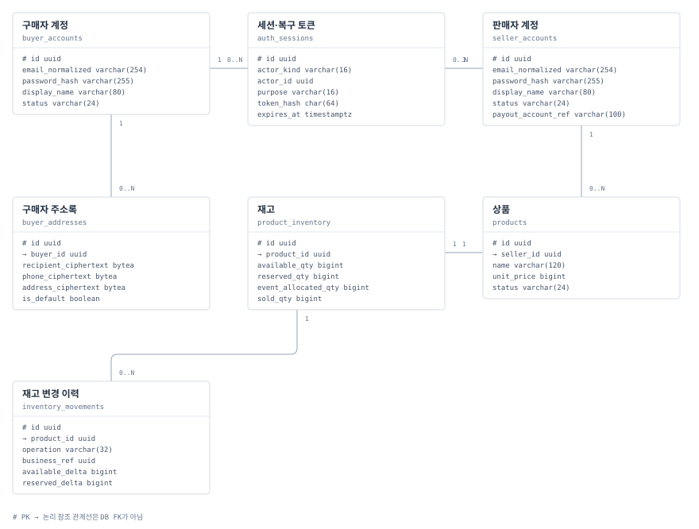
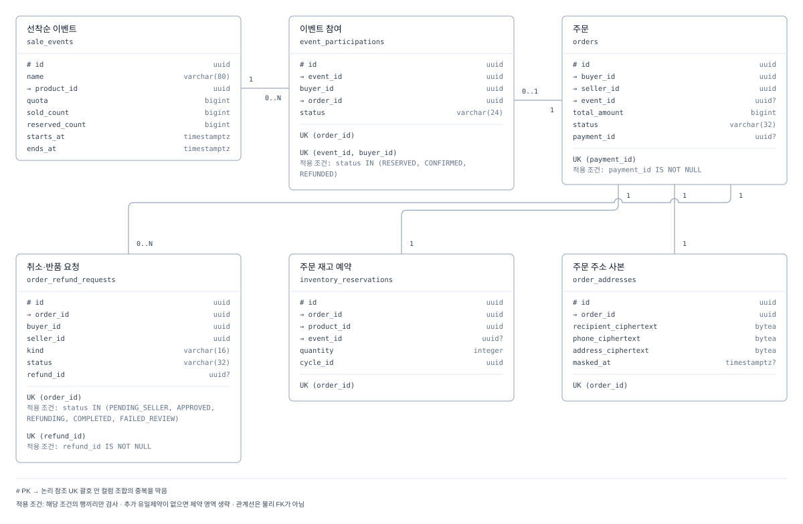
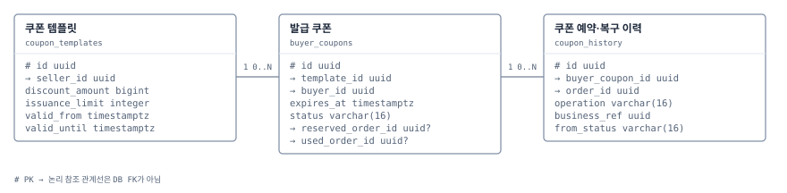
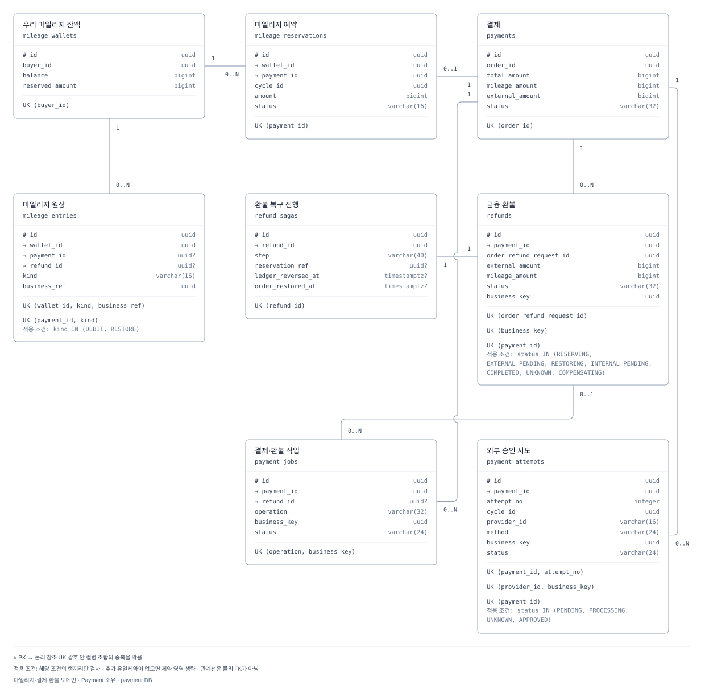
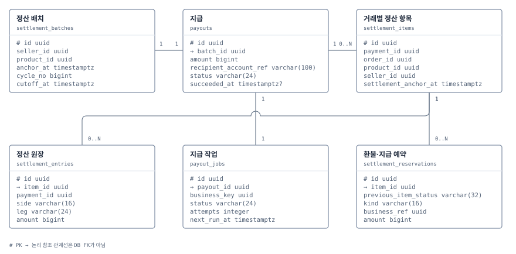
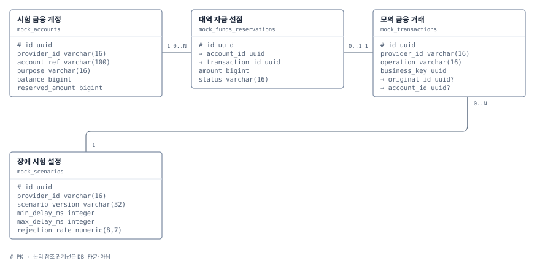
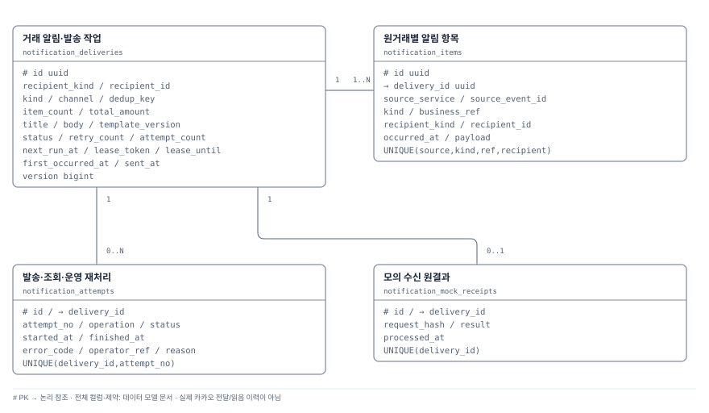
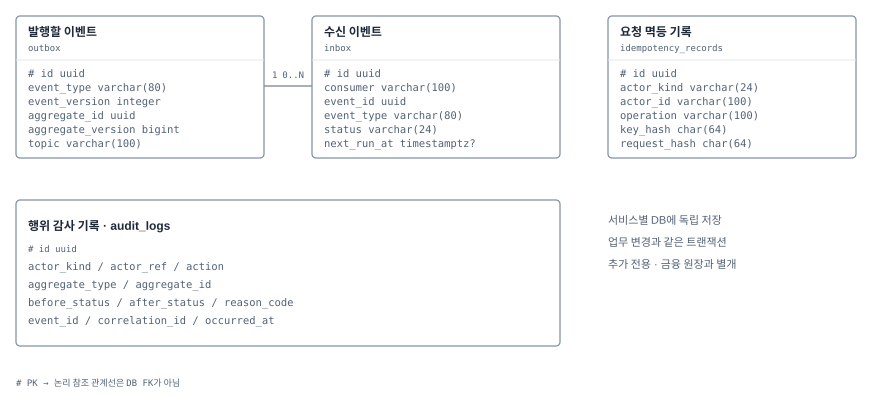

# 데이터 모델

서비스별 PostgreSQL과 [Redis 인증 데이터](#redis-인증-데이터)의 설계입니다. PostgreSQL의 물리 FK는 만들지 않고 아래 관계를 애플리케이션에서 검증합니다. 공통 시간 컬럼은 [시간 정보와 감사 기록](architecture.md#시간-정보와-감사-기록)에 따라 채웁니다. 생성/수정 시각과 행위 감사 로그는 별개입니다. 식별자는 서버 생성 UUID, 금액·누적 수량은 bigint, PostgreSQL 시각은 UTC `timestamptz`입니다. `?`는 nullable, 나머지 컬럼은 NOT NULL입니다. 숫자 버전은 0부터 시작하고 조건부 갱신마다 증가합니다. 실제 Flyway migration은 아직 없으며 [DB 변경 정책](migrations.md)을 따릅니다.

아래 컬럼·제약·인덱스가 기준이고 ERD는 주요 필드와 관계를 요약합니다. 각 뷰는 같은 DB 안의 관계를 보여주며 외부 서비스 ID는 값으로만 저장합니다. 주소·연락처는 별도 암호화 사본이고 금융 이벤트에 포함하지 않습니다.

소유 표기의 `commerce`는 커머스 앱과 그 앱이 소유한 DB·계정·스키마 이름입니다. 판매자 계정·컬럼의 `seller`는 업무 식별자입니다.

## 계정·상품

### buyer_accounts

소유: `commerce`. 구매자 계정.

| 컬럼 | 타입 | 의미 |
| --- | --- | --- |
| `id` | `uuid` | PK; 서버 생성 |
| `email_normalized` | `varchar(254)` | 업무 값 |
| `password_hash` | `varchar(255)` | 업무 값 |
| `display_name` | `varchar(80)` | 업무 값 |
| `status` | `varchar(24)` | 업무 값 |
| `auth_version` | `bigint` | 인증 버전; 기본 0 |
| `created_at` | `timestamptz` | NOT NULL |
| `updated_at` | `timestamptz` | NOT NULL |
| `version` | `bigint` | NOT NULL; 낙관적 버전 |
| `deleted_at` | `timestamptz?` | 논리삭제 |

**제약:** UNIQUE(email_normalized), 삭제 뒤에도 유지. status=ACTIVE/SUSPENDED/DELETED. auth_version은 인증에 영향 주는 계정 상태·비밀번호 변경과 가드 복구 때 증가하며 일반 엔티티 version과 구분한다.

**인덱스:** (status,id).

### password_reset_tokens

소유: `commerce`. PostgreSQL의 일회용 비밀번호 복구 토큰. 로그인 세션은 Redis에 저장한다.

| 컬럼 | 타입 | 의미 |
| --- | --- | --- |
| `id` | `uuid` | PK; 서버 생성 |
| `actor_kind` | `varchar(16)` | 업무 값 |
| `actor_id` | `uuid` | 업무 값 |
| `purpose` | `varchar(16)` | 업무 값 |
| `token_hash` | `char(64)` | 업무 값 |
| `expires_at` | `timestamptz` | 업무 값 |
| `consumed_at` | `timestamptz?` | 업무 값 |
| `revoked_at` | `timestamptz?` | 업무 값 |
| `delivery_ciphertext` | `bytea?` | 복구전달용암호문 |
| `delivery_status` | `varchar(16)?` | 업무 값 |
| `created_at` | `timestamptz` | NOT NULL |
| `updated_at` | `timestamptz` | NOT NULL |
| `version` | `bigint` | NOT NULL; 낙관적 버전 |

**제약:** UNIQUE(token_hash). actor_kind=BUYER/SELLER, purpose=PASSWORD_RESET. 목적·종류·10분 만료·소비/폐기를 DB에서 검사한다. 발급은 계정 잠금 아래 이전 복구 토큰을 폐기한다. 비밀번호 교체·토큰 소비·다른 복구 토큰 폐기·auth_version 증가는 같은 DB 트랜잭션이며 Redis 세션 폐기는 [정책의 차단·재조정](policies.md#폐기와-저장소-복구)을 따른다.

**인덱스:** (actor_kind,actor_id,purpose); (expires_at).

### seller_accounts

소유: `commerce`. 판매자 계정.

| 컬럼 | 타입 | 의미 |
| --- | --- | --- |
| `id` | `uuid` | PK; 서버 생성 |
| `email_normalized` | `varchar(254)` | 업무 값 |
| `password_hash` | `varchar(255)` | 업무 값 |
| `display_name` | `varchar(80)` | 업무 값 |
| `status` | `varchar(24)` | 업무 값 |
| `auth_version` | `bigint` | 인증 버전; 기본 0 |
| `payout_account_ref` | `varchar(100)` | 업무 값 |
| `created_at` | `timestamptz` | NOT NULL |
| `updated_at` | `timestamptz` | NOT NULL |
| `version` | `bigint` | NOT NULL; 낙관적 버전 |
| `deleted_at` | `timestamptz?` | 논리삭제 |

**제약:** UNIQUE(email_normalized), 구매자 계정과 별도. status=ACTIVE/SUSPENDED/DELETED. 지급 계정은 시험용 참조. auth_version은 인증에 영향 주는 계정 상태·비밀번호 변경과 가드 복구 때 증가하며 일반 엔티티 version과 구분한다.

**인덱스:** (status,id).

### buyer_addresses

소유: `commerce`. 구매자 주소록.

| 컬럼 | 타입 | 의미 |
| --- | --- | --- |
| `id` | `uuid` | PK; 서버 생성 |
| `buyer_id` | `uuid` | →buyer_accounts.id |
| `recipient_ciphertext` | `bytea` | 업무 값 |
| `phone_ciphertext` | `bytea` | 업무 값 |
| `address_ciphertext` | `bytea` | 업무 값 |
| `is_default` | `boolean` | 업무 값 |
| `created_at` | `timestamptz` | NOT NULL |
| `updated_at` | `timestamptz` | NOT NULL |
| `version` | `bigint` | NOT NULL; 낙관적 버전 |
| `deleted_at` | `timestamptz?` | 논리삭제 |

**제약:** 부분 UNIQUE(buyer_id) WHERE is_default AND deleted_at IS NULL. 타인 주소 접근 금지.

**인덱스:** (buyer_id,deleted_at,created_at,id).

### product_inventory

소유: `commerce`. 재고.

| 컬럼 | 타입 | 의미 |
| --- | --- | --- |
| `id` | `uuid` | PK; 서버 생성 |
| `product_id` | `uuid` | →products.id |
| `available_qty` | `bigint` | 업무 값 |
| `reserved_qty` | `bigint` | 업무 값 |
| `event_allocated_qty` | `bigint` | 업무 값 |
| `sold_qty` | `bigint` | 업무 값 |
| `created_at` | `timestamptz` | NOT NULL |
| `updated_at` | `timestamptz` | NOT NULL |
| `version` | `bigint` | NOT NULL; 낙관적 버전 |

**제약:** UNIQUE(product_id). 모든 수량>=0. 공개·일반 주문·이벤트 수량 배정은 동일 재고 행 잠금 순서를 사용.

**인덱스:** UNIQUE(product_id).

### products

소유: `commerce`. 상품.

| 컬럼 | 타입 | 의미 |
| --- | --- | --- |
| `id` | `uuid` | PK; 서버 생성 |
| `seller_id` | `uuid` | →seller_accounts.id |
| `name` | `varchar(120)` | 업무 값 |
| `unit_price` | `bigint` | 업무 값 |
| `status` | `varchar(24)` | 업무 값 |
| `created_at` | `timestamptz` | NOT NULL |
| `updated_at` | `timestamptz` | NOT NULL |
| `version` | `bigint` | NOT NULL; 낙관적 버전 |
| `deleted_at` | `timestamptz?` | 논리삭제 |

**제약:** CHECK(1<=unit_price AND unit_price<=10000000). status=DRAFT/ON_SALE/STOPPED/DELETED.

**인덱스:** (seller_id,status,created_at,id); (status,created_at,id).

### inventory_movements

소유: `commerce`. 재고 변경 이력.

| 컬럼 | 타입 | 의미 |
| --- | --- | --- |
| `id` | `uuid` | PK; 서버 생성 |
| `product_id` | `uuid` | →products.id |
| `operation` | `varchar(32)` | 업무 값 |
| `business_ref` | `uuid` | 업무 값 |
| `available_delta` | `bigint` | 업무 값 |
| `reserved_delta` | `bigint` | 업무 값 |
| `allocated_delta` | `bigint` | 업무 값 |
| `sold_delta` | `bigint` | 업무 값 |
| `reason` | `varchar(200)` | 업무 값 |
| `created_at` | `timestamptz` | NOT NULL |

**제약:** UNIQUE(product_id,operation,business_ref). 증감과 현재 재고를 같은 트랜잭션으로 기록.

**인덱스:** (product_id,created_at,id).

## Redis 인증 데이터

소유: 커머스 인증 영역. Gateway는 읽기 전용으로 검증하며 [세션 정책](policies.md#인증공통-api-기준)을 따른다. 아래 구조는 PostgreSQL 테이블이 아니며 시간은 UTC ISO 8601 문자열, 인증 버전은 0 이상의 정수다. 토큰 원문은 저장하지 않는다.

### 로그인 세션

키는 `commerce-settle:auth:session:<epoch>:<tokenHash>`다. epoch는 배포한 인증 세대 UUID, tokenHash는 256비트 이상 임의 토큰의 SHA-256이다.

| 필드 | 타입 | 의미 |
| --- | --- | --- |
| `actorKind` | `string` | BUYER/SELLER |
| `actorId` | `uuid` | 해당 종류의 PostgreSQL 계정 ID |
| `purpose` | `string` | SESSION |
| `authVersion` | `integer` | 발급 당시 계정의 auth_version |
| `issuedAt` | `string` | 서버 발급 시각 |
| `expiresAt` | `string` | issuedAt+30분; 변경 불가 |

**제약:** TTL은 expiresAt까지 남은 시간이다. 조회로 연장하지 않는다. 현재 세대·목적·만료와 아래 ACTIVE 가드의 인증 버전을 원자적으로 검증한다. 세션 또는 가드 누락 시 허용하지 않으며 PostgreSQL에서 세션을 재생성하지 않는다.

### 계정별 인증 가드

키는 `commerce-settle:auth:subject:<epoch>:<actorKind>:<actorId>`다. 개별 세션 목록을 스캔하지 않고 해당 계정 종류·ID의 전체 세션을 차단한다.

| 필드 | 타입 | 의미 |
| --- | --- | --- |
| `authVersion` | `integer` | PostgreSQL에서 확정한 auth_version |
| `state` | `string` | ACTIVE/BLOCKED; 정지·삭제·변경 중이면 BLOCKED |
| `pendingChangeId` | `uuid?` | 진행 중인 인증 변경의 동일성·재조정 기준; 확정 반영 뒤 null |

**제약:** 가드는 현재 세대에서 TTL로 만료시키지 않는다. 최초 로그인에서 DB 계정 상태·인증 버전을 확인해 없는 가드를 조건부 생성할 수 있으나, 기존 BLOCKED 가드를 로그인으로 열지 않는다. 폐기는 가드의 상태·인증 버전·pendingChangeId를 조건부 변경해 직렬화한다. DB 확정 상태 반영은 같은 변경만 허용하고 이전 버전의 지연 반영을 거절한다. 확정 정지/삭제 가드는 BLOCKED·pendingChangeId=null이며 401, 변경 중 가드·유효 세션의 가드 누락·Redis 검증 오류·복구 중 요청은 503이다. 재접속 때 이전 세션 세대를 계속 사용하지 않는다.

## 주문·선착순 이벤트

### sale_events

소유: `commerce`. 선착순 이벤트.

| 컬럼 | 타입 | 의미 |
| --- | --- | --- |
| `id` | `uuid` | PK; 서버 생성 |
| `seller_id` | `uuid` | →seller_accounts.id |
| `product_id` | `uuid` | →products.id |
| `name` | `varchar(80)` | 업무 값 |
| `event_price` | `bigint` | 업무 값 |
| `quota` | `bigint` | 업무 값 |
| `sold_count` | `bigint` | 업무 값 |
| `reserved_count` | `bigint` | 업무 값 |
| `starts_at` | `timestamptz` | 업무 값 |
| `ends_at` | `timestamptz` | 업무 값 |
| `status` | `varchar(24)` | 업무 값 |
| `published_at` | `timestamptz?` | 업무 값 |
| `closed_at` | `timestamptz?` | 업무 값 |
| `created_at` | `timestamptz` | NOT NULL |
| `updated_at` | `timestamptz` | NOT NULL |
| `version` | `bigint` | NOT NULL; 낙관적 버전 |

**제약:** name 1..80자, quota>0, event_price 1..10000000, 0<=S+R<=Q, starts_at<ends_at. status=DRAFT/SCHEDULED/OPEN/SOLD_OUT/CLOSED. 공개 후 사본 불변, 상품별 공개 기간 중복 검사는 product_inventory 잠금 아래 수행.

**인덱스:** (product_id,starts_at,ends_at); (status,starts_at,ends_at); (seller_id,created_at,id).

### event_participations

소유: `commerce`. 이벤트 참여.

| 컬럼 | 타입 | 의미 |
| --- | --- | --- |
| `id` | `uuid` | PK; 서버 생성 |
| `event_id` | `uuid` | →sale_events.id |
| `buyer_id` | `uuid` | 업무 값 |
| `order_id` | `uuid` | →orders.id |
| `status` | `varchar(24)` | 업무 값 |
| `created_at` | `timestamptz` | NOT NULL |
| `updated_at` | `timestamptz` | NOT NULL |
| `version` | `bigint` | NOT NULL; 낙관적 버전 |

**제약:** UNIQUE(order_id). 부분 UNIQUE(event_id,buyer_id) WHERE status IN (RESERVED,CONFIRMED,REFUNDED). 실패/안전 취소=RELEASED만 재참여 가능.

**인덱스:** (event_id,status); (buyer_id,created_at,id).

### orders

소유: `commerce`. 주문.

| 컬럼 | 타입 | 의미 |
| --- | --- | --- |
| `id` | `uuid` | PK; 서버 생성 |
| `buyer_id` | `uuid` | →buyer_accounts.id |
| `seller_id` | `uuid` | →seller_accounts.id |
| `product_id` | `uuid` | →products.id |
| `event_id` | `uuid?` | →sale_events.id |
| `buyer_coupon_id` | `uuid?` | →buyer_coupons.id |
| `payment_id` | `uuid?` | 외부Payment참조 |
| `product_name` | `varchar(120)` | 업무 값 |
| `unit_price` | `bigint` | 업무 값 |
| `quantity` | `integer` | 업무 값 |
| `gross_amount` | `bigint` | 업무 값 |
| `coupon_amount` | `bigint` | S+P; 표시용 총할인액 |
| `seller_coupon_amount` | `bigint` | S; 판매자 부담 할인 |
| `platform_coupon_amount` | `bigint` | P; 플랫폼 부담 지원 |
| `settlement_base_amount` | `bigint` | B=G−S; 수수료·정산 기준 |
| `total_amount` | `bigint` | 업무 값 |
| `mileage_amount` | `bigint` | 업무 값 |
| `external_amount` | `bigint` | 업무 값 |
| `payment_cycle_id` | `uuid` | 업무 값 |
| `external_method` | `varchar(24)?` | 업무 값 |
| `provider_id` | `varchar(16)?` | 업무 값 |
| `method_account_ref` | `varchar(100)?` | 시험용 |
| `status` | `varchar(32)` | 업무 값 |
| `fulfillment_status` | `varchar(24)` | UNSHIPPED/SHIPPED/DELIVERED/RETURN_RECEIVED |
| `simulation_seed` | `bigint` | 주문별 배송 소요일을 정한 시험 seed |
| `delivery_business_days` | `integer` | 생성 때 고정한 2 또는 3 |
| `delivery_calendar_version` | `varchar(32)` | 불변 시험 달력 버전 |
| `delivery_calendar` | `jsonb` | 시간대·공휴일 목록 사본 |
| `shipped_at` | `timestamptz?` | 최초 서버 발송 시각 |
| `delivery_due_at` | `timestamptz?` | 발송 당시 계산한 모의 도착 시각 |
| `delivered_at` | `timestamptz?` | 배송완료 반영 시 delivery_due_at을 복사 |
| `payment_confirmed_at` | `timestamptz?` | 업무 값 |
| `refund_deadline_at` | `timestamptz?` | 업무 값 |
| `purchase_confirmed_at` | `timestamptz?` | 업무 값 |
| `payment_wait_until` | `timestamptz` | 업무 값 |
| `policy_version` | `varchar(32)` | 업무 값 |
| `created_at` | `timestamptz` | NOT NULL |
| `updated_at` | `timestamptz` | NOT NULL |
| `version` | `bigint` | NOT NULL; 낙관적 버전 |

**제약:** G=unit_price*quantity, D=S+P, B=G-S, T=B-P=E+M; 1<=T<=10000000, S/P>=0이고 최대 하나만 양수, 0<=D<G, 0<=M<=T, E>=0. buyer_coupon_id가 있으면 M=0. 쿠폰의 결제수단·소유권·예산 예약을 함께 검사. 일반 quantity 1..10; event_id가 있으면1. Payment 연결 ID는 알려진 경우 UNIQUE. 상태 전이는 아래 표.

배송 소요일·seed·달력 사본은 생성 후 불변입니다. 발송/도착 예정 시각은 함께 설정하고 발송 재요청으로 바꾸지 않습니다. 배송완료 시 delivered_at=delivery_due_at, refund_deadline_at=delivered_at+168시간을 함께 저장합니다. 배송 전 deadline은 NULL이며 진행 중 취소·반품·환불은 자동 구매확정을 막습니다. 늦은 배송 작업과 환불 접수도 같은 주문 잠금으로 기한을 검사합니다.

**인덱스:** (buyer_id,created_at,id); (seller_id,created_at,id); (fulfillment_status,delivery_due_at,id); (status,refund_deadline_at,id); UNIQUE(payment_id) WHERE payment_id IS NOT NULL.

### order_refund_requests

소유: `commerce`. 취소·반품 요청.

| 컬럼 | 타입 | 의미 |
| --- | --- | --- |
| `id` | `uuid` | PK; 서버 생성 |
| `order_id` | `uuid` | →orders.id |
| `buyer_id` | `uuid` | 업무 값 |
| `seller_id` | `uuid` | 업무 값 |
| `kind` | `varchar(16)` | 업무 값 |
| `status` | `varchar(32)` | 업무 값 |
| `accepted_at` | `timestamptz` | 업무 값 |
| `reason` | `varchar(200)` | 업무 값 |
| `refund_id` | `uuid?` | 외부Payment참조 |
| `decision_at` | `timestamptz?` | 업무 값 |
| `received_at` | `timestamptz?` | 업무 값 |
| `closed_reason` | `varchar(200)?` | 업무 값 |
| `closure_evidence_ref` | `varchar(200)?` | 업무 값 |
| `created_at` | `timestamptz` | NOT NULL |
| `updated_at` | `timestamptz` | NOT NULL |
| `version` | `bigint` | NOT NULL; 낙관적 버전 |

**제약:** 부분 UNIQUE(order_id) WHERE status IN (PENDING_SELLER,APPROVED,REFUNDING,COMPLETED,FAILED_REVIEW). status=PENDING_SELLER/APPROVED/REFUNDING/COMPLETED/REJECTED/WITHDRAWN/FAILED_REVIEW/CLOSED. 재고 재입고는 received_at과 원복 유일성으로 보호.

**인덱스:** (order_id,created_at,id); (seller_id,status,created_at,id); UNIQUE(refund_id) WHERE refund_id IS NOT NULL.

### inventory_reservations

소유: `commerce`. 주문 재고 예약.

| 컬럼 | 타입 | 의미 |
| --- | --- | --- |
| `id` | `uuid` | PK; 서버 생성 |
| `order_id` | `uuid` | →orders.id |
| `product_id` | `uuid` | →products.id |
| `event_id` | `uuid?` | →sale_events.id |
| `quantity` | `integer` | 업무 값 |
| `cycle_id` | `uuid` | 업무 값 |
| `status` | `varchar(24)` | 업무 값 |
| `expires_at` | `timestamptz` | 업무 값 |
| `created_at` | `timestamptz` | NOT NULL |
| `updated_at` | `timestamptz` | NOT NULL |
| `version` | `bigint` | NOT NULL; 낙관적 버전 |

**제약:** UNIQUE(order_id). quantity>0. status=RESERVED/CONSUMED/RELEASED/RESTORED. 기한만으로 RELEASED 전이 금지.

**인덱스:** (status,expires_at,id); (product_id,status).

### order_addresses

소유: `commerce`. 주문 주소 사본.

| 컬럼 | 타입 | 의미 |
| --- | --- | --- |
| `id` | `uuid` | PK; 서버 생성 |
| `order_id` | `uuid` | →orders.id |
| `recipient_ciphertext` | `bytea` | 업무 값 |
| `phone_ciphertext` | `bytea` | 업무 값 |
| `address_ciphertext` | `bytea` | 업무 값 |
| `masked_at` | `timestamptz?` | 업무 값 |
| `hold_reason` | `varchar(200)?` | 업무 값 |
| `created_at` | `timestamptz` | NOT NULL |
| `updated_at` | `timestamptz` | NOT NULL |
| `version` | `bigint` | NOT NULL; 낙관적 버전 |

**제약:** UNIQUE(order_id). 주문 생성 후 사본 불변, 정한 마스킹/보존 보류만 허용.

**인덱스:** UNIQUE(order_id).

## 쿠폰

### coupon_templates

소유: `commerce`. 발급 당시 혜택 조건과 할인 비용 집계. WELCOME는 가입 시, GRADE는 월 배치가 서버 규칙으로 자동 생성합니다. 판매자 API는 SELLER 템플릿만 생성합니다.

| 컬럼 | 타입 | 의미 |
| --- | --- | --- |
| `id` | `uuid` | PK; 서버 생성 |
| `kind` | `varchar(16)` | WELCOME/GRADE/SELLER |
| `funder` | `varchar(16)` | PLATFORM/SELLER; 종류에서 서버가 결정 |
| `seller_id` | `uuid?` | SELLER에만 필요 |
| `product_id` | `uuid?` | SELLER의 지정 상품; null이면 판매자 전체 |
| `grade` | `varchar(16)?` | GRADE 선정자에게 적용할 BRONZE/SILVER/GOLD 혜택 |
| `target_month` | `date?` | GRADE 혜택 월의 첫날; WELCOME/SELLER는 null |
| `name` | `varchar(80)` | 표시명 |
| `discount_amount` | `bigint` | 정액 할인 |
| `min_order_amount` | `bigint` | 적용 전 최소 상품대금 |
| `min_seller_net_amount` | `bigint` | SELLER가 승인한 최소 정산액; 플랫폼 캠페인은 0 |
| `allowed_methods` | `varchar(24)[]` | 승인된 CREDIT_CARD/DEBIT_CARD/EASY_PAY |
| `pg_cost_ceiling_bps` | `integer` | PG 비용 상한; 기본 400bp |
| `other_cost_allowance` | `bigint` | 주문당 기타 비용 충당액; 기본 1,000원 |
| `issuance_limit` | `integer?` | SELLER가 정한 발급 수 한도; 플랫폼 종류는 null |
| `issued_count` | `integer` | 누적 발급 수 |
| `total_budget` | `bigint?` | SELLER가 정한 명목 할인 예산; 플랫폼 종류는 null |
| `committed_budget` | `bigint` | 발급했으나 아직 사용하지 않은 약속액 |
| `consumed_budget` | `bigint` | 사용 누계에서 확정 환불 상쇄를 뺀 금액 |
| `valid_from` | `timestamptz` | 신규 발급 시작 |
| `valid_until` | `timestamptz?` | SELLER의 종료 시각, GRADE의 월말 경계; WELCOME는 null |
| `status` | `varchar(16)` | ACTIVE/CLOSED |
| `created_at` | `timestamptz` | NOT NULL |
| `updated_at` | `timestamptz` | NOT NULL |
| `version` | `bigint` | 낙관적 버전 |

**제약:** 할인액>0, 할인액<min_order_amount<=10000000. issued_count·committed_budget·consumed_budget는 비음수입니다. SELLER는 양수인 issuance_limit·total_budget와 valid_until이 필수이며 issued_count<=issuance_limit, committed_budget+consumed_budget<=total_budget를 보호합니다. WELCOME/GRADE는 두 상한이 null이고 비용 집계만 수행합니다. WELCOME/GRADE는 funder=PLATFORM이고 seller_id/product_id는 null; SELLER는 funder=SELLER이고 seller_id 필수입니다. grade와 target_month는 GRADE에만 필요하고 나머지 종류는 null입니다. WELCOME의 발급 기간은 종료 없이 유지하고 쿠폰 기한은 가입+14일로 정합니다. GRADE의 기간은 혜택 월입니다. 상품 소유·사용 수단·손익 하한·최소 정산액은 서버가 검증합니다. 발급 뒤 혜택 조건은 변경하지 않습니다.

**인덱스:** (seller_id,status,created_at,id); (kind,target_month,status). 활성 WELCOME 캠페인은 전체 한 개, GRADE는 (grade,target_month)에 부분 UNIQUE. SELLER의 월별 UNIQUE는 두지 않습니다.

### buyer_coupons

소유: `commerce`. 발급 당시 조건과 예산 약속을 보존한 쿠폰.

| 컬럼 | 타입 | 의미 |
| --- | --- | --- |
| `id` | `uuid` | PK; 서버 생성 |
| `template_id` | `uuid` | →coupon_templates.id |
| `buyer_id` | `uuid` | →buyer_accounts.id |
| `kind` | `varchar(16)` | WELCOME/GRADE/SELLER |
| `funder` | `varchar(16)` | PLATFORM/SELLER |
| `seller_id` | `uuid?` | SELLER에만 값 |
| `product_id` | `uuid?` | SELLER 지정 상품 |
| `target_month` | `date?` | GRADE의 발급 업무 키; WELCOME/SELLER는 null |
| `discount_amount` | `bigint` | 원할인 사본 |
| `min_order_amount` | `bigint` | 최소 상품대금 사본 |
| `allowed_methods` | `varchar(24)[]` | 사용 수단 사본 |
| `valid_from` | `timestamptz` | 사용 시작 |
| `expires_at` | `timestamptz` | WELCOME=가입+14일, GRADE=다음 달 1일 00:00 KST, SELLER=템플릿 종료 |
| `status` | `varchar(16)` | ISSUED/RESERVED/USED/EXPIRED |
| `reserved_order_id` | `uuid?` | →orders.id |
| `used_order_id` | `uuid?` | →orders.id |
| `created_at` | `timestamptz` | NOT NULL |
| `updated_at` | `timestamptz` | NOT NULL |
| `version` | `bigint` | 낙관적 버전 |

**제약:** UNIQUE(template_id,buyer_id). WELCOME는 buyer_id, GRADE는 (buyer_id,target_month)에 종류별 부분 UNIQUE. SELLER는 캠페인별 유일성만 적용하고 다른 캠페인의 쿠폰도 발급할 수 있습니다. 발급 수 증가·할인 약속액 반영·쿠폰 저장은 같은 트랜잭션입니다. 판매자 상한은 SELLER 발급에만 검사합니다. 원할인·부담자·기간·수단은 불변이며 상태와 시각을 함께 검사합니다. 재가입·캠페인 교체로 발급 이력을 지우지 않습니다.

**인덱스:** (buyer_id,status,expires_at,id); UNIQUE(reserved_order_id) WHERE NOT NULL; UNIQUE(used_order_id) WHERE NOT NULL.

### coupon_history

소유: `commerce`. 발급·예약·사용·복구·만료와 예산 이동 이력.

| 컬럼 | 타입 | 의미 |
| --- | --- | --- |
| `id` | `uuid` | PK; 서버 생성 |
| `buyer_coupon_id` | `uuid` | →buyer_coupons.id |
| `order_id` | `uuid?` | 발급·미사용 만료는 null |
| `operation` | `varchar(16)` | ISSUE/RESERVE/USE/RELEASE/RESTORE/EXPIRE |
| `business_ref` | `uuid` | 발급 대상·결제 회차·원결제·만료의 업무 키 |
| `from_status` | `varchar(16)?` | ISSUE는 null |
| `to_status` | `varchar(16)` | 전이 결과 |
| `committed_delta` | `bigint` | 약속액 증감 |
| `consumed_delta` | `bigint` | 사용액 증감 |
| `created_at` | `timestamptz` | NOT NULL |

**제약:** UNIQUE(buyer_coupon_id,operation,business_ref). RESERVE/RELEASE는 payment_cycle_id별, USE/RESTORE는 원결제별 한 번. 쿠폰 상태·할인 비용 집계·이력을 같은 트랜잭션으로 반영하고 미확정 결과로 약속액을 해제하지 않습니다.

**인덱스:** (buyer_coupon_id,created_at,id).

### coupon_issue_runs

소유: `commerce`. 플랫폼 월간 우수고객의 대상 고정과 재시작 가능한 발급 작업. 판매자 자유 발급은 포함하지 않습니다.

| 컬럼 | 타입 | 의미 |
| --- | --- | --- |
| `id` | `uuid` | PK |
| `target_month` | `date` | UNIQUE; 혜택 월 첫날 |
| `cutoff_at` | `timestamptz` | 대상 구매확정 반영 마감 |
| `target_count` | `integer?` | 동점자 포함 선정 인원; 대상 고정 전 null |
| `cutoff_spend` | `bigint?` | 선정 대상의 최저 E 합계; 대상 고정 전·대상 없음은 null |
| `status` | `varchar(24)` | PREPARING/ISSUING/COMPLETED/EXPIRED |
| `created_at` | `timestamptz` | NOT NULL |
| `updated_at` | `timestamptz` | NOT NULL |
| `version` | `bigint` | 낙관적 버전 |

스케줄러가 매월 1일 00:10 KST부터 생성·실행하고 미완료 회차를 10분마다 자동 재시도합니다. 플랫폼 전체 E 합계>0인 구매자의 금액 순위 100위까지 동점자를 포함해 저장합니다. 대상 고정 뒤 target_count는 대상 행 수와 같고 cutoff_spend는 그 최저 금액입니다. 대상이 없으면 0/null로 완료합니다. 대상·해당 월 등급별 템플릿의 생성과 고정을 마친 뒤 ISSUING으로 전이합니다. 예정 할인 총액은 고정한 대상별 템플릿 할인액의 합이며 사전 예산 승인과 비교하지 않습니다. 오류가 나면 현재 단계·처리 결과를 유지하고 같은 run·대상을 재개합니다. 원자료가 없으면 발급하지 않고 재시도하며 만료 뒤에는 EXPIRED로 종결합니다.

### coupon_issue_targets

소유: `commerce`. 같은 회차의 플랫폼 월간 우수고객과 처리 결과.

| 컬럼 | 타입 | 의미 |
| --- | --- | --- |
| `id` | `uuid` | PK; 발급 업무 키 |
| `run_id` | `uuid` | →coupon_issue_runs.id |
| `template_id` | `uuid` | →coupon_templates.id |
| `buyer_id` | `uuid` | →buyer_accounts.id |
| `external_spend` | `bigint` | 고정한 대상 기간의 E 합계 |
| `rank_no` | `integer` | E 합계 내림차순 RANK; 1~100, 동점은 같은 순위 |
| `buyer_coupon_id` | `uuid?` | 처리된 원쿠폰 |
| `status` | `varchar(24)` | PENDING/ISSUED/EXPIRED |
| `created_at` | `timestamptz` | NOT NULL |
| `updated_at` | `timestamptz` | NOT NULL |
| `version` | `bigint` | 낙관적 버전 |

**제약:** UNIQUE(run_id,buyer_id), UNIQUE(buyer_coupon_id) WHERE buyer_coupon_id IS NOT NULL. template_id는 해당 월·등급의 GRADE 캠페인이며 external_spend>0, 1<=rank_no<=100입니다. 동점자 때문에 행 수가 100을 넘을 수 있습니다. 월별 마감의 불변 확정·취소 이력으로 대상과 합계를 고정합니다. 만료 뒤 재개는 새 쿠폰을 만들지 않고 EXPIRED로 종결합니다. 같은 대상 재시도는 원쿠폰을 재사용하며 PENDING 대상만 이어서 처리합니다. 쿠폰·발급 이력·대상 ISSUED 전이는 같은 DB 트랜잭션으로 반영합니다.

## 결제·마일리지

### mileage_wallets

소유: `payment`. 우리 마일리지 잔액.

| 컬럼 | 타입 | 의미 |
| --- | --- | --- |
| `id` | `uuid` | PK; 서버 생성 |
| `buyer_id` | `uuid` | 업무 값 |
| `balance` | `bigint` | 업무 값 |
| `reserved_amount` | `bigint` | 업무 값 |
| `created_at` | `timestamptz` | NOT NULL |
| `updated_at` | `timestamptz` | NOT NULL |
| `version` | `bigint` | NOT NULL; 낙관적 버전 |

**제약:** UNIQUE(buyer_id). CHECK(0<=reserved_amount AND reserved_amount<=balance). 갱신은 행 잠금/조건부 갱신.

**인덱스:** UNIQUE(buyer_id).

### mileage_reservations

소유: `payment`. 마일리지 예약.

| 컬럼 | 타입 | 의미 |
| --- | --- | --- |
| `id` | `uuid` | PK; 서버 생성 |
| `wallet_id` | `uuid` | →mileage_wallets.id |
| `payment_id` | `uuid` | →payments.id |
| `cycle_id` | `uuid` | 업무 값 |
| `amount` | `bigint` | 업무 값 |
| `status` | `varchar(16)` | 업무 값 |
| `created_at` | `timestamptz` | NOT NULL |
| `updated_at` | `timestamptz` | NOT NULL |
| `version` | `bigint` | NOT NULL; 낙관적 버전 |

**제약:** UNIQUE(payment_id), amount>0. status=RESERVED/CONSUMED/RELEASED. 재시도마다 새cycle_id, RESERVE/RELEASE business_ref는cycle_id; DEBIT/RESTORE business_ref는payment_id. 이력은mileage_entries로보존.

**인덱스:** (wallet_id,status); (status,updated_at,id).

### payments

소유: `payment`. 결제.

| 컬럼 | 타입 | 의미 |
| --- | --- | --- |
| `id` | `uuid` | PK; 서버 생성 |
| `order_id` | `uuid` | 외부커머스참조 |
| `buyer_id` | `uuid` | 업무 값 |
| `seller_id` | `uuid` | 업무 값 |
| `order_version` | `bigint` | 업무 값 |
| `product_id` | `uuid` | 업무 값 |
| `current_cycle_id` | `uuid` | 업무 값 |
| `gross_amount` | `bigint` | 업무 값 |
| `coupon_amount` | `bigint` | S+P; 표시용 총할인액 |
| `seller_coupon_amount` | `bigint` | S; 판매자 부담 할인 |
| `platform_coupon_amount` | `bigint` | P; 플랫폼 부담 지원 |
| `settlement_base_amount` | `bigint` | B=G−S; 수수료·정산 기준 |
| `total_amount` | `bigint` | 업무 값 |
| `mileage_amount` | `bigint` | 업무 값 |
| `external_amount` | `bigint` | 업무 값 |
| `fee_amount` | `bigint` | 업무 값 |
| `seller_net_amount` | `bigint` | 업무 값 |
| `status` | `varchar(32)` | 업무 값 |
| `confirmed_at` | `timestamptz?` | 업무 값 |
| `policy_version` | `varchar(32)` | 업무 값 |
| `created_at` | `timestamptz` | NOT NULL |
| `updated_at` | `timestamptz` | NOT NULL |
| `version` | `bigint` | NOT NULL; 낙관적 버전 |

**제약:** UNIQUE(order_id). T=E+M=B-P, fee=floor(B*15/100), seller_net=B-fee; D=S+P, B=G-S, 모두 비음수,T>=1. 쿠폰 사용 시 M=0. 같은 주문 재시도는 같은 결제의 새 attempt.

**인덱스:** (buyer_id,created_at,id); (status,updated_at,id).

### mileage_entries

소유: `payment`. 마일리지 원장.

| 컬럼 | 타입 | 의미 |
| --- | --- | --- |
| `id` | `uuid` | PK; 서버 생성 |
| `wallet_id` | `uuid` | →mileage_wallets.id |
| `payment_id` | `uuid?` | →payments.id |
| `refund_id` | `uuid?` | →refunds.id |
| `kind` | `varchar(16)` | 업무 값 |
| `business_ref` | `uuid` | 업무 값 |
| `amount` | `bigint` | 업무 값 |
| `balance_after` | `bigint` | 업무 값 |
| `created_at` | `timestamptz` | NOT NULL |

**제약:** UNIQUE(wallet_id,kind,business_ref). kind=SEED/RESERVE/RELEASE/DEBIT/RESTORE. amount>0. DEBIT/RESTORE는 원결제별 각각 한 번(부분 UNIQUE).

**인덱스:** (wallet_id,created_at,id); UNIQUE(payment_id,kind) WHERE kind IN (DEBIT,RESTORE).

### refund_sagas

소유: `payment`. 환불 복구 진행.

| 컬럼 | 타입 | 의미 |
| --- | --- | --- |
| `id` | `uuid` | PK; 서버 생성 |
| `refund_id` | `uuid` | →refunds.id |
| `step` | `varchar(40)` | 업무 값 |
| `reservation_ref` | `uuid?` | 업무 값 |
| `ledger_reversed_at` | `timestamptz?` | 업무 값 |
| `order_restored_at` | `timestamptz?` | 업무 값 |
| `last_error_code` | `varchar(80)?` | 업무 값 |
| `created_at` | `timestamptz` | NOT NULL |
| `updated_at` | `timestamptz` | NOT NULL |
| `version` | `bigint` | NOT NULL; 낙관적 버전 |

**제약:** UNIQUE(refund_id). 금융 성공/마일리지 복원/원장 상쇄/주문 복구를 별도 추적. 완료 ack 전 전체 완료 금지.

**인덱스:** (step,updated_at,id).

### refunds

소유: `payment`. 금융 환불.

| 컬럼 | 타입 | 의미 |
| --- | --- | --- |
| `id` | `uuid` | PK; 서버 생성 |
| `payment_id` | `uuid` | →payments.id |
| `order_refund_request_id` | `uuid` | 외부커머스참조 |
| `external_amount` | `bigint` | 업무 값 |
| `mileage_amount` | `bigint` | 업무 값 |
| `status` | `varchar(32)` | 업무 값 |
| `business_key` | `uuid` | 업무 값 |
| `external_status` | `varchar(24)` | 업무 값 |
| `external_ref` | `uuid?` | 업무 값 |
| `mileage_restored_at` | `timestamptz?` | 업무 값 |
| `created_at` | `timestamptz` | NOT NULL |
| `updated_at` | `timestamptz` | NOT NULL |
| `version` | `bigint` | NOT NULL; 낙관적 버전 |

**제약:** UNIQUE(order_refund_request_id), UNIQUE(business_key). 부분 UNIQUE(payment_id) WHERE status IN (RESERVING,EXTERNAL_PENDING,RESTORING,INTERNAL_PENDING,COMPLETED,UNKNOWN,COMPENSATING). 원결제 E/M을 복사해 불변.

**인덱스:** (payment_id,created_at,id); (status,updated_at,id).

### payment_jobs

소유: `payment`. 결제·환불 작업.

| 컬럼 | 타입 | 의미 |
| --- | --- | --- |
| `id` | `uuid` | PK; 서버 생성 |
| `payment_id` | `uuid` | →payments.id |
| `refund_id` | `uuid?` | →refunds.id |
| `operation` | `varchar(32)` | 업무 값 |
| `business_key` | `uuid` | 업무 값 |
| `status` | `varchar(24)` | 업무 값 |
| `attempts` | `integer` | 업무 값 |
| `next_run_at` | `timestamptz` | 업무 값 |
| `lease_owner` | `varchar(100)?` | 업무 값 |
| `lease_until` | `timestamptz?` | 업무 값 |
| `last_error_code` | `varchar(80)?` | 업무 값 |
| `created_at` | `timestamptz` | NOT NULL |
| `updated_at` | `timestamptz` | NOT NULL |
| `version` | `bigint` | NOT NULL; 낙관적 버전 |

**제약:** UNIQUE(operation,business_key). 작업 저장 뒤 메시지 ack. status=PENDING/RUNNING/RETRY/REVIEW_REQUIRED/DONE.

**인덱스:** (status,next_run_at,lease_until,id).

### payment_attempts

소유: `payment`. 외부 승인 시도.

| 컬럼 | 타입 | 의미 |
| --- | --- | --- |
| `id` | `uuid` | PK; 서버 생성 |
| `payment_id` | `uuid` | →payments.id |
| `attempt_no` | `integer` | 업무 값 |
| `cycle_id` | `uuid` | 업무 값 |
| `provider_id` | `varchar(16)` | 업무 값 |
| `method` | `varchar(24)` | 업무 값 |
| `account_ref` | `varchar(100)` | 업무 값 |
| `business_key` | `uuid` | 업무 값 |
| `external_ref` | `uuid?` | 업무 값 |
| `amount` | `bigint` | 업무 값 |
| `status` | `varchar(24)` | 업무 값 |
| `scenario_version` | `varchar(32)?` | 업무 값 |
| `created_at` | `timestamptz` | NOT NULL |
| `updated_at` | `timestamptz` | NOT NULL |
| `version` | `bigint` | NOT NULL; 낙관적 버전 |

**제약:** UNIQUE(payment_id,attempt_no), UNIQUE(provider_id,business_key). 진행 중/성공 시도는 결제별1개(부분 UNIQUE). E>0인 경우만 생성. 상태=PENDING/PROCESSING/UNKNOWN/APPROVED/DECLINED/CANCELLED.

**인덱스:** (status,updated_at,id); UNIQUE(payment_id) WHERE status IN (PENDING,PROCESSING,UNKNOWN,APPROVED).

## 정산·지급

### settlement_batches

소유: `settlement`. 정산 배치.

| 컬럼 | 타입 | 의미 |
| --- | --- | --- |
| `id` | `uuid` | PK; 서버 생성 |
| `seller_id` | `uuid` | 업무 값 |
| `batch_date` | `date` | Asia/Seoul 마감 날짜 |
| `cutoff_at` | `timestamptz` | 업무 값 |
| `policy_version` | `varchar(32)` | 업무 값 |
| `status` | `varchar(24)` | 업무 값 |
| `net_amount` | `bigint` | 업무 값 |
| `created_at` | `timestamptz` | NOT NULL |
| `updated_at` | `timestamptz` | NOT NULL |
| `version` | `bigint` | NOT NULL; 낙관적 버전 |

**제약:** UNIQUE(seller_id,batch_date,policy_version); cutoff_at은 해당 batch_date의 10:00 Asia/Seoul. net_amount>=0, status=CREATED/RESERVED/PROCESSING/COMPLETED/REVIEW_REQUIRED.

**인덱스:** (status,created_at,id).

### payouts

소유: `settlement`. 지급.

| 컬럼 | 타입 | 의미 |
| --- | --- | --- |
| `id` | `uuid` | PK; 서버 생성 |
| `batch_id` | `uuid` | →settlement_batches.id |
| `seller_id` | `uuid` | 업무 값 |
| `recipient_account_ref` | `varchar(100)` | 업무 값 |
| `recipient_account_version` | `bigint` | 업무 값 |
| `funding_account_ref` | `varchar(100)` | 업무 값 |
| `succeeded_at` | `timestamptz?` | 업무 값 |
| `amount` | `bigint` | 업무 값 |
| `business_key` | `uuid` | 업무 값 |
| `external_ref` | `uuid?` | 업무 값 |
| `status` | `varchar(24)` | 업무 값 |
| `hold_reason` | `varchar(32)?` | NON_BUSINESS_DAY/UNKNOWN/CONFIRMED_REJECTION |
| `created_at` | `timestamptz` | NOT NULL |
| `updated_at` | `timestamptz` | NOT NULL |
| `version` | `bigint` | NOT NULL; 낙관적 버전 |

**제약:** UNIQUE(batch_id), UNIQUE(business_key), amount>0. 접수/외부 성공 구분. 수취/출금 계정 사본 불변. SUCCEEDED이면 succeeded_at 필수; 원대역의 최초 성공 시각을 복사해 재조회에도 유지.

**인덱스:** (seller_id,created_at,id); (status,updated_at,id).

### settlement_items

소유: `settlement`. 거래별 정산 항목.

| 컬럼 | 타입 | 의미 |
| --- | --- | --- |
| `id` | `uuid` | PK; 서버 생성 |
| `payment_id` | `uuid` | 업무 값 |
| `order_id` | `uuid` | 업무 값 |
| `product_id` | `uuid` | 업무 값 |
| `seller_id` | `uuid` | 업무 값 |
| `eligible_received_at` | `timestamptz?` | 업무 값 |
| `ready_at` | `timestamptz?` | 구매확정과 선행 원장이 모두 준비된 시각 |
| `total_amount` | `bigint` | T; 구매자 부담액 |
| `platform_coupon_amount` | `bigint` | P; 플랫폼 지원 원금 |
| `settlement_base_amount` | `bigint` | B=T+P |
| `external_amount` | `bigint` | 업무 값 |
| `mileage_amount` | `bigint` | 업무 값 |
| `fee_amount` | `bigint` | 업무 값 |
| `net_amount` | `bigint` | 업무 값 |
| `status` | `varchar(32)` | 업무 값 |
| `purchase_confirmed_at` | `timestamptz?` | 업무 값 |
| `order_version` | `bigint` | 업무 값 |
| `payout_id` | `uuid?` | →payouts.id |
| `created_at` | `timestamptz` | NOT NULL |
| `updated_at` | `timestamptz` | NOT NULL |
| `version` | `bigint` | NOT NULL; 낙관적 버전 |

**제약:** ready_at=max(purchase_confirmed_at,eligible_received_at). UNIQUE(payment_id). T=E+M, B=T+P=fee+net. fee=floor(B*15/100). 플랫폼 지원분을 포함한 선지급 재원은 항상 충분하게 준비. 상태 조건과 예약을 같은 트랜잭션으로 보호.

**인덱스:** (seller_id,status,ready_at,id); (payout_id); UNIQUE(payment_id). 배치는 ready_at<cutoff_at인 미선점 항목을 조회하며 payout_id가 있으면 다른 배치에 배정하지 않습니다.

### settlement_entries

소유: `settlement`. 정산 원장.

| 컬럼 | 타입 | 의미 |
| --- | --- | --- |
| `id` | `uuid` | PK; 서버 생성 |
| `item_id` | `uuid` | →settlement_items.id |
| `payment_id` | `uuid` | 업무 값 |
| `side` | `varchar(16)` | 업무 값 |
| `leg` | `varchar(24)` | 업무 값 |
| `amount` | `bigint` | 업무 값 |
| `business_ref` | `uuid` | 업무 값 |
| `reversal_of` | `uuid?` | →settlement_entries.id |
| `policy_version` | `varchar(32)` | 업무 값 |
| `created_at` | `timestamptz` | NOT NULL |

**제약:** UNIQUE(payment_id,leg,business_ref), UNIQUE(reversal_of) WHERE NOT NULL. SOURCE:EXTERNAL/MILEAGE/PLATFORM_COUPON, ALLOCATION:SELLER/FEE. 각 측 합계=B=E+M+P; 환불은 원항목 반대 부호. 판매자 잔액은 SELLER leg만 집계.

**인덱스:** (item_id,created_at,id); (payment_id,side).

### payout_jobs

소유: `settlement`. 지급 작업.

| 컬럼 | 타입 | 의미 |
| --- | --- | --- |
| `id` | `uuid` | PK; 서버 생성 |
| `payout_id` | `uuid` | →payouts.id |
| `business_key` | `uuid` | 업무 값 |
| `status` | `varchar(24)` | 업무 값 |
| `attempts` | `integer` | 업무 값 |
| `next_run_at` | `timestamptz` | 업무 값 |
| `lease_owner` | `varchar(100)?` | 업무 값 |
| `lease_until` | `timestamptz?` | 업무 값 |
| `created_at` | `timestamptz` | NOT NULL |
| `updated_at` | `timestamptz` | NOT NULL |
| `version` | `bigint` | NOT NULL; 낙관적 버전 |

**제약:** UNIQUE(payout_id), UNIQUE(business_key). 지급 항목 선점·금액·작업 생성 원자 저장. next_run_at은 Payout 응답의 nextAttemptAt 원천입니다. 비영업일 보류는 같은 작업을 재개하고 attempts를 늘리지 않으며 확정 거절은 REVIEW_REQUIRED입니다.

**인덱스:** (status,next_run_at,lease_until,id).

### settlement_reservations

소유: `settlement`. 환불·지급 예약.

| 컬럼 | 타입 | 의미 |
| --- | --- | --- |
| `id` | `uuid` | PK; 서버 생성 |
| `item_id` | `uuid` | →settlement_items.id |
| `previous_item_status` | `varchar(32)` | 업무 값 |
| `kind` | `varchar(16)` | 업무 값 |
| `business_ref` | `uuid` | 업무 값 |
| `amount` | `bigint` | 업무 값 |
| `status` | `varchar(16)` | 업무 값 |
| `payout_id` | `uuid?` | →payouts.id |
| `created_at` | `timestamptz` | NOT NULL |
| `updated_at` | `timestamptz` | NOT NULL |
| `version` | `bigint` | NOT NULL; 낙관적 버전 |

**제약:** UNIQUE(item_id,kind,business_ref). 부분 UNIQUE(item_id) WHERE status=ACTIVE, kind=REFUND/PAYOUT. amount=원항목 net_amount.

**인덱스:** UNIQUE(item_id) WHERE status=ACTIVE; (kind,business_ref,status).

## 금융 Mock

### mock_accounts

소유: `finance_mock`. 시험 금융 계정.

| 컬럼 | 타입 | 의미 |
| --- | --- | --- |
| `id` | `uuid` | PK; 서버 생성 |
| `provider_id` | `varchar(16)` | 업무 값 |
| `account_ref` | `varchar(100)` | 업무 값 |
| `purpose` | `varchar(16)` | 업무 값 |
| `opening_balance` | `bigint` | 시험 계정 생성 때 받은 불변 기초잔액 |
| `balance` | `bigint` | 업무 값 |
| `reserved_amount` | `bigint` | 업무 값 |
| `created_at` | `timestamptz` | NOT NULL |
| `updated_at` | `timestamptz` | NOT NULL |
| `version` | `bigint` | NOT NULL; 낙관적 버전 |

**제약:** UNIQUE(provider_id,account_ref,purpose). CHECK(0<=reserved_amount AND reserved_amount<=balance). purpose=WALLET/PAYOUT. PAYOUT의 balance=opening_balance+해당 계정 cash_entries 합계이며 예약액은 소비 전까지 차감하지 않습니다.

**인덱스:** UNIQUE(provider_id,account_ref,purpose).

### mock_funds_reservations

소유: `finance_mock`. 대역 자금 선점.

| 컬럼 | 타입 | 의미 |
| --- | --- | --- |
| `id` | `uuid` | PK; 서버 생성 |
| `account_id` | `uuid` | →mock_accounts.id |
| `transaction_id` | `uuid` | →mock_transactions.id |
| `amount` | `bigint` | 업무 값 |
| `status` | `varchar(16)` | 업무 값 |
| `created_at` | `timestamptz` | NOT NULL |
| `updated_at` | `timestamptz` | NOT NULL |
| `version` | `bigint` | NOT NULL; 낙관적 버전 |

**제약:** UNIQUE(transaction_id), amount>0, status=RESERVED/CONSUMED/RELEASED. 계정 잔액 검사·선점과 거래 기록 원자 저장.

**인덱스:** (account_id,status).

### mock_transactions

소유: `finance_mock`. 모의 금융 거래.

| 컬럼 | 타입 | 의미 |
| --- | --- | --- |
| `id` | `uuid` | PK; 서버 생성 |
| `provider_id` | `varchar(16)` | 업무 값 |
| `operation` | `varchar(16)` | 업무 값 |
| `business_key` | `uuid` | 업무 값 |
| `original_id` | `uuid?` | →mock_transactions.id |
| `account_id` | `uuid?` | →mock_accounts.id |
| `method` | `varchar(24)?` | 업무 값 |
| `funding_account_id` | `uuid?` | 외부 승인/지급의 PAYOUT 재원 계정 |
| `pg_calendar_version` | `varchar(32)?` | 승인 당시 입금 달력 버전 |
| `pg_calendar` | `jsonb?` | 시간대·공휴일 목록 사본 |
| `pg_receipt_due_at` | `timestamptz?` | 승인 시각+대역별 영업일 |
| `pg_received_at` | `timestamptz?` | 실제 입금/입금 전 환불 상쇄 처리 시각 |
| `pg_received_amount` | `bigint?` | 입금 처리 전 NULL, 처리 뒤 E 또는 0 |
| `amount` | `bigint` | 업무 값 |
| `status` | `varchar(24)` | 업무 값 |
| `succeeded_at` | `timestamptz?` | 업무 값 |
| `scenario_version` | `varchar(32)` | 업무 값 |
| `result_seed` | `bigint` | 업무 값 |
| `created_at` | `timestamptz` | NOT NULL |
| `updated_at` | `timestamptz` | NOT NULL |
| `version` | `bigint` | NOT NULL; 낙관적 버전 |

**제약:** UNIQUE(provider_id,operation,business_key). 진행 중/성공 환불은 original_id별1개(부분 UNIQUE). amount>0. 카드 승인은 내부 잔액 차감 없이 결과만 모의. 최초 SUCCEEDED 시각 succeeded_at을 결과와 원자 저장하고 이후 불변.

원승인당 입금은 한 번이며 입금/환불은 원승인 행 잠금으로 경합합니다. 승인 성공·입금 예정 정보는 같은 트랜잭션에서 저장합니다. 입금 전 확정 환불은 0 입금으로 종결하고, 입금 후 환불은 E 차감·환불 결과·원수단 잔액 복원을 원자 저장합니다. 입금 후 환불액도 사전 준비한 충분한 모의 재원에 포함합니다. pg_received_amount=0인 상쇄에는 현금 행을 만들지 않습니다. P/M은 PG 입금에 포함하지 않습니다.

**인덱스:** (operation,status,pg_receipt_due_at,id) WHERE pg_received_at IS NULL; (provider_id,status,created_at,id); (original_id).

### mock_cash_entries

소유: `finance_mock`. PAYOUT의 PG 입금·환불·지급 차감을 보존하는 추가 전용 현금 기록. 선지급 재원은 항상 충분하며 이 기록으로 재원 부족 보류를 만들지 않습니다.

| 컬럼 | 타입 | 의미 |
| --- | --- | --- |
| `id` | `uuid` | PK; 서버 생성 |
| `account_id` | `uuid` | →mock_accounts.id; purpose=PAYOUT |
| `kind` | `varchar(24)` | PG_RECEIPT/REFUND_DEBIT/PAYOUT_DEBIT |
| `transaction_id` | `uuid` | →mock_transactions.id |
| `amount` | `bigint` | 입금은 양수, 환불/지급 차감은 음수 |
| `created_at` | `timestamptz` | NOT NULL |

**제약:** UNIQUE(kind,transaction_id). amount!=0, kind에 맞는 부호·거래 종류·계정을 검증합니다. 원래 거래 ID·금액을 한 번만 반영하고 행·계정 잔액을 같은 트랜잭션으로 갱신합니다. UPDATE/DELETE를 제공하지 않습니다. 지급 성공 차감은 대역 예약 소비와 원자 저장합니다.

**인덱스:** (account_id,created_at,id); UNIQUE(kind,transaction_id).

### mock_scenarios

소유: `finance_mock`. 장애 시험 설정.

| 컬럼 | 타입 | 의미 |
| --- | --- | --- |
| `id` | `uuid` | PK; 서버 생성 |
| `settlement_delay_business_days` | `integer?` | PG/EASY_PAY의 입금 지연 0~365; PAYOUT은 NULL |
| `provider_id` | `varchar(16)` | 업무 값 |
| `scenario_version` | `varchar(32)` | 업무 값 |
| `min_delay_ms` | `integer` | 업무 값 |
| `max_delay_ms` | `integer` | 업무 값 |
| `rejection_rate` | `numeric(8,7)` | 업무 값 |
| `response_loss_rate` | `numeric(8,7)` | 업무 값 |
| `lookup_failure_rate` | `numeric(8,7)` | 업무 값 |
| `seed` | `bigint` | 업무 값 |
| `created_at` | `timestamptz` | NOT NULL |

**제약:** UNIQUE(provider_id,scenario_version). 0<=min<=max, 각 확률0..1. 저장 거래의 결과는 설정 변경 뒤에도 불변.

**인덱스:** UNIQUE(provider_id,scenario_version).

## 거래 알림

네 테이블은 커머스(`commerce`)가 소유하며 `commerce` DB에 저장합니다. 알림 전용 DB나 물리 FK를 만들지 않습니다. [거래 알림 정책](policies.md#거래-알림)이 종류·수신자·묶음·재시도 기준입니다.

### notification_deliveries

소유: `commerce`. 거래 알림과 발송 작업.

| 컬럼 | 타입 | 의미 |
| --- | --- | --- |
| `id` | `uuid` | PK; deliveryId이자 모의 수신 멱등키 |
| `kind` | `varchar(40)` | 정책의 거래 알림 종류 |
| `recipient_kind` | `varchar(16)` | BUYER/SELLER |
| `recipient_id` | `uuid` | 종류에 맞는 계정 ID; 논리 참조 |
| `channel` | `varchar(24)` | MOCK_KAKAO 고정 |
| `dedup_key` | `varchar(200)` | 단건=원업무 ID, 판매 묶음=UTC 구간 시작 |
| `item_count` | `integer` | 중복 제외 항목 수; 1 이상 |
| `first_occurred_at` | `timestamptz` | 항목 중 가장 이른 발생 시각 |
| `total_amount` | `bigint` | 판매 묶음의 주문 결제액 합계; 그 외 0 |
| `template_version` | `varchar(32)` | 최초 렌더 때 고정 |
| `title` | `varchar(120)` | 안내 제목 |
| `body` | `varchar(1000)` | 모의 안내 본문; COLLECTING이면 빈 값 |
| `status` | `varchar(24)` | COLLECTING/PENDING/SENDING/UNKNOWN/RETRY/SENT/REVIEW_REQUIRED |
| `bucket_start` | `timestamptz?` | 판매 묶음만 사용 |
| `bucket_end` | `timestamptz?` | 시작+1분; 닫힌 본문은 불변 |
| `attempt_count` | `integer` | 전체 시도 일련번호; 재처리 때 초기화 금지 |
| `retry_count` | `integer` | 현재 라운드의 SEND/LOOKUP 횟수 0..10 |
| `next_run_at` | `timestamptz` | 다음 마감/발송/조회 시각 |
| `lease_token` | `uuid?` | 작업 임대마다 새 값 |
| `lease_until` | `timestamptz?` | 임대 만료 |
| `last_error_code` | `varchar(80)?` | 민감값 없는 실패 코드 |
| `sent_at` | `timestamptz?` | 원모의 수신 ACCEPTED 확인 시각 |
| `created_at` | `timestamptz` | 생성 |
| `updated_at` | `timestamptz` | 갱신 |
| `version` | `bigint` | 낙관적 버전 |

**제약:** UNIQUE(channel,kind,recipient_kind,recipient_id,dedup_key). recipient_kind에 맞는 계정을 검증하며 수신처는 mock:<종류>:<ID>로 계산한다. SALE_COMPLETED만 COLLECTING과 1분 구간을 사용한다. 마감 시 행 잠금 아래 항목 추가를 차단하고 본문·템플릿·합계를 고정한다. 같은 계정의 동일 구간에 열린 묶음 하나만 존재한다. 그 외 종류의 bucket 값은 NULL이다. SENT에는 sent_at 필수. lease_token과 lease_until은 함께 설정/해제한다. attempt_count/retry_count>=0, retry_count<=10.

**인덱스:** (status,next_run_at,lease_until,id); (recipient_kind,recipient_id,created_at DESC,id DESC).

### notification_items

소유: `commerce`. 원거래별 알림 항목.

| 컬럼 | 타입 | 의미 |
| --- | --- | --- |
| `id` | `uuid` | PK |
| `delivery_id` | `uuid` | →notification_deliveries.id |
| `source_service` | `varchar(16)` | commerce/payment/settlement |
| `source_event_id` | `uuid` | 수신 eventId 또는 로컬 전이에서 생성한 고정 ID |
| `kind` | `varchar(40)` | 알림 종류 |
| `business_ref` | `uuid` | 원주문/요청/결제/환불/배치/지급 ID |
| `recipient_kind` | `varchar(16)` | BUYER/SELLER |
| `recipient_id` | `uuid` | 계정 ID |
| `occurred_at` | `timestamptz` | 원업무 발생 시각 |
| `payload` | `jsonb` | 해당 수신자에게 허용된 거래·금액·잔액 사본 |
| `created_at` | `timestamptz` | 커머스 최초 접수 시각 |

**제약:** UNIQUE(source_service,kind,business_ref,recipient_kind,recipient_id). delivery와 종류·수신자가 같아야 한다. 항목·묶음 연결·item_count/first_occurred_at/total_amount 갱신은 한 트랜잭션으로 저장하며 중복이면 집계도 증가시키지 않는다. 목록 조회는 저장 집계를 사용하고 항목별 추가 조회를 만들지 않는다. 판매자 항목/본문에는 구매자 지갑 잔액을 복사하지 않는다. Payment의 원본 Inbox payload는 내부 복구 전용이다. 결제 business_ref=paymentId, 환불=refundId, 반품=requestId, 발송/구매확정/미결제 취소/판매=orderId, 정산/지급조치=batchId, 지급완료=payoutId.

**인덱스:** (delivery_id,occurred_at,id); (source_event_id).

### notification_attempts

소유: `commerce`. 발송·조회·운영 재처리 이력.

| 컬럼 | 타입 | 의미 |
| --- | --- | --- |
| `id` | `uuid` | PK |
| `delivery_id` | `uuid` | →notification_deliveries.id |
| `attempt_no` | `integer` | 발송의 전체 단조 증가 일련번호 |
| `operation` | `varchar(16)` | SEND/LOOKUP/REPLAY |
| `status` | `varchar(24)` | RUNNING/SUCCEEDED/RETRYABLE_FAILURE/PERMANENT_FAILURE/UNKNOWN |
| `started_at` | `timestamptz` | 시작 |
| `finished_at` | `timestamptz?` | 종료 |
| `error_code` | `varchar(80)?` | 오류 코드 |
| `operator_ref` | `varchar(100)?` | REPLAY 실행 서비스 자격의 운영자 |
| `reason` | `varchar(200)?` | REPLAY 사유 |

**제약:** UNIQUE(delivery_id,attempt_no), attempt_no>=1. REPLAY는 operator_ref/reason 필수이며 원키·본문을 바꾸지 않고 retry_count만 0으로 재개한다. SEND/LOOKUP 시작과 delivery 임대·카운트 갱신을 원자 저장한다. 만료된 RUNNING은 UNKNOWN으로 남기고 LOOKUP부터 재개한다.

**인덱스:** (delivery_id,attempt_no); (status,started_at).

### notification_mock_receipts

소유: `commerce`. 모의 수신 원결과.

| 컬럼 | 타입 | 의미 |
| --- | --- | --- |
| `id` | `uuid` | PK |
| `delivery_id` | `uuid` | →notification_deliveries.id; 모의 수신 멱등키 |
| `request_hash` | `char(64)` | 수신자·종류·템플릿·고정 본문의 canonical SHA-256 |
| `result` | `varchar(16)` | ACCEPTED/REJECTED; 첫 확정 결과 불변 |
| `processed_at` | `timestamptz` | 모의 수신 결과 최초 저장 시각 |

**제약:** UNIQUE(delivery_id). 원키+같은 해시는 기존 결과를 반환하고 다른 해시는 충돌로 거절한다. 모의 수신 어댑터는 호출자 임대와 별도 DB 트랜잭션으로 먼저 커밋한다. 응답 유실 뒤에도 수신 결과를 조회할 수 있다. 실제 카카오 수신/읽음 이력이 아니다.

**인덱스:** UNIQUE(delivery_id).

## 메시지·멱등성·감사

### outbox

소유: `각 서비스 DB`. 발행할 이벤트.

| 컬럼 | 타입 | 의미 |
| --- | --- | --- |
| `id` | `uuid` | PK; 서버 생성 |
| `event_type` | `varchar(80)` | 업무 값 |
| `event_version` | `integer` | 업무 값 |
| `aggregate_id` | `uuid` | 업무 값 |
| `aggregate_version` | `bigint` | 업무 값 |
| `topic` | `varchar(100)` | 업무 값 |
| `message_key` | `varchar(100)` | 업무 값 |
| `payload` | `jsonb` | 업무 값 |
| `status` | `varchar(16)` | 업무 값 |
| `attempts` | `integer` | 업무 값 |
| `next_run_at` | `timestamptz` | 업무 값 |
| `lease_until` | `timestamptz?` | 업무 값 |
| `created_at` | `timestamptz` | NOT NULL |
| `updated_at` | `timestamptz` | NOT NULL |
| `version` | `bigint` | NOT NULL; 낙관적 버전 |

**제약:** id=eventId. 상태와 함께 원자 저장. payload에 주소·비밀번호·인증 토큰·실결제 비밀값 금지.

**인덱스:** (status,next_run_at,lease_until,id).

### inbox

소유: `각 서비스 DB`. 수신 이벤트.

| 컬럼 | 타입 | 의미 |
| --- | --- | --- |
| `id` | `uuid` | PK; 서버 생성 |
| `consumer` | `varchar(100)` | 업무 값 |
| `event_id` | `uuid` | 업무 값 |
| `event_type` | `varchar(80)` | 업무 값 |
| `event_version` | `integer` | 업무 값 |
| `occurred_at` | `timestamptz` | 업무 값 |
| `payload` | `jsonb` | 업무 값 |
| `next_run_at` | `timestamptz?` | 업무 값 |
| `aggregate_id` | `uuid` | 업무 값 |
| `aggregate_version` | `bigint` | 업무 값 |
| `status` | `varchar(24)` | 업무 값 |
| `result_ref` | `uuid?` | 업무 값 |
| `created_at` | `timestamptz` | NOT NULL |
| `updated_at` | `timestamptz` | NOT NULL |
| `version` | `bigint` | NOT NULL; 낙관적 버전 |

**제약:** UNIQUE(consumer,event_id). status=RECEIVED/WAITING/APPLIED/REVIEW_REQUIRED. WAITING은 원 event_type/version/occurred_at/payload와 다음 재판정 시각을 보존해 Kafka ack·재시작 뒤에도 로컬에서 재개. payload에 금융 계약 외의 주소/인증 비밀값 금지.

**인덱스:** (status,created_at,id).

### idempotency_records

소유: `각 서비스 DB`. 요청 멱등 기록.

| 컬럼 | 타입 | 의미 |
| --- | --- | --- |
| `id` | `uuid` | PK; 서버 생성 |
| `actor_kind` | `varchar(24)` | 업무 값 |
| `actor_id` | `varchar(100)` | 업무 값 |
| `operation` | `varchar(100)` | 업무 값 |
| `key_hash` | `char(64)` | 업무 값 |
| `request_hash` | `char(64)` | 업무 값 |
| `resource_id` | `uuid?` | 업무 값 |
| `response_status` | `integer?` | 업무 값 |
| `response_snapshot` | `jsonb?` | 업무 값 |
| `status` | `varchar(16)` | 업무 값 |
| `expires_at` | `timestamptz?` | 업무 값 |
| `created_at` | `timestamptz` | NOT NULL |
| `updated_at` | `timestamptz` | NOT NULL |
| `version` | `bigint` | NOT NULL; 낙관적 버전 |

**제약:** UNIQUE(actor_kind,actor_id,operation,key_hash). PENDING/COMPLETED; 본문 불일치409. 금융/주문 보존, 일반 관리24h. 민감 응답 원문은 보존하지 않음.

구매자 가입은 서버가 `actor_kind=PUBLIC`, `actor_id=BUYER_REGISTRATION`, `operation=REGISTER`로 고정해 계정 생성 전에도 같은 키를 찾습니다. 기존 테이블을 사용하며 `request_hash`는 가입 본문의 서버 키 기반 HMAC-SHA256, `resource_id`는 생성한 구매자 계정 ID, `response_status`는 201입니다. 계정·웰컴 발급·이 기록의 COMPLETED 전이는 같은 트랜잭션이며 별도 가입 테이블을 만들지 않습니다. 재요청·충돌·만료의 기준은 [구매자 가입 재시도](policies.md#구매자-가입-재시도)를 따릅니다.

**인덱스:** (expires_at); (resource_id).

### audit_logs

소유: `각 서비스 DB`. 주요 변경의 실행 주체·행위 기록이며 금융 원장을 대신하지 않습니다. 커머스·Payment·Settlement·Finance Mock이 자기 DB에 각각 저장합니다.

| 컬럼 | 타입 | 의미 |
| --- | --- | --- |
| `id` | `uuid` | PK; 서버 생성 |
| `actor_kind` | `varchar(16)` | BUYER/SELLER/SERVICE/OPERATOR/SYSTEM |
| `actor_ref` | `varchar(100)` | 검증한 계정 UUID·서비스/운영자/배치 식별자; 이메일 금지 |
| `action` | `varchar(80)` | ORDER_CREATED/REFUND_REQUESTED/PAYMENT_CONFIRMED/MILEAGE_DEBIT/PAYOUT_SUCCEEDED/NOTIFICATION_REPLAY 등 허용 목록 |
| `aggregate_type` | `varchar(50)` | 기록 대상 종류 |
| `aggregate_id` | `uuid` | 원주문/거래/작업 ID; 논리 참조 |
| `before_status` | `varchar(32)?` | 최초 생성이면 NULL |
| `after_status` | `varchar(32)?` | 잔액 변화 등 상태 없는 행위이면 NULL |
| `reason_code` | `varchar(80)?` | 거절·보상·운영 처리 사유 코드 |
| `event_id` | `uuid?` | 수신 이벤트이면 원 eventId |
| `correlation_id` | `varchar(100)` | 요청/이벤트/배치의 비밀값 없는 추적 ID |
| `occurred_at` | `timestamptz` | 해당 서비스에서 변경한 UTC 시각 |

**제약:** 추가 전용이며 UPDATE/DELETE API를 만들지 않는다. 업무 변경·감사 행을 같은 트랜잭션으로 저장하고 둘 다 롤백한다. 멱등 재요청은 기존 결과를 반환하며 상태 변경 감사 행을 다시 만들지 않는다. 실제 운영 재처리는 새 실행 행위를 기록한다. 계정 인증 변경·가드 복구는 ACCOUNT_AUTH_CHANGED/ACCOUNT_AUTH_GUARD_RECOVERED로 기록하고 correlation_id에 pendingChangeId를 사용해 DB 확정 결과와 연결한다. 원금액 변화의 근거는 원결제·마일리지/정산 원장을 참조한다. 전체 요청/응답·주소·전화번호·비밀번호·토큰·자유 형식 본문을 저장하지 않는다. 인증 실패는 별도 보안 로그이며 성공한 업무 감사 행으로 위장하지 않는다.

**인덱스:** (aggregate_type,aggregate_id,occurred_at,id); (actor_kind,actor_ref,occurred_at,id); (correlation_id).

## 트랜잭션과 관계

- `buyer_accounts/seller_accounts`는 독립 계정이다. Redis 세션과 password_reset_tokens의 계정 종류+ID가 해당 계정을 선택한다. 로그인 세션은 Redis, 복구 토큰과 인증 버전은 PostgreSQL에 두며 두 저장소의 변경을 단일 트랜잭션으로 취급하지 않는다.
- 주문·주소 사본·재고/쿠폰/이벤트 예약·Outbox를 커머스 한 트랜잭션으로 저장한다. 멱등 기록도 같은 트랜잭션에 완료한다.
- 이벤트 공개는 일반 가용 재고에서 Q를 배정하고, 참여는 R을 증가한다. 승인 시 R 감소·S 증가·배정 재고 감소·판매량 증가를 함께 반영한다. 종료 시 미사용분만 일반 재고로 반환하며 미확정 R은 유지한다.
- 마일리지 잔액의 reserved_amount는 활성 예약 합계와 일치해야 한다. 사용 시 예약/잔액 차감·DEBIT·결제 확정·Outbox를 한 번에 기록하고, 환불 시 원외부 환불 확인 뒤 RESTORE·잔액·환불 상태·Outbox를 한 번에 기록한다.
- 정산 항목은 결제당 하나, 지급은 배치당 하나이다. 활성 정산 예약은 항목당 하나여서 환불과 지급이 동시에 선점할 수 없다. partial UNIQUE로 보호하고 모든 상태/금액을 같은 DB에서 검사한다.
- 정산 원장은 SOURCE(E/M/P)와 ALLOCATION(판매자/수수료)의 두 측을 분리한다. 각 측의 합계가 B이고 환불 뒤 0으로 상쇄된다. 두 측을 합쳐 매출을 두 배로 세지 않는다. reversal_of는 원원장 항목당 한 번이다.
- outbox/inbox/idempotency_records 정의는 commerce/payment/settlement/finance_mock 각각에 적용한다. 서비스 간 공유 테이블이나 SQL join은 만들지 않는다. inbox의 event_id는 발신 outbox id와 논리적으로 대응하며 여러 consumer가 각각 수신할 수 있다.
- 로컬 주문 전이·알림 항목, 외부 알림 Inbox·항목은 각각 커머스 한 트랜잭션에 저장한다. 알림 모의 수신은 별도 트랜잭션으로 기록하고 금융 DB를 갱신하지 않는다.
- PK/UNIQUE/CHECK는 DB 제약으로, 합계·참조·다중 행 전이는 행 잠금/조건부 갱신·동일 트랜잭션으로 구현한다. ERD의 관계선은 FK constraint가 있다는 뜻이 아니다. FK 미사용의 보완책과 재검토 조건은 [FK 미사용 결정](decisions/0006-no-foreign-keys-within-service.md)을 따른다.

## 저장 상태와 전이

| 대상 | 정상·실패 전이 |
| --- | --- |
| 주문 | 배송 UNSHIPPED→SHIPPED→DELIVERED이며 반품 입고는 SHIPPED/DELIVERED→RETURN_RECEIVED. PAYMENT_PENDING→PAID/DECLINED/CANCEL_PENDING→CANCELLED. PAID→REFUND_PENDING→REFUNDED 또는 안전한 종결 후 PAID. PAID→PURCHASE_CONFIRMED는 배송완료·환불 마감 초과·미진행 환불일 때만. |
| 결제 | PENDING→PROCESSING→CONFIRMED/DECLINED/UNKNOWN. UNKNOWN은 원대역 조회로만 확정. DECLINED 재시도는 예약 재확보 후 새 attempt. |
| 외부 시도 | PENDING→PROCESSING→APPROVED/DECLINED/UNKNOWN. M 전액이면 attempt 없음. |
| 금융 환불 | RESERVING→EXTERNAL_PENDING→RESTORING→INTERNAL_PENDING→COMPLETED. 원장 상쇄·커머스 복구 확인 대기는 INTERNAL_PENDING이며, RefundCompleted 발행만으로 완료하지 않는다. RefundOrderRestored를 수신·반영한 뒤 COMPLETED로 전이한다. 외부 거절은 COMPENSATING→DECLINED, 결과 불명은 UNKNOWN. |
| 정산 항목 | WAITING_CONFIRMATION/PAYABLE→REFUND_RESERVED→REFUNDED. 지급은 PAYABLE→PAYOUT_RESERVED→PAID만 허용. 보상은 previous_item_status와 최신 구매확정/환불 정보를 대조해 조건부 복귀. |
| 거래 알림 | 판매 COLLECTING→PENDING, 나머지 PENDING→SENDING→SENT/RETRY/UNKNOWN/REVIEW_REQUIRED. UNKNOWN은 원수신 조회부터 재개. SENT는 모의 수신 확인이며 금융 성공 상태를 바꾸지 않는다. |
| 쿠폰·이벤트·예약 | [정책](policies.md)의 상태와 시각 조건을 함께 적용한다. 상태를 덮어써 사용/복원 이력을 지우지 않는다. |

## 구현 시 검증

migration을 추가할 때 위 부분 유니크·체크·인덱스와 실제 enum을 DDL에 명시한다. 동시에 같은 쿠폰·마일리지·마지막 재고를 쓰는 경우와 환불/지급 예약 경합, 자동 구매확정/환불 마감 경합을 실제 DB로 검사한다. 현재 문서·그림의 구조 검사는 DB 동작 검증을 대신하지 않는다.
